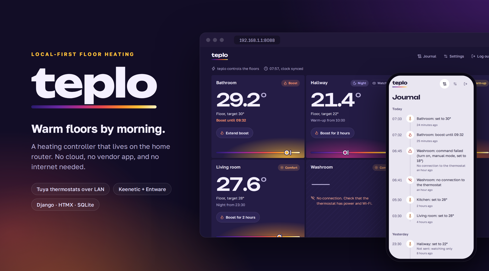
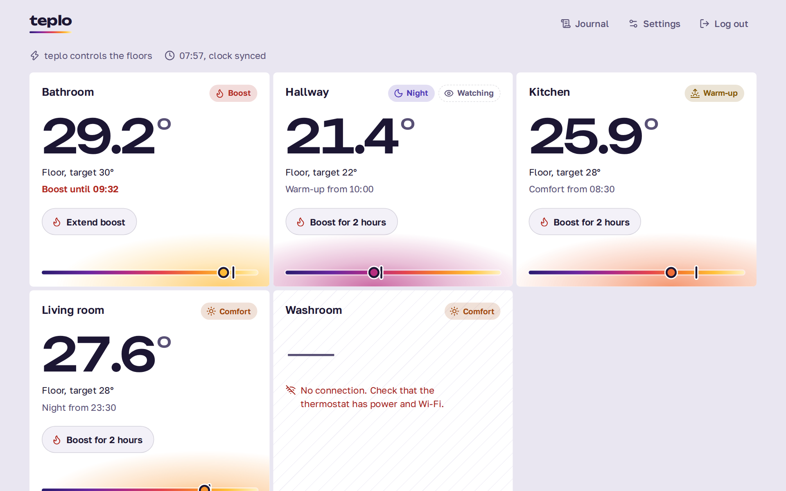
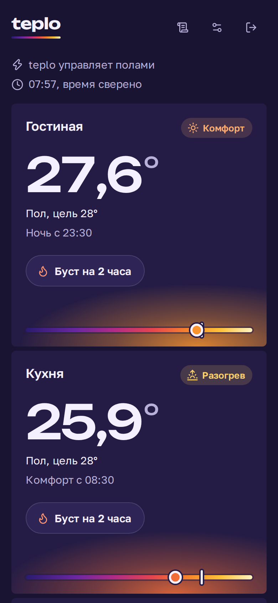
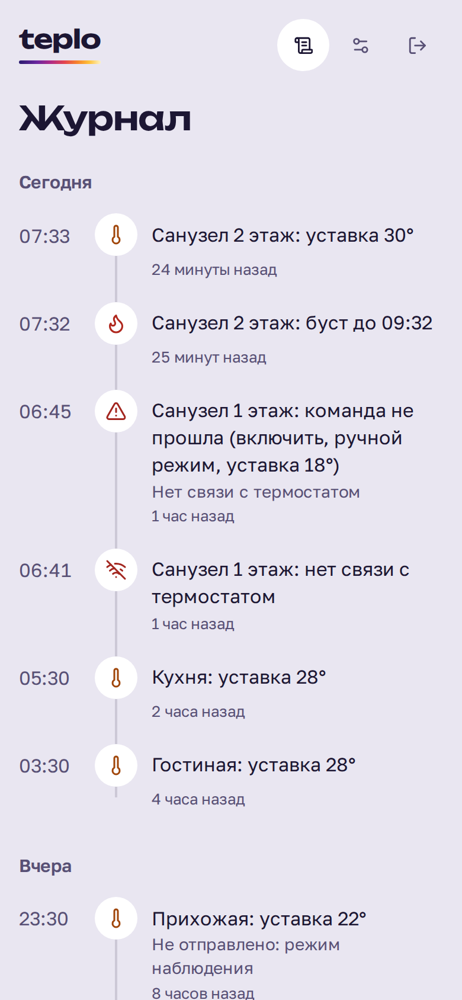
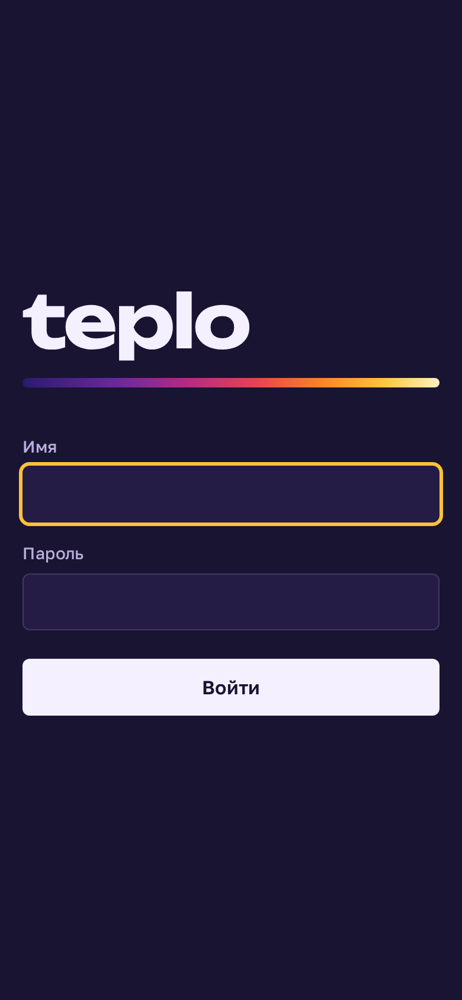
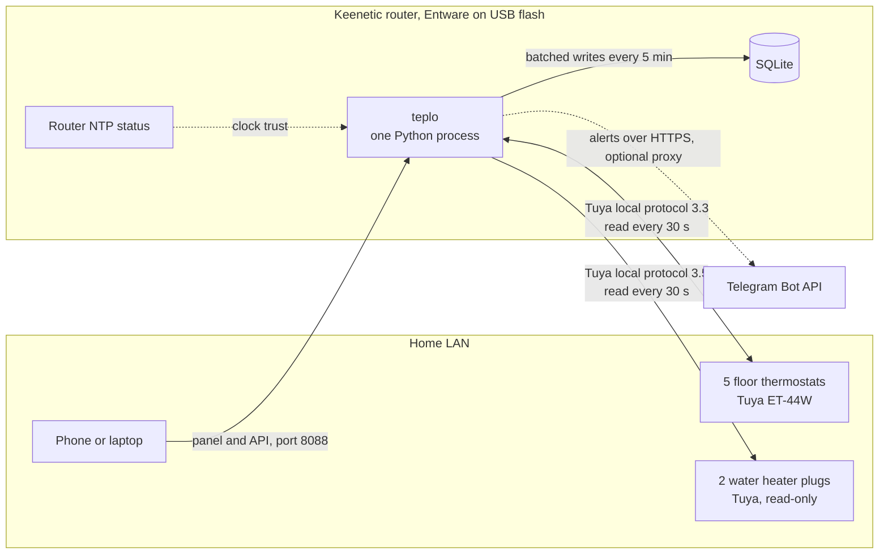
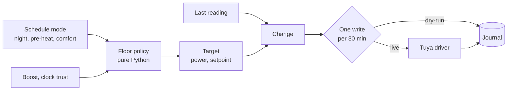
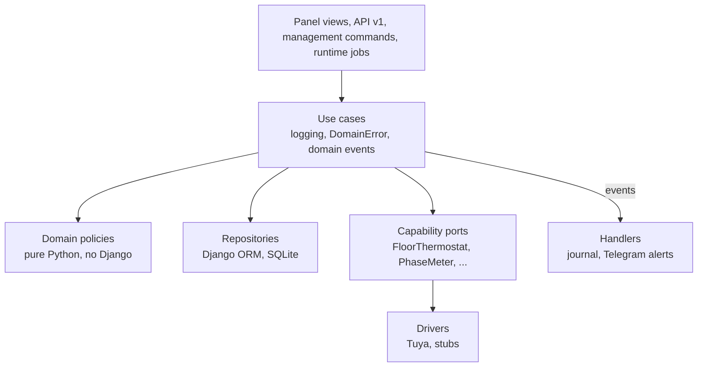

<p align="center">
  
</p>

<p align="center">
  <a href="https://github.com/Barsoomx/teplo/actions/workflows/ci.yml"></a>
  
  
  
  
  <a href="LICENSE"></a>
</p>

**teplo** (Russian *тепло*, "warmth") is a local-first controller for electric floor heating.
It runs 24/7 on a home router, drives the thermostats over the LAN and serves its own web panel, so the house stays warm when the internet or the vendor cloud is down.

Since October 2026 it heats a two-storey house: five floor zones, a night setback and a morning pre-heat timed to wake-up.

## Why

The house is heated by electric floors and fed by a 3-phase 15 kW connection with a 25 A breaker on the pole.
Two problems motivated teplo:

- **Cold mornings.** Floors were switched off for the night, and a one-hour morning boost cannot warm a room through a concrete screed.
- **Breaker trips.** An EV charges on a single phase behind an inverter voltage stabilizer. When a water heater, a floor zone and a microwave land on the same phase, the input breaker trips and the whole house goes dark.

teplo pre-heats rooms so they are warm by wake-up time. Its next stage keeps every phase under the breaker limit by shedding low-priority loads within seconds.

## What it does

- **Warm by wake-up.** Weekly comfort periods per zone. At night the floor drops to a night setpoint; three hours before the morning comfort period it starts pre-heating, so the screed is warm when the alarm goes off.
- **Boost.** One tap holds a zone at its boost setpoint for two hours.
- **Gentle on the hardware.** A thermostat gets at most one change per zone per 30 minutes. History is buffered in memory and written to the router's USB flash in batches.
- **Dry-run first.** Globally or per zone, teplo journals the commands it would send without sending them.
- **Trusted clock.** The schedule follows the clock only while the router reports NTP as synchronized; with a doubtful clock every zone holds comfort.
- **Offline by design.** Thermostats are reached with the Tuya local protocol. The panel and every asset it loads are served from the router.
- **Keeps heating when teplo stops.** Each thermostat regulates on its own at the last setpoint, and a cron watchdog restarts the process.
- **A panel made for the phone.** Server-rendered Django with htmx, dark and light themes, English and Russian, a timeline journal and a JSON API under `api/v1`.
- **Alerts in Telegram.** One chat hears about a thermostat or water heater plug that stops answering, a zone left off while it should heat and teplo coming back after an outage, and again when an alert clears. The journal keeps them too.
- **Water heaters in view.** The dashboard shows each water heater plug's relay state, power and voltage, and the history keeps its current as well; teplo only reads the plugs.
- **Reusable.** A house is a site app with data migrations. Device keys, the panel password and the Telegram bot token stay in a secrets file on the router.

## Panel

<p align="center">
  
</p>

<p align="center">
  
  
  
</p>

The panel reads like a thermal camera: each room is a floor tile, and an ironbow ramp from 14 to 32 °C is the only saturated colour on the page, so colour always means floor temperature.
The theme and the language follow the device.

## How it works



Every minute the heating cycle decides each zone's target and sends only what differs from the thermostat's last reading:



A weekday in the living room:

```mermaid
gantt
    title Living room floor setpoint
    dateFormat HH:mm
    axisFormat %H:%M
    todayMarker off
    Night 22 °C       :done, 00:00, 03:30
    Pre-heat 28 °C    :active, 03:30, 06:30
    Comfort 28 °C     :crit, 06:30, 23:30
    Night 22 °C       :done, 23:30, 23:59
```



## Architecture

Lightweight domain-driven design: Django models are the persistent entities, use cases orchestrate, and pure policies decide.



- One asyncio process runs the periodic jobs (polls, heating cycle, capture, flush, alerts) in worker threads and serves the panel with uvicorn from the same loop.
- Domain policies import nothing from Django, drivers or the network; AST architecture tests keep the boundaries.
- A new device type is a driver behind a capability port; an unsupported one is a stub that raises `DriverNotImplementedError`.
- Dependencies are pure Python or provided by Entware, so the router needs no compiler.

```
app/
  apps/
    core/           BaseUseCase, DomainError, domain events, asyncio runtime
    climate/        zones, schedules, floor policy, heating cycle
    devices/        device registry, capability ports, Tuya drivers, state stores
    telemetry/      samples and the event journal
    notifications/  Telegram alerts: policy, outbox, Bot API client
    system/         trusted clock
    panel/          dashboard, journal, API v1
  sites/
    example/        a two-zone sample house
    barsoom/        the house teplo heats today
deploy/             router installer, init script and release script
docs/               design, deployment, screenshots
scripts/            demo house, screenshot generator, CI watcher
```

## Run it

Try the panel on a demo house:

```sh
docker compose up demo
```

Open http://localhost:8088 and sign in as `owner` with the password `demo`.
The interface language follows the browser; `DEMO_LANGUAGE=ru docker compose up demo` names the rooms in Russian.

Checks, as CI runs them on every push:

```sh
docker compose run --rm -w /code app ruff check .
docker compose run --rm -w /code app mypy app
docker compose run --rm -w /code app pytest
```

Heat your own house:

1. Copy `app/sites/example` to `app/sites/<name>` and describe the thermostats, zones and schedules in its data migration.
2. Get each thermostat's local key with the Smart Life QR login described in [`docs/design.md`](docs/design.md#local-keys).
3. Install on the router, run a night in dry-run and enable live control zone by zone: [`docs/deploy.md`](docs/deploy.md).

`sh scripts/screenshots.sh` rebuilds the images in `docs/assets` from the demo house.

## Hardware

| Role | Device | Integration | Stage |
|---|---|---|---|
| Floor thermostats | Tuya Wi-Fi thermostats (tested: Warmfloor ET-44W) | Tuya local protocol | 1, live |
| Phase meter | ESP32 with 3× SCT-013 split-core CT clamps | ESPHome over MQTT | 2 |
| Air and outdoor sensors | ESP32-C3 with SHT3x/SHT4x, DS18B20 | ESPHome over MQTT | 3 |
| Smart plugs | Tuya Wi-Fi plugs with power metering | Tuya local protocol 3.5 | read-only now, switching in 4 |
| Heat pump, air conditioner, EV charger | any | driver stub | later |

The router is a Keenetic/Netcraze with Entware on USB storage (aarch64, 1 GB RAM); teplo takes about 70 MB of it.

## Roadmap

- [x] **Thermostats and schedules:** night setback, timed pre-heat, boost, dry-run, panel and journal. Live since 29 October 2026.
- [x] **Telegram alerts:** a lost thermostat or plug, a zone left off while it should heat, teplo back after an outage.
- [x] **Water heater monitoring:** relay state, power, current and voltage of the water heater plugs, read-only.
- [ ] **Phase meter:** per-phase current from CT clamps, a configurable shedding priority and staggered starts.
- [ ] **Air sensors:** air-temperature regulation and a learned optimal start.
- [ ] **Smart plugs:** water heaters as sheddable loads, washing machine monitoring.
- [ ] Schedule and settings pages in the panel.

Each stage first runs in dry-run, journaling the decisions it would make, before it is allowed to switch devices.

## Documentation

- [`docs/design.md`](docs/design.md): goals, invariants, control logic, failure modes and the data model.
- [`docs/deploy.md`](docs/deploy.md): router install, releases, operation and rollback.
- [`CLAUDE.md`](CLAUDE.md): code conventions for people and coding agents.

## License

[MIT](LICENSE). Vendored assets keep their own licenses: the Golos Text and Unbounded fonts (SIL OFL 1.1), the Lucide icons (ISC) and htmx (0BSD).
