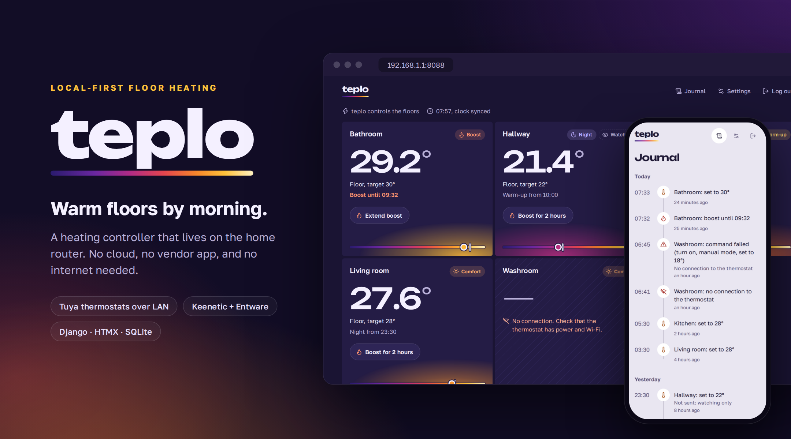
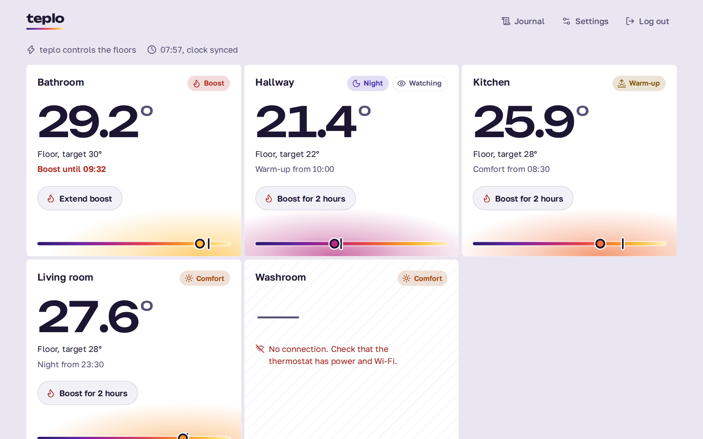
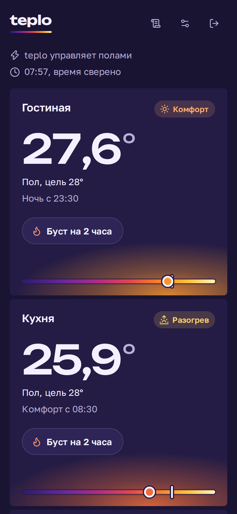
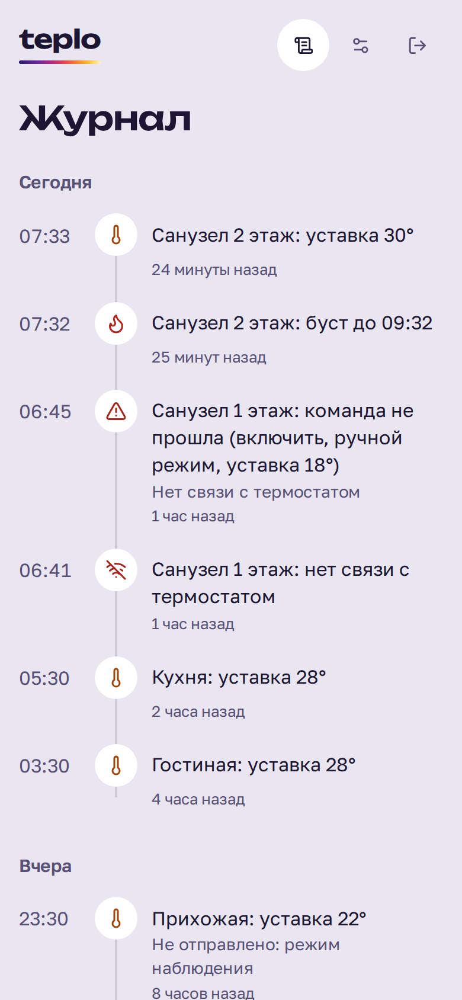
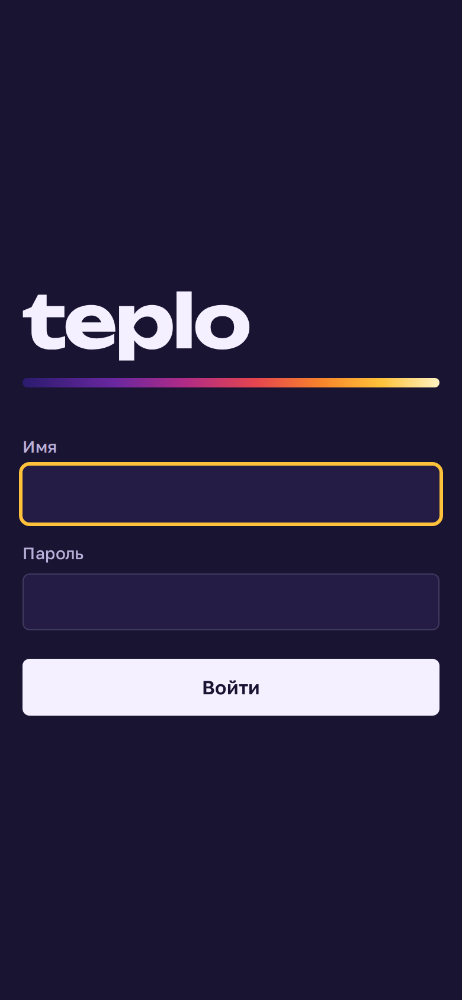
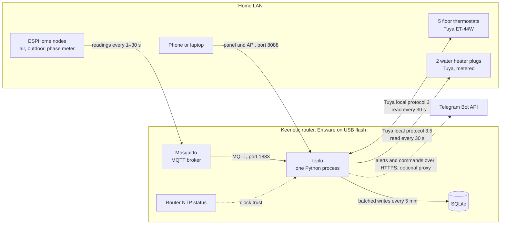
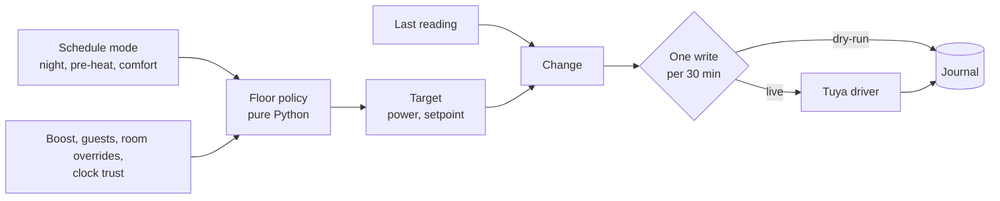
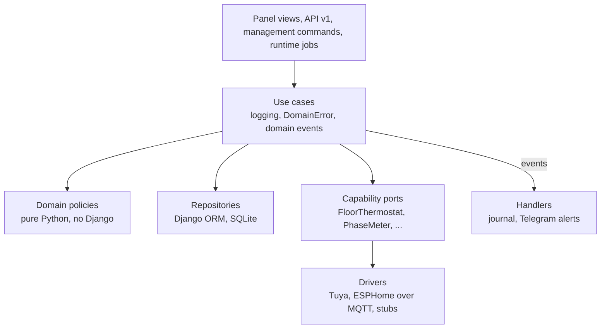

<p align="center">
  
</p>

<p align="center">
  <a href="https://github.com/Barsoomx/teplo/actions/workflows/ci.yml"></a>
  
  
  
  
  <a href="LICENSE"></a>
</p>

**teplo** (Russian *тепло*, "warmth") is a local-first controller for electric floor heating.
It runs 24/7 on a home router, drives the thermostats over the LAN and serves its own web panel, so the house stays warm when the internet or the vendor cloud is down.

Since October 2026 it heats a two-storey house: five floor zones, a night setback and a morning pre-heat timed to wake-up.

## Why

The house is heated by electric floors and fed by a 3-phase 15 kW connection with a 25 A breaker on the pole.
Two problems motivated teplo:

- **Cold mornings.** Floors were switched off for the night, and a one-hour morning boost cannot warm a room through a concrete screed.
- **Breaker trips.** An EV charges on a single phase behind an inverter voltage stabilizer. When a water heater, a floor zone and a microwave land on the same phase, the input breaker trips and the whole house goes dark.

teplo pre-heats rooms so they are warm by wake-up time. Its next stage keeps every phase under the breaker limit by shedding low-priority loads within seconds.

## What it does

- **Warm by wake-up.** Weekly comfort periods per zone. At night the floor drops to a night setpoint; three hours before the morning comfort period it starts pre-heating, so the screed is warm when the alarm goes off.
- **Boost.** One tap holds a zone at its boost setpoint for two hours.
- **Guests and room targets.** One tap keeps the guest rooms at comfort through the night and until 14:00 after it, for up to three nights. On a room whose floors read the air, −/+ moves its target by half a degree for two hours, and teplo takes the floors a setpoint up or down to follow it, within the same 30-minute write budget.
- **Gentle on the hardware.** A thermostat gets at most one change per zone per 30 minutes. History is buffered in memory and written to the router's USB flash in batches.
- **Dry-run first.** Globally or per zone, teplo journals the commands it would send without sending them.
- **Trusted clock.** The schedule follows the clock only while the router reports NTP as synchronized; with a doubtful clock every zone holds comfort.
- **Offline by design.** Thermostats and plugs are reached with the Tuya local protocol, the sensors through an MQTT broker on the router. The panel and every asset it loads are served from the router.
- **Keeps heating when teplo stops.** Each thermostat regulates on its own at the last setpoint, and a cron watchdog restarts the process.
- **A panel made for the phone.** Server-rendered Django with htmx, dark and light themes, English and Russian, a timeline journal and a JSON API under `api/v1`.
- **Alerts and commands in Telegram.** One chat hears about a thermostat, water heater plug or sensor that stops answering, a phase meter gone stale, a phase overloaded for a minute, a zone left off while it should heat and teplo coming back after an outage, and again when an alert clears. Once switched on, the same chat takes the owner's commands and answers each at once: «гости» for guests, «холодно в гостиной» or «жарко на кухне» for a degree up or down for two hours, «гостиная 22» and «гостиная авто», «буст санузел 2» and «статус» for the rooms, targets, floors and phases. The commands go through the same use cases as the panel, which stays the full control path without the internet. The journal keeps alerts and commands too.
- **Power cuts on record.** After a power cut the panel asks whether our breaker tripped or the village lost power, so outages of the grid never count as overloads.
- **Water heaters in view.** The dashboard shows each water heater plug's relay state, power and voltage, and the history keeps its current as well; teplo switches the plugs only to shed them, and load management still runs in dry-run.
- **Sensors in view.** ESPHome nodes report the air temperature and humidity of the rooms, the outdoor temperature and the current on each phase. The dashboard groups the rooms by floor and shows a room's air beside its floor reading, or on a tile of its own in a room without a heated floor, the outdoor temperature above the floors and the phase currents as bars refreshed every 3 seconds; the history keeps them, and `api/v1/sensors` and `api/v1/phases` give them as JSON. Air control from the room and outdoor sensors ships in dry-run and is switched on zone by zone in the admin; load management on the phase currents ships in dry-run too and is switched on load by load.
- **Edited in the panel.** A schedule page sets each room's comfort windows by weekday, shows when the warm-up of each of its floors starts and copies a day or a week; a settings page holds each room's air targets and backup heat, the floor setpoints, the climate and load thresholds and the shedding order. Every change lands in the journal, and the switches that let teplo act live stay in the admin.
- **Reusable.** A house is a site app with data migrations. Device keys, the panel password, the Telegram bot token and the MQTT credentials stay in a secrets file on the router.

## Panel

<p align="center">
  
</p>

<p align="center">
  
  
  
</p>

The panel reads like a thermal camera: each room is a floor tile, and an ironbow ramp from 14 to 32 °C is the only saturated colour on the page, so colour always means floor temperature.
The theme and the language follow the device.

## How it works



Every minute the heating cycle decides each zone's target and sends only what differs from the thermostat's last reading:



A weekday in the living room:

```mermaid
gantt
    title Living room floor setpoint
    dateFormat HH:mm
    axisFormat %H:%M
    todayMarker off
    Night 22 °C       :done, 00:00, 03:30
    Pre-heat 28 °C    :active, 03:30, 06:30
    Comfort 28 °C     :crit, 06:30, 23:30
    Night 22 °C       :done, 23:30, 23:59
```



## Architecture

Lightweight domain-driven design: Django models are the persistent entities, use cases orchestrate, and pure policies decide.



- One asyncio process runs the periodic jobs (polls, heating cycle, capture, flush, alerts) in worker threads and serves the panel with uvicorn from the same loop.
- Domain policies import nothing from Django, drivers or the network; AST architecture tests keep the boundaries.
- A new device type is a driver behind a capability port; an unsupported one is a stub that raises `DriverNotImplementedError`.
- Dependencies are pure Python or provided by Entware, so the router needs no compiler.

```
app/
  apps/
    core/           BaseUseCase, DomainError, domain events, asyncio runtime
    house/          floors and rooms
    climate/        zones, schedules, floor policy, heating cycle
    power/          power cuts and their causes, load management
    devices/        device registry, capability ports, Tuya and ESPHome drivers, state stores
    telemetry/      samples and the event journal
    notifications/  Telegram alerts and commands: policy, outbox, Bot API client, command parser
    system/         trusted clock
    panel/          dashboard, schedule, settings, journal, API v1
  sites/
    example/        a two-zone sample house
    barsoom/        the house teplo heats today
deploy/             router installer, init script and release script
docs/               design, deployment, screenshots
scripts/            demo house, screenshot generator, CI watcher, the office computer's presence script
```

## Run it

Try the panel on a demo house:

```sh
docker compose up demo
```

Open http://localhost:8088 and sign in as `owner` with the password `demo`.
The interface language follows the browser; `DEMO_LANGUAGE=ru docker compose up demo` names the rooms in Russian.

Checks, as CI runs them on every push:

```sh
docker compose run --rm -w /code app ruff check .
docker compose run --rm -w /code app mypy app scripts/pc_presence.py scripts/pc_presence_tests.py
docker compose run --rm -w /code app pytest
```

Heat your own house:

1. Copy `app/sites/example` to `app/sites/<name>` and describe the thermostats, zones and schedules in its data migration.
2. Get each thermostat's local key with the Smart Life QR login described in [`docs/design.md`](docs/design.md#local-keys).
3. Install on the router, run a night in dry-run and enable live control zone by zone: [`docs/deploy.md`](docs/deploy.md).

`sh scripts/screenshots.sh` rebuilds the images in `docs/assets` from the demo house.

## Hardware

| Role | Device | Integration | Stage |
|---|---|---|---|
| Floor thermostats | Tuya Wi-Fi thermostats (tested: Warmfloor ET-44W) | Tuya local protocol | 1, live |
| Phase meter | ESP32 with 3× SCT-013 split-core CT clamps | ESPHome over MQTT | shedding in 2, in dry-run until switched on per load |
| Air and outdoor sensors | ESP32-C3 with SHT3x/SHT4x, DS18B20 | ESPHome over MQTT | regulation in 3, in dry-run until switched on per zone |
| Smart plugs | Tuya Wi-Fi plugs with power metering | Tuya local protocol 3.5 | switching in 4, in dry-run until switched on per load |
| Convector | Tuya Wi-Fi heater (tested: Thermex Frame 2000E) | Tuya local protocol 3.5 | house model block B, in dry-run until its gates are switched on |
| Presence | the office computer now, through `scripts/pc_presence.py` on Windows with Python 3.12, from its keyboard and mouse input; HLK-LD2410C mmWave radars on the air nodes later | MQTT like an ESPHome node | house model block C, only watched until a room's `follows occupancy` is ticked |
| Heat pump, air conditioner, EV charger | any | driver stub | later |

The router is a Keenetic/Netcraze with Entware on USB storage (aarch64, 1 GB RAM); teplo takes about 70 MB of it.

## Roadmap

- [x] **Thermostats and schedules:** night setback, timed pre-heat, boost, dry-run, panel and journal. Live since 29 October 2026.
- [x] **Telegram alerts:** a lost thermostat, plug or sensor, a stale phase meter, a zone left off while it should heat, teplo back after an outage.
- [x] **Water heater monitoring:** relay state, power, current and voltage of the water heater plugs, read-only.
- [x] **Sensor monitoring:** air temperature and humidity, outdoor temperature and per-phase current from ESPHome nodes over MQTT, on the dashboard and in the history, read-only.
- [ ] **Phase meter:** load management on the measured phase currents: a shedding priority, staggered starts, a limp mode for a lost meter, passive phase learning and EV detection. Shipped in dry-run: the journal shows what it would shed, restore or hold back and the dashboard shows the shedding order and the EV badge, until it is switched on in the admin, load by load.
- [ ] **Air sensors:** air-temperature regulation, a learned optimal start and backup heat for the bedroom from the floor of the bathroom next to it. Shipped in dry-run: the journal shows what they would do, and each room tile names the path that drives it and its air target, until they are switched on in the admin, air control zone by zone.
- [ ] **Smart plugs:** water heaters as sheddable loads, shipped in dry-run with load management; washing machine monitoring.
- [x] **House model, block A:** floors and rooms, comfort windows, targets and backup heat per room, guests, 2-hour room overrides and commands from the Telegram chat.
- [ ] **House model, block B:** an estimate of the unclamped phase, the fireplace kept out of what the floors learn, a 2-hour hold for a floor changed on its thermostat, and the office convector driven from the office's targets and shed as a load. Shipped behind gates switched on in the admin.
- [ ] **House model, block C:** each room's occupancy from the presence sources in it, the office computer first and radars later, shown and journaled, and followed by the heat sources of a room without a floor once its gate is ticked; then the bedroom air conditioner.
- [x] **Schedule and settings pages:** comfort windows per weekday with the warm-up they lead to, copied by day or by room; room air targets, zone setpoints, climate and load thresholds and the shedding order. Every change is journaled; the gates stay in the admin.

Each stage first runs in dry-run, journaling the decisions it would make, before it is allowed to switch devices.

## Documentation

- [`docs/design.md`](docs/design.md): goals, invariants, control logic, failure modes and the data model.
- [`docs/deploy.md`](docs/deploy.md): router install, releases, operation, rollback and the ESPHome nodes.
- [`CLAUDE.md`](CLAUDE.md): code conventions for people and coding agents.

## License

[MIT](LICENSE). Vendored assets keep their own licenses: the Golos Text and Unbounded fonts (SIL OFL 1.1), the Lucide icons (ISC) and htmx (0BSD).
