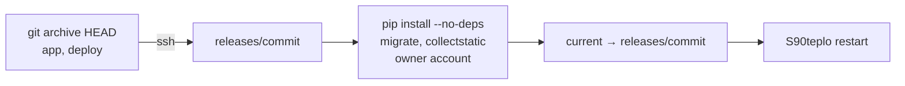

# Deploying teplo to the router

Target: Keenetic/Netcraze with Entware on USB storage, SSH to Entware on port 222.

## First install

1. Copy the router scripts and run the installer:

   ```sh
   scp -P 222 -r deploy/router root@192.168.1.1:/tmp/teplo-router
   ssh -p 222 root@192.168.1.1 sh /tmp/teplo-router/install.sh
   ```

2. Edit `/opt/etc/teplo/teplo.env`: set `TEPLO_SITE`, `TEPLO_PANEL_HOST`, `TEPLO_ALLOWED_HOSTS`. Keep `TEPLO_DRY_RUN=true` for the first run. The installer fills in a random `DJANGO_SECRET_KEY` when the file has none; teplo refuses to start without it.
3. Create `/opt/etc/teplo/secrets.toml` from `deploy/router/secrets.toml.example`, one `[devices.<slug>]` table per device slug of the site, and `chmod 600` it. Local keys come from the Smart Life QR login described in `docs/design.md`.

## Deploy a release

```sh
sh deploy/deploy.sh
```

The script installs pinned requirements into `/opt/share/teplo/venv` (Entware provides `cryptography`), migrates, collects static files, creates or updates the `owner` panel account from `secrets.toml`, switches `/opt/share/teplo/current` and restarts the service. The panel is at `http://192.168.1.1:8088/`.



A failed step stops the script before `current` moves, so the running release stays in place.

Layout on the router:

```
/opt/share/teplo/
  releases/<commit>/    app and deploy trees of one commit
  current               symlink to the running release
  venv/                 laid out by hand: Entware's python3 ships no venv module
/opt/etc/teplo/
  teplo.env             settings, read at start
  secrets.toml          device addresses and keys, panel password (chmod 600)
/opt/etc/init.d/S90teplo
/opt/var/lib/teplo/     SQLite database and static files
/opt/var/log/teplo/     teplo.log, restarts.log
```

Releases ship without tests: `.gitattributes` marks `*_tests.py` and `conftest.py` as `export-ignore`. Django imports every module of a `templatetags` package at startup, and the router has no pytest.

## Operate

- Service: `/opt/etc/init.d/S90teplo {start|stop|restart|status}`. `stop` gives teplo 10 s to finish its cleanup and then kills it, so `restart` never runs two instances.
- Logs: `/opt/var/log/teplo/teplo.log`; restarts: `/opt/var/log/teplo/restarts.log`.
- The cron watchdog restarts teplo when its process dies or exceeds 300 MB RSS and trims the log above 5 MB. After `S90teplo stop` it leaves teplo stopped until the next `start`.
- Secrets and settings are read at start: restart after editing them.

## Enable live control

1. Watch the dry-run journal (`/journal/`) through at least one night and one morning pre-heat.
2. Set `TEPLO_DRY_RUN=false` in `/opt/etc/teplo/teplo.env` and restart.
3. In the admin (`/admin/climate/zone/`), tick `live control` one zone at a time and confirm on the dashboard that the thermostat setpoint follows the target.

## Roll back

```sh
ssh -p 222 root@192.168.1.1 'ls -1t /opt/share/teplo/releases'
ssh -p 222 root@192.168.1.1 'ln -sfn /opt/share/teplo/releases/<previous> /opt/share/teplo/current && /opt/etc/init.d/S90teplo restart'
```
