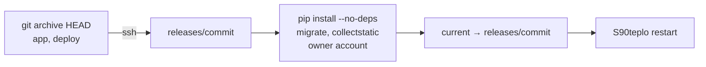

# Deploying teplo to the router

Target: Keenetic/Netcraze with Entware on USB storage, SSH to Entware on port 222.

## First install

1. Copy the router scripts and run the installer:

   ```sh
   scp -P 222 -r deploy/router root@192.168.1.1:/tmp/teplo-router
   ssh -p 222 root@192.168.1.1 sh /tmp/teplo-router/install.sh
   ```

2. Edit `/opt/etc/teplo/teplo.env`: set `TEPLO_SITE`, `TEPLO_PANEL_HOST`, `TEPLO_ALLOWED_HOSTS`. Keep `TEPLO_DRY_RUN=true` for the first run. The installer fills in a random `DJANGO_SECRET_KEY` when the file has none; teplo refuses to start without it.
3. Create `/opt/etc/teplo/secrets.toml` from `deploy/router/secrets.toml.example`, one `[devices.<slug>]` table per device slug of the site, and `chmod 600` it. The `barsoom` site has five thermostats and the water heater plugs `plug-boiler-1f` and `plug-boiler-2f`. Tuya plugs need `protocol = '3.5'`: a table without it gets 3.3, the thermostats' protocol, and the plug shows as unavailable. A protocol other than `'3.1'`–`'3.5'`, e.g. `'3,5'`, or an empty `address` shows on the panel as a wrong address or protocol for that device only. A device without a table stays unavailable and raises a device-lost alert 10 minutes after the start. Local keys come from the Smart Life QR login described in `docs/design.md`.
4. For alerts, add the `[telegram]` table described in [Telegram alerts](#telegram-alerts).

## Deploy a release

```sh
sh deploy/deploy.sh
```

The script installs pinned requirements into `/opt/share/teplo/venv` (Entware provides `cryptography`), migrates, collects static files, creates or updates the `owner` panel account from `secrets.toml`, switches `/opt/share/teplo/current` and restarts the service. The panel is at `http://192.168.1.1:8088/`.



A failed step stops the script before `current` moves, so the running release stays in place.

After the deploy, send a test alert as shown in [Telegram alerts](#telegram-alerts) to confirm that the new release still reaches the chat.

Layout on the router:

```
/opt/share/teplo/
  releases/<commit>/    app and deploy trees of one commit
  current               symlink to the running release
  venv/                 laid out by hand: Entware's python3 ships no venv module
/opt/etc/teplo/
  teplo.env             settings, read at start
  secrets.toml          device addresses and keys, panel password, Telegram bot (chmod 600)
/opt/etc/init.d/S90teplo
/opt/var/lib/teplo/     SQLite database and static files
/opt/var/log/teplo/     teplo.log, restarts.log
```

Releases ship without tests: `.gitattributes` marks `*_tests.py` and `conftest.py` as `export-ignore`. Django imports every module of a `templatetags` package at startup, and the router has no pytest.

## Telegram alerts

teplo sends its alerts (a lost thermostat or plug, a zone left off while it should heat, teplo back after an outage; see Alerts in `docs/design.md`) to one Telegram chat, set in the `[telegram]` table of `secrets.toml`:

```toml
[telegram]
token = 'bot-token'
chat_id = 'chat-id'
proxy = 'http://proxy.example:3128'
```

- `token`: the bot's token from BotFather.
- `chat_id`: the chat that receives the alerts. Send the bot a message, or add it to a group, and take `chat.id` from `https://api.telegram.org/bot<token>/getUpdates`; a group's id is negative.
- `proxy`: optional, an HTTP proxy for `api.telegram.org`. Leave it out to connect directly.

Without the table, or with an empty `token` or `chat_id`, alerts are only journaled and `teplo.log` says so once. Alerts are written in Russian; `TEPLO_ALERT_LANGUAGE=en` in `teplo.env` switches them to English.

teplo reads the table at start: after adding or changing it, restart teplo (`/opt/etc/init.d/S90teplo restart`). After that, and after every deploy, send a test message:

```sh
ssh -p 222 root@192.168.1.1 'set -a; . /opt/etc/teplo/teplo.env; set +a; /opt/share/teplo/venv/bin/python /opt/share/teplo/current/app/manage.py send_test_alert'
```

It prints `ok` once Telegram has accepted the message, and otherwise fails with the error code and the reason:

- `telegram_not_configured`: the table is missing, or its `token` or `chat_id` is empty.
- `alert_rejected`: Telegram refused the message. HTTP 401 or 404 means a wrong token; 400 or 403, a wrong `chat_id` or a chat the bot may not write to: open the chat with the bot and press Start.
- `alert_delivery_failed`: Telegram could not be reached. `CERTIFICATE_VERIFY_FAILED` in the reason means the router lacks CA certificates: `opkg install ca-bundle`. A timeout points at the network or the `proxy`.

## Operate

- Service: `/opt/etc/init.d/S90teplo {start|stop|restart|status}`. `stop` gives teplo 10 s to finish its cleanup and then kills it, so `restart` never runs two instances.
- Logs: `/opt/var/log/teplo/teplo.log`; restarts: `/opt/var/log/teplo/restarts.log`.
- The cron watchdog restarts teplo when its process dies or exceeds 300 MB RSS and trims the log above 5 MB. After `S90teplo stop` it leaves teplo stopped until the next `start`.
- Secrets and settings are read at start: restart after editing them.

## Enable live control

1. Watch the dry-run journal (`/journal/`) through at least one night and one morning pre-heat.
2. Set `TEPLO_DRY_RUN=false` in `/opt/etc/teplo/teplo.env` and restart.
3. In the admin (`/admin/climate/zone/`), tick `live control` one zone at a time and confirm on the dashboard that the thermostat setpoint follows the target.

## Roll back

```sh
ssh -p 222 root@192.168.1.1 'ls -1t /opt/share/teplo/releases'
ssh -p 222 root@192.168.1.1 'ln -sfn /opt/share/teplo/releases/<previous> /opt/share/teplo/current && /opt/etc/init.d/S90teplo restart'
```
