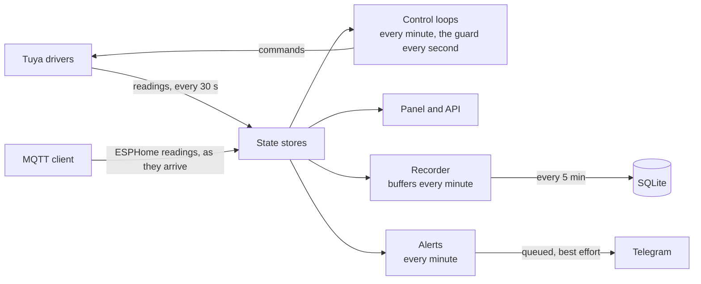
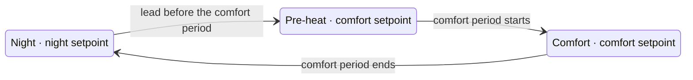

# teplo — design

Source of truth for behaviour. When behaviour changes, this document changes in the same commit.
Code conventions live in [`CLAUDE.md`](../CLAUDE.md).

## 1. Goals

1. **Morning comfort.** Rooms reach the comfort temperature by the start of the comfort period, every day.
2. **No breaker trips.** Current on every phase stays under the input breaker limit, whatever the household switches on.
3. **Offline operation.** Control, panel and history keep working with the internet down.
4. **Convenient control.** A web panel on the LAN, usable from a phone.
5. **24/7 monitoring.** Live state, history and an event journal.
6. **Reuse.** Another house is a configuration, not a fork.

Non-goals for v1: remote access from outside the LAN (use a VPN), cloud integrations, cooling, controlling the EV.

## 2. Invariants

- **Offline at runtime.** Devices are driven over the LAN. The internet serves only Telegram alerts and NTP, both best-effort.
- **Router-hosted.** One process on a Keenetic/Netcraze router with Entware: aarch64, Python 3.13, about 600 MB free RAM, USB flash storage.
- **Secrets outside the repository.** Device addresses and keys, tokens and passwords live in the secrets file on the router; the repository references devices by slug.
- **Configuration is data.** Schedules, tariffs, limits and priorities live in the database, seeded by site data migrations and edited in the panel.
- **Fail-safe actuation.** While teplo is down, every floor holds at least its idle floor setpoint.
- **Monitor-only loads are never switched.** The washing machine and group plugs are observed, nothing more.

## 3. Reference house

The first site (`sites/barsoom`) shaped the requirements.

- **Supply:** 3 phases, 15 kW allocated, C25 breaker on the pole, C20 in the house.
- **Stabilizers:** inverter, single-phase Штиль ИнСтаб IS7000 (5.5 kW output, 90–310 V input) on two phases, a third planned. At low grid voltage a stabilizer draws more input current than it delivers: about 25 A at 230 V, 30 A at 190 V, 35 A at 165 V for full load.
- **EV:** US-spec Model S 2014, single-phase charging at 10–22 A through a mobile connector, behind a stabilizer. Not controllable locally: no BLE vehicle commands, dead cellular modem.
- **Heating:** electric floors are the main heating; a fireplace is lit by hand. The second floor warms from air rising from below and the second-floor bathroom floor.

| Zone | Kind | Notes |
|---|---|---|
| Living room | air | most important, shed last |
| Kitchen | air | |
| Hallway | air | shed first among floors |
| Bathroom 1F | floor | rarely needed, idle by default |
| Bathroom 2F | floor | also heats the second floor |

Other loads: two water heaters on smart plugs (sheddable), a washing machine on a smart plug (monitor-only), the EV (detected).

## 4. Devices

### Capabilities

The domain talks to devices through capability ports. A driver implements one or more capabilities for one protocol.

| Capability | Reads | Commands |
|---|---|---|
| `FloorThermostat` | power, setpoint, floor temperature, relay | power, setpoint |
| `MeteredPlug` | on/off, power, current, voltage | — |
| `SwitchablePlug` | as `MeteredPlug` | on/off |
| `TemperatureSensor` | temperature, optional humidity | — |
| `PhaseMeter` | current per phase | — |
| `ClimateUnit` | mode, target, room temperature | mode, target |
| `EvCharger` | charging state, current | current limit |

v1 drivers: Tuya thermostat, Tuya plug (read-only or switchable), ESPHome temperature sensor, ESPHome phase meter.
`ClimateUnit` and `EvCharger` ship as stub drivers: a device can be configured with them and the panel shows it as "driver not implemented".

Every reading carries a timestamp. A device is **unavailable** after 10 minutes without a reading, counted on the monotonic clock from the moment teplo stored the reading, so setting the system clock neither hides a lost device nor makes a live one look lost; the phase meter is **stale** after 10 seconds.

### Tuya thermostats (Warmfloor ET-44W)

- Local protocol 3.3 on TCP 6668, AES with a per-device local key.
- No air sensor: the only temperature is the remote floor probe.
- Data points verified on the device:

| DP | Meaning | Values |
|---|---|---|
| 1 | power | bool |
| 2 | mode | `hold` (manual), `smart` (weekly program), `holiday` |
| 3 | relay | `heating` while the relay is closed, `warming` while the thermostat idles |
| 16 | setpoint | int, 0.1 °C, 50–400 |
| 24 | floor temperature | int, 0.1 °C |
| 121 | probably the floor limit | int, 0.1 °C, reads 450 |

The driver reads DP 3 into the thermostat state as heating, idle or, when DP 3 is missing or reads anything else, unknown, so the relay never makes a thermostat unreadable. Load management tells a heating floor from an idle one by it (section 7); nothing the heating cycle writes depends on it. DPs 104–117 are vendor-specific and unmapped; 116 is not a temperature. teplo keeps the thermostat in `hold` mode.

- **Write budget:** one state change per zone per 30 minutes. Whether the device persists every write to flash is unknown, so writes stay rare. Dry-run journals at the same cadence on its own timestamp and does not spend the budget, so a zone switched to live control writes at the next cycle. Air mode in dry-run keeps its would-be changes 30 minutes apart on a third timestamp (section 6). A live shed of load management is the one write that overrides the budget: it switches the thermostat off at once and stamps its write, so the zone's next write still waits 30 minutes; should the database refuse the stamp, load management keeps the zone shed until 30 minutes after the shed instead (section 7), and so it does with a zone shed it resumes after a restart, which cannot tell whether the stamp was stored. The write that hands a released zone back waits for the budget like any other and, like the heating cycle's writes, goes out only once its stamp is stored.
- **Write gate:** the heating cycle and the load guard run concurrently (section 5), and a cycle reads the zones' write stamps once, at its start, so a cycle still writing other zones would miss a write the guard made since. Every live thermostat write therefore goes through one write gate per zone, kept in memory and shared by the whole process: the heating cycle's writes, and load management's shed and the release that switches a thermostat back on. The gate keeps the latest write of each zone: its stamp, the moment on the monotonic clock it took the slot and the moment its stamp was stored. At the moment of a write it checks the budget and takes the slot in one step under a lock; the writer then stores the stamp and writes. Every writer tells the gate the moment on the monotonic clock it read the stamps, taken no later than the time it writes for: the heating cycle takes it when it takes its time, before it reads the wall clock and the zones, and the guard's release passes the moment it last read the loads. That order alone decides, never the wall clock. A write whose stamp was stored by that moment is one the writer read: it holds the writer exactly as the stored stamp it read does, a stamp later than the clock, as after the clock was set back, and a stamp a boost cleared since included (section 9). Any other write, one whose stamp was stored after that moment or not at all, the writer could not have read, as a guard write the heating cycle read after it took its time: it holds the zone for 30 minutes on the monotonic clock from the moment it took the slot, whatever the stamps read. A shed's slot holds the zone for 30 minutes on the monotonic clock even for a writer that read its stamp, as well as by that stamp, so a clock stepped forward after the shed, as when NTP sets a clock that ran behind through a power cut, does not let the restored zone be written sooner than 30 minutes after the shed. The heating cycle reports a write held back this way as throttled, as it does within 30 minutes of the stamp, and the guard keeps the zone shed and tries the release again the next second. The heating cycle asks the gate whether it would take a zone's write when it decides the zone, by the same rule and without taking the slot, so a write the gate holds back is throttled before the cycle asks load management for start permits and asks for none (section 6). A shed takes the slot whatever the budget. Each zone also has a lock of its own, which a writer holds from the check that its slot still holds, made after its stamp is stored, through its commands to the thermostat: the heating cycle for its write, the release for its command, and a shed, once it has taken the slot, for its command. So a write a shed overtook goes no further and is reported as throttled, and a shed that takes the slot while a write of the heating cycle is in flight switches the thermostat off right after that write, never before it. No writer holds the lock while it stores a stamp, and the heating cycle holds one zone's lock at a time, for one write, never across the cycle: a shed waits for the lock only while the heating cycle's write to that zone's thermostat is in flight, at most its power, mode and setpoint commands, a few hundred milliseconds on the LAN. A thermostat that does not answer fails that write at its first command, once the Tuya client gives up after some 11 to 16 seconds (two attempts to connect, 5 seconds each, or three to read a reply), and the cycle sends it nothing more; the shed's own command to that thermostat takes as long, and the driver already makes any command wait for one in flight to the same thermostat. A shed of another zone, a stamp being stored and a database that stays locked never hold a shed up. A boost and a restore send nothing to a thermostat and take no lock. A stamp the database refuses gives the slot back to the write before it, as nothing was written, while a write that fails after its stamp keeps it, as it took the budget. A boost frees the slot with the stamps, so the boost goes out at the next cycle as before, unless a shed took the slot less than 30 minutes before on the monotonic clock: then the boost keeps the slot and the zone's stamps, and goes out at the zone's next allowed write after the shed, never sooner than 30 minutes after it, whether it was pressed while the zone was shed or after its restore. A boost pressed while the heating cycle writes the zone ends as the stamps it leaves say, whichever step of the cycle's write it lands between: the next cycle reads the stamps after the boost and the gate judges its write by them, so the boost goes out at the next cycle when it cleared the stamps after the cycle stored its own, and 30 minutes after the cycle's write when the cycle stored its stamp after the boost cleared them. A restore of a zone writes nothing itself: the heating cycle's write that follows it takes the gate like any other. After a restart, before the jobs and the panel start, the gate takes back the hold of every zone with a live shed stored on its load less than 30 minutes before, whether the zone is still shed or its floor was handed back: the zone stays held for the rest of the 30 minutes after the moment stored with the shed, or for 30 minutes from the start when the clock reads earlier than that moment, as a shed resumed after a restart is (section 7), so neither a boost nor a clock set back or stepped forward lets the heating cycle write it sooner. teplo started in dry-run takes back no hold, as it writes nothing. Should the database refuse that read, the start logs `periodic_job_failed` and goes on with the stored stamps alone. Otherwise the gate starts empty, and the stored stamps decide. The dry-run stamps stay outside it. With load management in dry-run and no live shed stored on a load, as in a house where it never ran live, the guard never writes and the start takes back no hold, and every write of the heating cycle has its stamp stored before the next cycle reads the stamps, so the gate holds the heating cycle's writes exactly as their stored stamps did before it, a boost pressed at any moment and a clock set back or stepped forward included: it never holds a write the stored stamps let go.

### Tuya plugs

- Wi-Fi plugs with power metering (Tuya category `cz`), local protocol 3.5 on TCP 6668; their secrets set `protocol = '3.5'`.
- A plug's driver says whether teplo may switch it. `tuya_plug` implements `MeteredPlug` only and has no switching operation, so nothing in teplo can switch a plug that keeps it. Monitor-only plugs, such as the washing machine's, keep it: the database refuses a monitor-only device with a switching driver. `tuya_switchable_plug` implements `SwitchablePlug`: it reads the plug as `tuya_plug` does and switches the relay by writing DP 1 under the same lock as its reads, so a switch never overlaps a poll of the plug; a socket error or a reply carrying `Error` fails the write as `device_unavailable`, as it fails a read. A data migration gives the switching driver to both water heater plugs of `sites/barsoom` and to the water heater plug of `sites/example`, and only plugs with that driver are offered as the plug of a load (section 7). Only load management switches a plug.
- The driver registry builds one driver per plug, the one its device names when the plug is first used, and the poll reads a switchable plug through the driver that switches it. Asked for a switchable plug, the registry reads the device each time and refuses with `plug_not_switchable` when the device is monitor-only or its driver only reads. A plug given the switching driver while teplo runs is read through that driver once something first asks to switch it.
- The driver takes its client from the shared Tuya client builder, like the thermostat driver, so the long-lived client never switches itself to "device22" mode, which queries DP 1 only (see Power loss in section 9). tinytuya 1.20 makes that switch only for protocols 3.3 and 3.4, so for the 3.5 plugs the guard is insurance.
- A job of their own polls the plugs every 30 seconds, so a lost plug never delays the thermostats. Availability changes are journaled as for a thermostat, a plug that stays unavailable raises the device-lost alert under its own name (section 9), and the recorder samples `plug_on` (0 or 1), `plug_power` (W), `plug_current` (A) and `plug_voltage` (V) every minute.
- Data points, from the Tuya cloud model and a local status read:

| DP | Code | Meaning | Values |
|---|---|---|---|
| 1 | `switch_1` | relay | bool |
| 18 | `cur_current` | current | int, mA |
| 19 | `cur_power` | active power | int, 0.1 W |
| 20 | `cur_voltage` | voltage | int, 0.1 V |

Not read yet: 9 `countdown`, 17 `add_ele` (energy since the previous report, 0.001 kWh), 26 `fault`, 38 `relay_status` (`memory`: the relay returns to its last state after a power cut) and the remaining vendor DPs.

### Local keys

A Tuya device's local key comes from the cloud once, via the Smart Life QR login used by Home Assistant: the owner reads the User Code in Smart Life (Me → Settings → Account and Security), scans a QR and confirms; the tool downloads every device with its local key and logs out. Re-pairing a device changes its key.

### ESPHome devices

ESPHome firmware publishes readings to the Mosquitto broker on the router. Configurations live in `esphome/`.

- **Phase meter:** ESP32 with three SCT-013-050 clamps (1 V at 50 A) on the input phase conductors, before the stabilizers. Each clamp sits on a single conductor. The clamps share a 1.65 V bias (two 10 kΩ resistors, 10 µF to ground) and feed ADC1 pins. Reports RMS current per phase every second.
- **Air sensors:** ESP32-C3 with SHT3x over I2C, the sensor 5–10 cm away from the board. Reports every 30 seconds.
- **Outdoor sensor:** DS18B20 on a 3 m cable with a 4.7 kΩ pull-up, the board indoors.
- **Link:** the air and outdoor nodes are ESP32-C3 SuperMini boards, whose crystal sits next to the antenna. At full transmit power their link fails, and at 8.5 dB the router barely hears a node a room or two away, so they transmit at 10 dB; a node may set its own power. Every node keeps its radio awake (no Wi-Fi power save) and Bluetooth off, pings the broker every 60 seconds, and restarts after 5 minutes without it, as a SuperMini can hang with its Wi-Fi associated and nothing passing.

The firmware and teplo share one MQTT contract:

- **Broker:** Mosquitto on the router, port 1883, on the LAN address only, with a username and password for every client (`docs/deploy.md`). teplo takes its credentials from the `[mqtt]` table of the secrets file (section 11), the nodes from `esphome/secrets.yaml` (`mqtt_broker`, `mqtt_username`, `mqtt_password`), which stays out of the repository.
- **Nodes:** a node is named `teplo-` and the slug of its device, e.g. `teplo-air-kitchen`. It publishes under `teplo/<node>` without Home Assistant discovery, and its birth and will messages, `online` and `offline`, go to `teplo/<node>/status`.
- **Readings:** every sensor publishes to `teplo/<node>/sensor/<object_id>/state` with QoS 0, not retained: a decimal string, or `nan` when the reading failed.

| Node | Device kind | Object ids | Every |
|---|---|---|---|
| `teplo-air-living-room`, `teplo-air-kitchen`, `teplo-air-hallway`, `teplo-air-second-floor` | temperature sensor | `temperature` (°C) and `humidity` (%), 1 decimal | 30 s |
| `teplo-outdoor` | temperature sensor | `temperature` (°C), 1 decimal | 30 s |
| `teplo-phase-meter` | phase meter | `l1_current`, `l2_current`, `l3_current` (A RMS), 2 decimals | 1 s |

A node may also publish `wifi_signal` (dBm, every 60 seconds) and `uptime`, which teplo ignores. `teplo-ir-bedroom` and `teplo-spare` use the same broker but are not teplo devices.

teplo subscribes to `teplo/+/sensor/+/state` and `teplo/+/status`:

- A node maps to the device of its slug whose driver is `esphome_temperature` (kind `temperature_sensor`) or `esphome_phase_meter` (kind `phase_meter`). teplo reads these devices from the database when it starts, so a device added later is heard after a restart.
- Retained messages, nodes without such a device and object ids the device's driver does not read are ignored. The first message of an unknown node is logged as `esphome_node_unknown`, which points at a misspelt node name.
- A temperature sensor's `temperature` becomes a new reading, stamped when it arrives. `humidity` joins the latest reading without making it younger, so the age of a reading is always the age of its temperature; a new temperature keeps the previous humidity until the next one arrives.
- The phase meter's `l1_current`, `l2_current` and `l3_current` are the currents of phases A, B and C. Its store keeps the latest current of each phase with the moment it arrived on the monotonic clock, and the mean and maximum of each phase since they were last taken for history. The meter is stale while a phase has no current from the last 10 seconds, and the store names each such phase. The driver of a stale meter refuses to read, and the readings it gives are dated by the oldest of the three.
- Values stay decimals. `nan` records the failure `sensor_reading_failed`, and a payload that is not a number `device_protocol_error`, instead of a reading; a failed humidity also leaves the latest reading without humidity. `offline` on the status topic records `device_unavailable`. A broker that teplo cannot reach, that refuses its credentials or that drops the connection records `broker_unavailable` for every ESPHome device; the next connection clears that failure and no other, so a node that stays silent once the broker is back, such as one unplugged before a broker restart or one still booting when teplo connects late, is journaled as a device without a reading rather than blamed on a broker that works. As for a Tuya device, a failure keeps the last reading until it ages out, and the next reading clears it. A driver asked for a reading it no longer has raises the failure recorded for its device, with that failure's code, or `device_unavailable` when none was recorded. A failing reading is logged once, and again only after a good one.
- Without an `[mqtt]` table teplo does not connect and logs `mqtt_not_configured` once at start; the ESPHome devices stay unavailable and everything else runs as before.
- Nothing polls these devices, so a job of their own checks their stores every 30 seconds. Its first check waits a minute after the start, by when every node that is up has reported, so a restart does not journal working sensors as lost. Availability changes are journaled as for a thermostat, with the code of the recorded failure, or `device_unavailable` with the reason `no reading` when none was recorded, so the panel's journal explains every loss: a device that has not reported since the start is journaled unavailable at the first check, with the failure recorded for it, such as `broker_unavailable`, or else as `device_unavailable`. The phase meter becomes unavailable, like any device, 10 minutes after its newest current; its staleness is not journaled.
- Every minute the recorder samples `air_temperature` (°C) of every available temperature sensor, with `air_humidity` (%) when the reading has one, and the mean and maximum current of each phase since the previous sample, `phase_current_mean` and `phase_current_max` (A) under the subjects `l1`, `l2` and `l3`. Each sample starts the mean and maximum over, and an unavailable phase meter records none.

## 5. Architecture

### Process

One process on the router runs an asyncio runtime:

- device drivers and the MQTT client feed a **state store** per device kind (latest readings and availability): jobs poll the Tuya devices, the MQTT client writes the ESPHome readings as they arrive, and a job checks the ESPHome stores for availability changes (section 4);
- the MQTT client runs in paho's network thread from just after the start journal entry until after the last sample flush. It subscribes again on every connection and reconnects on its own, 1 second after a failure and then doubling the wait up to 30 seconds. A message that fails in handling is logged and dropped, so it never ends the thread;
- control loops read the state stores, decide, and send commands through drivers: the heating cycle every minute (section 6) and the load guard every second (section 7);
- a recorder samples every available device each minute and writes the history to SQLite in batches every 5 minutes. The metrics are `floor_temperature`, `floor_setpoint` and `thermostat_power` for a thermostat, `plug_on`, `plug_power`, `plug_current` and `plug_voltage` for a plug, `air_temperature` and `air_humidity` for a temperature sensor, and `phase_current_mean` and `phase_current_max` for each phase of the phase meter;
- an alert job checks the state stores every minute and queues alerts, a report job checks every minute for an outage before the start until it is reported, and a third job sends the queue to Telegram (section 9);
- uvicorn serves the Django ASGI app (panel and API) from the same loop;
- use cases are synchronous: each periodic job runs its use case in a worker thread (`asyncio.to_thread`) with fresh database connections, and Django runs the panel's views in its own thread, so blocking device and ORM calls stay off the loop;
- jobs run concurrently: in-memory state (state stores, sample buffer, alert book, alert outbox, the heating cycle's control book, the load guard's guard book, the zones' write gate) is guarded by locks, the Tuya drivers serialize calls to each device, every live thermostat write takes its zone's write gate and sends its commands under the zone's lock (section 4), and the MQTT thread writes the sensor stores while jobs and the panel read them.



### Modules

Bounded contexts are Django apps laid out in the altyn-backend style described in `CLAUDE.md` (domain policies, use cases, models, repositories, services, drivers, views):

- **climate**: zones, schedules, regulation, optimal start.
- **power**: power cuts and their causes, loads, phase limits, the load guard: shedding, phase map learning and EV detection.
- **devices**: registry, capabilities, drivers, state store.
- **tariffs**: tariff intervals.
- **telemetry**: history samples, event journal, retention (planned).
- **notifications**: Telegram alerts.
- **system**: trusted clock, dry-run, health.
- **panel**: web pages and API.

Control policies in `climate/domain` and `power/domain` import nothing from Django, Tuya or MQTT; AST architecture tests keep it that way.

## 6. Heating control

### Zones

- **Air zone:** has an air sensor; teplo switches the floor to hold the room air at the target.
- **Floor zone:** no air sensor; teplo sets the thermostat's floor setpoint from the schedule and the thermostat regulates itself.
- A zone has one or more heat sources ordered by priority. v1 uses floor thermostats only; a heat pump can become the first source later with the floor as backup.
- A zone's air sensor is a `temperature_sensor` device linked to the zone. The climate settings name the outdoor sensor and the second-floor sensor. Both come from the site data and are edited in the admin; the heating cycle reads the outdoor sensor for optimal start and the second-floor sensor for the second-floor guard, and the panel shows their readings (section 10).

### Control paths

Air control ships in dry-run: gates edited in the admin keep the thermostats on their floor-mode writes until the owner switches air control on, zone by zone. Every minute the heating cycle picks one path per zone:

| Path | Zone | The thermostat follows |
|---|---|---|
| floor mode | a floor zone, or an air zone whose air sensor is unavailable | floor mode |
| air mode | an air zone with `air_control_live` on and its air sensor available | air mode |
| air mode in dry-run | an air zone with `air_control_live` off and its air sensor available | floor mode, while air mode journals what it would do |

`air_control_live` is off by default. `TEPLO_DRY_RUN` and a zone's `live_control` gate every thermostat write on every path as before: a write they hold back is journaled as `zone_command_issued` with `dry_run` set, on its own 30-minute stamp. The second-floor guard has a gate of its own, `second_floor_guard_live` in the climate settings, off by default. On every path, boost and the second-floor guard included, load management holds a shed zone, and a write that starts a zone waits for a permit (see Shed zones and starts).

The owner switches the gates in the admin. A zone's `air_control_live` is ticked in the zone list or on the zone's page, one air zone at a time, once the dry-run journal (see Dry-run journal) shows what air mode would do, while the zone's card (section 10) names the path that drives it and its air target; the next cycle runs the zone in air mode, and its writes take the zone's write budget like any other. Unticking it hands the thermostat back to floor mode at the zone's next allowed write. `second_floor_guard_live` is ticked in the climate settings the same way. The zone's page shows the boost and the write stamps read-only, as the heating cycle and the boost write them: saving the page never posts back the values it was opened with, which could cancel a boost or let a second write follow within 30 minutes. While the zone's load is shed live, the page also shows the zone's slug and thermostat read-only (section 7).

### Schedules and targets

Weekly schedule per zone; each period selects a mode with a target. The air targets are set per zone. The owner edits the comfort windows on the panel's schedule page and the targets on its settings page (section 10).

| Mode | Air target | Default period |
|---|---|---|
| comfort | 22.0 °C | 06:30–23:30 every day |
| night | 19.5 °C | the rest |

Pre-heat, the lead before a comfort period, aims at the comfort target. Overrides from the panel: `+/-` changes the target until the next period; **boost** holds the zone at its boost floor setpoint for 2 hours.

### Floor mode

Every zone carries a comfort, a night and a boost floor setpoint for floor mode, and an idle floor setpoint and a floor limit for air mode (see Actuation). A floor zone always runs in floor mode; an air zone runs in floor mode while its air sensor is unavailable or its air control is off.

- comfort period and pre-heat: comfort floor setpoint;
- night: night floor setpoint;
- boost: boost floor setpoint;
- clock untrusted: comfort floor setpoint.

| Zone | Comfort | Night | Boost |
|---|---|---|---|
| Living room, Kitchen, Hallway | 28 °C | 22 °C | 30 °C |
| Bathroom 2F | 30 °C | 22 °C | 30 °C |
| Bathroom 1F | 18 °C | 18 °C | 30 °C |

Pre-heat in floor mode starts a fixed lead before the comfort period, 3 hours by default and configurable per zone.



### Regulation of air zones

In air mode a zone is in one of two air states, heat or idle, decided every minute from its air sensor.

- The air target is the comfort air target in the comfort period and in pre-heat, and the night air target at night.
- Heat starts when air < target − start offset (0.3 °C, climate settings).
- Heat stops when air ≥ target − early-stop offset. The offset is learned per zone (see Learning) and starts at the initial early-stop offset of the climate settings, 0.3 °C.
- The early-stop offset in effect is at most the start offset less the minimum band (0.2 °C, climate settings, validated between 0.1 and 1.0 °C), so heat stops at least the band above where it starts, whatever the zone has learned. Without it the two thresholds met when both offsets were 0.3 °C, as on the first night of dry-run at a night target of 19.5 °C, or crossed once a learned offset grew past the start offset, and either way the zone turned heat on and off every 30 minutes, paced only by the write budget. The band clamps the early-stop offset in effect, never the owner's start offset: with the defaults heat starts below target − 0.3 °C and stops at target − 0.1 °C, 19.2 and 19.4 °C at night. A start offset narrower than the band would stop heat above the target, so the settings page and the admin refuse a start offset below the band, whichever of the two is edited (section 10).
- In between, the zone keeps its air state. A zone entering air mode, when its gate is switched on, its air sensor returns, its shed ends or teplo starts, starts idle unless the start condition holds.
- Minimum 30 minutes between state changes of a zone: a change that needs a thermostat write waits for the zone's write budget (section 4), and for a start permit when it starts the zone (see Shed zones and starts), and until the write goes out, or is journaled while writes are held back, the zone keeps its previous state. A change that needs no write, as during a boost or while the zone is disabled, takes effect at once.
- teplo keeps the air state of each zone in memory.

### Actuation

| Zone state | Thermostat power | Thermostat setpoint |
|---|---|---|
| heat | on | floor limit (default 30 °C) |
| idle | on | idle floor setpoint (default 18 °C) |
| boost | on | boost floor setpoint, whatever the air state |
| shed | off | unchanged |
| disabled | off | unchanged |

Idle is a raised floor minimum rather than off, so a dead controller leaves the house at no less than 18 °C on the floor. Load management, not the heating cycle, switches a shed zone off (section 7), and the heating cycle leaves it off until the shed ends (see Shed zones and starts). The idle floor setpoint, the floor limit and both air targets are set per zone, validated like the other setpoints; the reference house gives its air zones 18 °C, 30 °C, 22.0 °C and 19.5 °C.

### Optimal start

teplo starts heating early enough to reach the comfort target at the start of the comfort period.

- Lead time = dead time + max(0, comfort air target − current air) / heat-up rate. The rate is the one learned for the 5 °C bucket of the current outdoor reading, or else the one of the nearest learned bucket, the colder one on a tie.
- Until a zone has 3 learned mornings (climate settings), or without an air or an outdoor reading, the lead is the zone's fixed pre-heat lead, 3 hours by default. Every lead is capped at 4 hours (climate settings) and is never below the dead time.
- Optimal start drives the pre-heat only of an air zone in air mode. Floor zones, and air zones in floor mode or in air mode in dry-run, keep their fixed lead.
- The lead is computed every minute until the pre-heat starts; from then the start is held until the comfort period begins, so a room that warms faster than planned stays in pre-heat. teplo keeps the start in memory: a cycle after a restart computes it again from the room as it is, and a sensor that drops out and returns finds it held.
- In air mode in dry-run, floor mode pre-heats on the fixed lead and warms the air the lead is computed from, which would push a later would-be start further back every minute. So the would-be start is held from the start of floor mode's pre-heat as well, on the lead computed then, before the floor has warmed the air; the would-be pre-heat still begins at its own start.
- An untrusted clock pauses optimal start along with the schedules: no new start is held, and a start already held stays held, so a minute of doubt about the clock in the middle of a pre-heat neither ends it nor sets a new start from the room it has warmed.

### Learning

Each zone keeps what it has learned in its own row (`ZoneLearning`), written at most once per stop and once per morning, so the flash sees few writes. Progress within a stop or a morning stays in memory: a restart loses only the stop or the morning in progress. A row that cannot be written, as while the database stays locked, loses that stop or that morning: the failure is logged as `zone_early_stop_offset_save_failed` or `zone_morning_save_failed` and the write is not retried; the zone goes on with what it had learned before. The admin lists the rows read-only: the early-stop offset and beside it the one in effect, which the minimum band may hold lower (see Regulation of air zones), the dead time, the heat-up rate of each outdoor bucket and the count of learned mornings.

- **Early-stop offset.** When heat stops in air mode and the write of the idle floor setpoint goes out live, teplo watches the air: the peak is the highest reading of the next 2 hours, or of the time until heat starts again if that comes sooner. The stop asks for the offset in effect when heat stopped + (peak − target), and the learned offset moves toward it by an exponential moving average with alpha 0.3, rounded to 0.01 °C and kept within 0 and 1.5 °C. The offset in effect is the one the minimum band left (see Regulation of air zones), so while the band holds it below the learned offset, the learned offset still settles on how far the room coasts after a stop instead of growing with every stop the band moved, and it takes effect once a wider start offset leaves room for it. A stop teaches only under the target the zone last chose to heat for: a stop caused by a falling target, as at the end of the comfort period, teaches nothing, and neither does a stop in dry-run, because the floor keeps heating. A boost, a lost air sensor, the zone leaving live air mode, a shed or an untrusted clock drops the watch.
- **Mornings.** A morning is the pre-heat that drives an air zone, observed from its first minute: the zone goes from night to pre-heat, both seen on a trusted clock, with its air sensor and the outdoor sensor available, its thermostat written live and set to the pre-heat's target in that minute or already holding it, heating enabled and no boost. A pre-heat whose first write waits for the write budget or a start permit, fails or finds the thermostat unavailable or the zone shed is not a morning, as the floor would start heating later than the pre-heat. Today's floor-mode pre-heat with its fixed lead counts as a morning: the floor is the heat source either way, at its comfort setpoint in floor mode and at its floor limit while air mode heats. So a zone learns while it runs in floor mode or in air mode in dry-run, and has its mornings when air control is switched on. The cycle samples the air every minute. The dead time lasts from the start of the pre-heat until the air has risen 0.1 °C; the rate is the rise after the dead time divided by the hours until the air reaches the comfort target or, short of it, until the comfort period starts. In air mode the pre-heat stops heating at the comfort target less the early-stop offset and lets the air coast the rest of the way, so the first minute it goes idle, its idle floor setpoint written or already set, ends the morning as if the air had reached the target, and the idle minutes after it do not lower the rate; a pre-heat that starts idle is not a morning. The floor-mode pre-heat heats until the comfort period and keeps the rule above. A morning is dropped when a sensor is lost, the thermostat becomes unavailable or a write to it fails, the zone is shed, a boost starts, the zone stops heating on schedule or the pre-heat ends before the comfort period, but not when a write waits for the write budget or a start permit, as the thermostat holds what it was last given meanwhile. One whose rise after the dead time is 0.2 °C or less teaches nothing. A learned morning moves the zone's dead time, and the rate of the bucket of the outdoor reading taken when the pre-heat started, by an exponential moving average with alpha 0.3, and counts the learned mornings. A pre-heat already running when teplo starts, or when its clock becomes trusted, is not a morning, and neither is one whose floor was not at its night setting when it began: the night before a morning counts only once the zone's thermostat took the night's target on a trusted clock, as written, already held or journaled while writes are held back. A night minute whose write waits for the write budget or a start permit, fails, or finds the thermostat unavailable or the zone shed leaves the thermostat with what it held before, so it counts as the minute before it did: as night after a night the thermostat took, and not after a pre-heat, a comfort period or a comfort target an untrusted clock held. So when an untrusted clock held the comfort floor setpoint, the first trusted minute of night found the thermostat unavailable and the air sensor returns in a minute whose write budget lets the pre-heat's write go out, no morning starts on a floor that has been heating all along. teplo's first cycle has no air reading yet, as the sensors report every 30 seconds and their retained messages are ignored, so it runs an air zone in floor mode, whose fixed lead may still read night while air mode's own pre-heat runs; a zone that enters air mode from night into pre-heat therefore starts a morning only when the pre-heat's write goes out in that minute, not when its thermostat already holds the pre-heat's target, which it may have taken before teplo started. A comfort start has one morning at most: the zone keeps in memory the comfort start of the last pre-heat its thermostat took on a trusted clock (set to the pre-heat's target, already holding it, or with the write journaled while writes are held back), on whichever path and whether a morning started then or not, and starts no morning for that comfort start again. So when the air sensor drops out of air mode's pre-heat and floor mode's shorter fixed lead reads night, the held pre-heat that resumes when the sensor returns, on a floor that has been heating since before, starts no morning, whether a morning had started for it and was dropped or its first write had waited for the write budget or a start permit and a later one went out; a pre-heat whose start the zone missed because the air sensor was lost then still becomes a morning when the sensor returns and the pre-heat's write goes out, as long as its thermostat has not taken a pre-heat for that comfort start.

### Second-floor guard

The second floor has no heating of its own and warms from below and from Bathroom 2F, the guarded zone named in the climate settings.

- The guard turns on when the second-floor sensor reads below 19.0 °C and releases at 19.0 + 0.3 °C or more; in between it keeps its state. The threshold, the hysteresis and the guarded zone come from the climate settings. A lost second-floor sensor, or no guarded zone, leaves the guard off and the zone on its schedule.
- With `second_floor_guard_live` on, the guarded zone heats at least at its comfort floor setpoint, on whichever path drives it. The guard only raises: a zone already at its comfort or boost setpoint keeps it, and a disabled zone stays off. Its writes take the zone's write budget like any other.
- teplo keeps the guard's state in memory; it starts off.

### Shed zones and starts

Load management (section 7) reaches the heating cycle in two ways, on every path, boost and the second-floor guard included.

- **A shed zone is held.** While load management has a zone shed live, the cycle neither writes to its thermostat, which the shed switched off, nor stamps or journals a write for it, and air mode in dry-run journals nothing for it either. The zone keeps no air state meanwhile, and a morning or an early-stop watch in progress is dropped, as the floor is off; the comfort start it last pre-heated for and, in air mode in dry-run, the would-be thermostat target last journaled stay in memory. The restore releases the hold, and the zone's target returns at its next allowed write: as the shed stamped its write, or was held until 30 minutes after the shed when the database refused the stamp or teplo restarted meanwhile, never sooner than 30 minutes after the shed, a boost pressed meanwhile included (section 4). A zone whose `live_control` is switched off while it is shed stays held until load management switches its thermostat back on at that next allowed write (section 7). A dry-run shed switched nothing off and holds nothing.
- **A start needs a permit.** A write starts a zone when it switches the thermostat on, or raises its setpoint above the floor temperature while the thermostat does not heat: its relay idles or, with the relay unknown, its setpoint is at or below the floor temperature. Every minute the cycle first decides all zones on what their sensors and thermostats read and on whether each zone's write gate would take its write (section 4), asks load management for a permit for each write that would start a zone, served most important first by the priority of its load, and then runs zone by zone as it did before load management: each zone is decided again at its turn on its air and its thermostat as they read then, and on whether it is shed or its write gate holds its write then, so a poll that lands while an earlier zone is being written counts for the zones after it. A write that starts a zone at its turn goes with the answer to the cycle's request; a start the cycle did not ask for, as when the thermostat read otherwise when it asked, waits for the next cycle when its permit would be live and is written as before otherwise. A refused start writes nothing and keeps the write budget, so the zone asks again at the next cycle; meanwhile the zone keeps its state, as when a write waits for the budget. The permit is live only for a zone whose writes are live and whose load is live with `load_management_live` on; otherwise the cycle writes as before and journals `start_would_wait_dry_run` when the permit would have been refused and the write at the zone's turn still starts it (section 7). A zone that is not a load writes as before.

### Dry-run journal

The dry-run paths journal what they would do only when it changes, never every minute, as each journal entry is written to flash:

| Entry | Written when | Payload |
|---|---|---|
| `air_control_dry_run` | the would-be thermostat target of a zone in air mode in dry-run changes | air, target, schedule mode, would-be state, the would-be state the zone followed until then, would-be power and setpoint, the start offset and the early-stop offset in effect, and in pre-heat the lead in minutes |
| `optimal_start_dry_run` | the start of the pre-heat a zone in air mode in dry-run would use is held, once per morning: when that pre-heat begins, or when floor mode's pre-heat begins if that comes first | lead in minutes, would-be start, start of the fixed lead |
| `second_floor_guard_dry_run` | the guard, with its gate off, would turn on or off | second-floor air, whether the guard would be on, the comfort floor setpoint it would hold |

A zone in air mode in dry-run runs the air regulation and the optimal start of air mode on its own would-be state and follows it as live air mode would, so the journal shows what live air control would really write. A change of the would-be state that leaves the would-be thermostat target as it was, as during a boost or while heating is off, is followed at once without an entry, as live air mode follows it without a write; a change of the would-be thermostat target is journaled. These entries keep 30 minutes apart on a stamp of their own, `last_air_dry_run_at`, apart from the write stamp and `last_dry_run_at`; a change held back, or made while the thermostat is unavailable, keeps the previous would-be state, as a held-back write keeps the live one. With a boost from 07:00 to 09:00, a would-be stop of heat at 08:50 is followed without an entry, and the idle floor setpoint is journaled at 09:00, when the boost ends and live air mode would write it. A boost clears the stamp as it clears the write stamp. A stamp that cannot be stored, as while the database stays locked, is logged as `zone_air_dry_run_stamp_failed` and holds the change back as the 30 minutes do: no entry, the previous would-be state kept, and the next cycle tries again, so no entry goes out without its stamp. teplo keeps the would-be thermostat target last journaled, the would-be state the zone follows and the would-be start in memory, so after a restart the next cycles journal them again. A zone that leaves air mode in dry-run, as while its air sensor is lost, takes as its would-be thermostat target what its thermostat follows on the path that drives it meanwhile, floor mode's target or live air mode's, once the thermostat holds it, as written, already set or journaled while writes are held back, and none while it does not. So the first entry after the zone returns compares what air mode would write with what the thermostat really holds: with the sensor lost from 07:10 to 07:40 in the comfort period, floor mode keeps the floor at its comfort setpoint of 28 °C, and air mode's 30 °C for heat is journaled when the sensor returns, though it was the would-be target journaled before the loss, while the boost setpoint floor mode wrote during a boost is not journaled again. Each entry names the zone as its subject, and the panel's journal puts it in words (section 10).

### Fallbacks

- Air sensor unavailable: the zone runs in floor mode until the sensor returns, then enters air mode again.
- Clock untrusted: schedules pause and every zone holds its comfort target, the comfort floor setpoint in floor mode and the comfort air target in air mode.
- Manual changes made on a thermostat or in a vendor app are reverted at the zone's next allowed write.
- Database failure: the zones run one by one, and a zone that fails on the database, as when its write stamp cannot be stored while the database stays locked, is logged as `zone_cycle_failed` and reports failed for that minute, without a `zone_command_failed` entry, keeping in memory what it held the minute before; the other zones still run and the commands the cycle sent are journaled, and so is a `start_would_wait_dry_run` entry whose zone then fails, as load management notes each waiting episode once. The write stamp is stored before the thermostat is written, or the held-back write journaled, so a stamp that fails holds the write back, gives the zone's write slot back (section 4) and no write goes out unstamped. What a zone learned is stored after the write, and a failure to store it is only logged; a would-be stamp that fails holds its dry-run entry back (see Learning and Dry-run journal). A zone deleted in the admin after the cycle read the zones fails its turn the same way once a repository no longer finds it, as when what it learned is stored: it is logged as `zone_cycle_failed` with the error `zone not found` and reports failed, while the other zones still run and the cycle's entries are journaled, a command its turn sent before included. The cycle reads the climate settings, the zones and what they have learned before the guard or any zone moves, so a read that fails ends that minute with nothing changed and the next cycle journals a guard change in full.

## 7. Load management

Load management ships in dry-run. A guard checks the phases every second and decides what to shed and restore; until the owner switches it on in the admin, load by load, it only journals those decisions (see Gates).

### Inputs

- Current per phase every second from the phase meter (section 4).
- The latest state of each load's thermostat or plug, as the polls leave it in the state stores (section 4).
- The loads and the load settings, seeded by the site data and edited on the panel's settings page, their gates in the admin (section 10).

### Loads

A load is a zone's floor or a plug that teplo may switch off to relieve a phase: in the reference house the two water heaters and the five floors. A load has a slug, a name, what it controls (its zone, or its plug by device slug), a unique priority from 1, the phase the owner set (`l1`, `l2`, `l3` or `unknown`), the nominal current the owner set, if any, and a `live` gate of its own. Passive learning adds the learned phase, the learned current and the number of votes behind them (see Phase map learning).

- **Effective phase:** the owner's phase, else the learned one, else unknown.
- **Effective current:** the nominal current, else the learned one, else the default load current of the load settings, 6.0 A.

Learned values never override what the owner set. Only a plug whose driver can switch it can be a load (section 4); monitor-only plugs and the EV are never loads.

A load **draws** while its plug is on and draws more than 0.5 A, or while its thermostat is powered and its relay heats; with the relay unknown, a powered thermostat set above its floor temperature draws. A load whose device is unavailable, or whose last poll failed after its latest reading, neither draws nor is chosen, so the guard sends no shed or restore that would wait out the timeouts of a device that does not answer.

### Gates

A command reaches a device only when `TEPLO_DRY_RUN` is off, `load_management_live` in the load settings is on and the load's `live` is on, and, for a zone, the zone's `live_control` is on, as for every thermostat write. `load_management_live` and every load's `live` are off by default. Otherwise the guard takes the same decision and journals it as a `*_dry_run` entry (see Journal), once, when it is taken: no entry repeats every second or every minute, as each one is written to flash.

### Thresholds per phase

| Threshold | Default | Meaning |
|---|---|---|
| start ceiling | 20 A | a load starts only if the predicted current stays at or below it |
| shed | above 24 A for 3 s | shed loads on that phase, one per second, until ≤ 20 A |
| restore | ≤ 18 A for 2 min | return one shed load per minute |

The load settings hold them with the other limits: one shed a second, one restore a minute, starts 30 seconds apart, the meter lost after 60 seconds stale, and the default load current. The database keeps the restore threshold at or below the start ceiling and the start ceiling below the shed threshold.

Rationale: a C25 breaker holds 1.13 × In (28 A) for an hour and trips within an hour at 1.45 × In (36 A); real trips came from overloads around 37 A. Seconds of reaction time are enough.

### Shedding priority

The loads' priorities order the list; loads are shed from the top and returned from the bottom. Default, as `sites/barsoom` seeds it with every phase unknown and both water heaters at a nominal 6.0 A:

1. Water heater 1F
2. Water heater 2F
3. Bathroom 1F
4. Hallway
5. Kitchen
6. Bathroom 2F
7. Living room

Loads on the overloaded phase are shed first, then loads of unknown phase. Monitor-only loads and the EV are never in the list.

### The guard

A job runs the guard every second, in two steps. The first watches the phases, learns phases, spots EV charging and journals what it sees; the second sheds and restores. So the overload entry is on flash before the shed it causes. Runs never overlap: a device write inside a run delays the next check.

The guard keeps its state in memory: the watch of each phase, the last 2 minutes of per-second phase currents, the loads' latest readings, the sheds, the last start permit, the loads waiting to start and what learning and EV detection have seen. It reads the phase meter's store and the thermostat and plug stores every second, and the loads, the load settings, the zones under live control and the phase meter's slug at most once a minute, so an edit in the admin reaches it within a minute and an ordinary second neither reads nor writes the database. It writes only on events: an overload and its end, a shed, a restore, an override, a failed command, a learned phase and an EV charge. A shed never waits for the database: the guard switches the device first, then stamps a zone's write, and stores a live shed or its end once the second's commands are sent. A zone's shed waits only for a write of the heating cycle to the same thermostat already in flight, and the release only for the same, under the zone's lock (section 4). The release that switches a zone's thermostat back on respects the write budget, so, as the heating cycle does, it takes the zone's write gate (section 4) and stores the write's stamp before it writes (see Restoring). When the database cannot take a write, the guard goes on: it keeps the shed in memory and stores it a minute later, logs a shed zone's stamp it could not store and keeps that zone shed until 30 minutes after the shed, and leaves a learned phase for the load's next vote. When it cannot read, as when looking up a plug's switching driver finds the database locked, or cannot store a release's stamp, that command goes no further and reaches no device: the guard logs `load_command_failed` with the database's error, journals nothing, counts the load as unavailable until its device is read again, as after a failed write, and goes on with the rest of the second, keeping the commands it has already sent. Hold periods run on the monotonic clock.

### Overload and shedding

The guard follows each phase in two views. The live view is the measured current less the relief of live sheds: a live shed relieves its phase until the meter delivers a current of that phase read at least 5 seconds after the shed, the time its drop takes to show, so a meter whose messages lag or stop for a few seconds after a shed never makes the guard shed again on a current from before the drop. The dry-run view also takes off every dry-run shed until it is restored, as nothing really drops, so it shows the phase as a guard with every load live would see it. Live decisions use the live view and only live loads, dry-run decisions the dry-run view and only the loads that are not live: a dry-run shed never stops the shedding of a live load and never makes room for one. A phase whose live view stays above the shed threshold for 3 seconds is overloaded, and `phase_overload` is journaled with the phase and its current. While the overloaded phase stays above the start ceiling in a view, the guard sheds one load a second for it in that view: the first by priority among the drawing loads not yet shed whose effective phase is that phase, then among the drawing loads of unknown phase. The overload ends once the live view has stayed at or below the restore threshold for 2 minutes, and `phase_calm` is journaled; the dry-run view keeps an overload of its own, which only paces the dry-run sheds and restores. So in a house where no load is live, nothing relieves the live view and `phase_overload` and `phase_calm` follow the real current: a dry-run shed that would have brought the phase under the restore threshold returns its load on the dry-run view's calm, journaled as `load_restored_dry_run`, while `phase_calm` waits until the measured current itself has stayed at or below the restore threshold for 2 minutes. A phase without a fresh current restarts its shed holds and keeps the overload; its calm holds, the restore threshold's in each view and the alert's, only pause while it is silent and count on from where they stood once it reports again, unless it stayed silent for the meter-lost time of 60 seconds, which restarts them. So a meter whose link drops out for a few seconds every minute still lets a calm phase end its overload and return its loads, once its readings add up to 2 minutes at or below the restore threshold. A current counts once: the holds move on only with a newer reading, so one reading above the shed threshold followed by a stall of the meter's messages is not taken for 3 seconds above it. A phase that stays above the shed threshold for a minute also raises the phase overload alert (section 9).

Shedding a plug switches it off; only a plug that is on draws, so only such a plug is shed. Shedding a zone switches its thermostat off at once, overriding the 30-minute write budget (section 4), and stamps the write like any other; a zone whose stamp the database refuses is neither restored nor released before 30 minutes after the shed, so its next write waits as long as after a stamped one. A zone shed resumed after a restart is held the same way, counted from the moment stored with it, as the restart cannot tell whether its stamp was stored. A floor handed back less than 30 minutes before a restart keeps the rest of that hold too: the write gate takes it back at the start (section 4), so a boost pressed after the restart, or a clock set at it, never lets the heating cycle switch the floor on sooner than 30 minutes after the shed. The heating cycle holds a shed zone and writes nothing to it; once the zone is restored, its own target comes back through the heating cycle at its next allowed write, never sooner than 30 minutes after the shed (section 6). A live shed is stored on the load: when it happened, why, the phase it was shed for, the device it switched off, the zone's thermostat or the plug, and, for a plug, whether the plug was on, so a restart keeps it and restores it by the same rule. A shed stored without its device, as by the release before the one that added it, which runs on while a deploy migrates the database before the restart, is taken as switched off on the device the load controls, as the migration that added the device took the sheds stored before it; otherwise it would read as pointed at another device and be released to none. The guard keeps the same in memory from the moment of the shed, so a shed still waiting for the database (see The guard) knows its device too. A restore and a release switch back on the device the shed switched off, never the one the load or its zone names by then: a load or a zone pointed at another plug or thermostat in the admin, while the shed is stored or still waits in memory, does not redirect them. Such a shed is released as when its gate is switched off (see Restoring), journaled with the cause `released`: the plug the shed switched off goes back on at once, and the thermostat at the zone's next allowed write, as the heating cycle will drive the zone's new thermostat; until then the zone stays shed and held, and a calm phase does not restore it. The admin refuses to delete a load while it is shed live, and with it the zone or the plug it controls, and keeps the load's slug, its kind and what it controls read-only meanwhile, and on the zone's page the zone's slug and thermostat, as the guard follows a shed by the load's slug and the heating cycle holds a zone by its slug: so a load is never left switched off without a shed to restore it. The locks follow the shed the database has stored and stay a convenience: what teplo switches back on is the device the shed switched off. A floor handed back after an overload keeps its shed stored, marked as handed back, until it heats again (see Phase meter lost); it is no longer shed, so the locks and the refusal to delete leave it. A dry-run shed lives in memory only. A write that fails is journaled as `load_command_failed` with its error code, and the load counts as unavailable until its device is read again, so the next second sheds the next load. A plug may still have switched off, as when it took the command and only its replies were lost, so the first reading of a plug after its failed shed decides: a plug that reads off is taken as shed then, journaled as `load_shed` and stored with the moment of the failed write, and comes back by the restore path like any other shed; a plug that still reads on stays unshed. A load pointed at another plug before that reading is taken as shed at once, journaled and stored the same way, as its readings now come from the other plug and cannot tell whether the one the shed tried switched off; it is then released like any shed whose load was pointed at another device, so the plug the shed tried is switched back on, which changes nothing if the shed never took.

### Restoring

Each view restores its own sheds. Once a phase has stayed at or below the restore threshold for 2 minutes in a view, the guard returns one of the view's sheds a minute, the most important first, each only if the phase's current in that view plus the load's effective current stays at or below the start ceiling, on every phase for a load of unknown phase. A load whose device is unavailable is passed over, and a load shed for no known phase waits until every phase has calmed; nothing is restored while the meter is stale, and while it is lost only floors come back (see Phase meter lost). Restoring a plug switches it back on only if teplo switched it off, and needs a start permit (see Starting loads): the guard first checks that the start gate would grant it, so a restore that waits for its permit reads nothing from the database, and takes the permit only once it has found the plug's switching driver. Restoring a zone ends its shed and the heating cycle's hold; the thermostat gets the zone's target from the heating cycle at its next allowed write, which needs a start permit when it switches the thermostat back on (see Starting loads). A restore whose write fails is journaled as `load_command_failed`, once per shed however often it fails again, and the load counts as unavailable until its device is read again: the guard tries it again only after a newer reading, and only when no other shed can return in its place, so the next shed returns a minute later even while a plug that cannot be switched still answers its polls. Once it is the last shed left, or the only one with room, it is tried again at the restore pace, once a minute, after each newer reading of its device, a plug's poll every 30 seconds, and journaled no more.

- **Owner override.** An owner who switches a shed plug back on by hand wins: the first poll that reads it on drops the shed, journaled as `load_shed_overridden`, and the guard does not shed that plug again until the overload on its phase ends. A restore whose write switched the plug on but whose reply was lost reads the same way: the restore is journaled as failed, the next poll reads the plug on, and the shed is dropped as an owner override, `load_shed_overridden` and all, with the plug kept from the sheds of the overload still going on its phase, if any.
- **Gate switched off.** Switching a load's `live`, `load_management_live` or a zone's `live_control` off releases the load's live shed through the restore path when the guard next reads the loads, and `load_restored` names the release as its cause; so does pointing the load or its zone at another device (see Overload and shedding). teplo hands a load back as it found it: a plug teplo switched off is switched back on at once, whatever its gates. A zone whose writes stay live returns to its schedule at its next allowed write, as after a restore. A zone whose `live_control` is off is no longer written by the heating cycle, so the guard keeps it shed and held until its next allowed write, 30 minutes after the shed's write and after the zone's last write, as the zone's write gate (section 4) counts it, then stamps the write and switches its thermostat back on: a shed overrides the write budget, a release and a restore respect it. Until the gate allows the write, the guard tries the release every second, in memory, and journals nothing. As with the heating cycle's writes, the stamp is stored before the thermostat is written, so no release goes out unstamped and the zone's next write, the heating cycle's once `live_control` is back on, waits 30 minutes after it. A stamp the database refuses holds the release back as a failed lookup does (see The guard): nothing reaches the thermostat, and the zone stays shed and held until the release is tried again, or until its `live_control` is back on and the guard restores it as any shed. A shed resumed after a restart counts those 30 minutes from the moment stored with it, or from the restart when the clock reads earlier than that moment. A release that fails is tried again only after a newer reading and 30 minutes after the attempt. One whose write fails is journaled like a failed restore; its stamp was stored before the write, so the attempt took the write budget, and the stamp, which the guard reads with the loads, keeps that deadline across a restart and, once `live_control` is back on and the guard restores the zone, holds the heating cycle's next write as long. Switching a load live drops its dry-run shed the same way, without a write.
- **`TEPLO_DRY_RUN`** holds back every write, so teplo started in dry-run neither resumes nor restores a live shed stored on a load; the shed stays stored until teplo runs live again. Meanwhile the plug or the thermostat the shed switched off stays off, and the zone-off alert reports such a thermostat (section 9).

### Starting loads

A start needs a permit from the guard's start gate: a fresh phase meter, at least 30 seconds since the last permit granted, and the measured current of the load's phase plus its effective current at or below the start ceiling, on every phase for a load of unknown phase. While the meter is lost, a floor starts on the terms of limp mode instead (see Phase meter lost). The gate judges by the guard's state as its last second left it: the meter, the loads' readings and the measured phase currents. A live start is judged on the measured current alone: a live shed makes room for it once the meter shows its drop, never on the relief the live view counts while the shed settles (see Overload and shedding), as the meter reports every second and its drop may already show, which the relief would count a second time; a dry-run shed never makes room for it. A dry-run start is judged on the measured current less the dry-run sheds still standing, as the dry-run view takes them, without the relief of settling live sheds. Two kinds of start ask for a permit: the guard's restores of plugs, and the heating cycle's writes that start a zone (section 6). The starts the heating cycle asks for in one cycle are served most important first; as permits are 30 seconds apart and the cycle runs every minute, one zone starts a minute. A write the zone's write gate holds back, as within 30 minutes of a live shed on the monotonic clock, asks for no permit (section 4), so it never takes the start of the minute from a zone that can start. A refused start writes nothing and keeps the zone's write budget, so the zone asks again at the next cycle.

A start takes its permit only when its command is live (see Gates): for a zone, when its writes are live, `load_management_live` is on and its load is live. A dry-run start only checks the gate, so a decision that is only journaled never delays a real start; within one cycle, though, a would-be permit holds back the dry-run starts after it, as a real one would. The heating cycle writes a dry-run start as before and, when its permit would have been refused, journals `start_would_wait_dry_run` once per waiting episode: a load waits from the first cycle that would refuse its start until a cycle that does not, because the start would be granted or is not asked. The entry goes with the write at the zone's turn in the first cycle of the episode, and only when that write still starts the zone: a zone that a poll shows at its target, or heating, by its turn starts nothing and gets no entry. A dry-run check stays quiet, like a dry-run limp shed, until the meter has delivered a reading since teplo started. A zone without a load is never gated, and neither is a start before the guard has watched its first second.

### Phase meter lost

For the first 60 seconds a stale meter only stops new starts and restores. After 60 seconds stale the meter is lost and the house runs limp: at most one drawing floor per phase, floors of unknown phase counting as one more phase; the others are shed by priority, one a second, with the reason `meter_lost`, and no plug starts. Each view goes through the drawing floors from the most important down and keeps each whose phase no floor kept before it has. The live view counts every floor that draws, live or not, and leaves a floor that is not live drawing, as it cannot shed it, so it sheds a live floor only beside a more important one, and a floor that is not live yet never costs the most important floor its heat. A floor of unknown phase may heat beside a floor of its real phase, which limp mode cannot tell, so every floor's phase is set or learned before floors go live (`docs/deploy.md`). A floor starts again only while no other floor of its phase draws, 30 seconds apart like any start, so a dead meter never leaves the house without heat, and only where its phase allows it, as nothing may see the current its start adds: a phase that still reports needs room for the floor under the start ceiling, as with a fresh meter, and a phase that went silent while overloaded in the start's view refuses it with `phase_overloaded` until the phase reports again or the floor's `live` is unticked, as it holds a floor shed for that overload; a floor of unknown phase needs this of every phase. A start never knowingly pushes a silent phase past the shed threshold either: it needs the phase's last reading plus the floor's effective current at or below the shed threshold, 24 A by default, on every silent phase for a floor of unknown phase, and waits with `phase_would_overload` otherwise, until the phase reports again, while it stays the one floor allowed on the phase, a floor of unknown phase still counting as one more phase. The last reading is the measured current for a live start, and the measured current less the dry-run sheds still standing for a dry-run one, as for a phase that reports; it counts as it was, whatever has switched off since, and however long the phase has been silent, past the meter-lost time of the load settings included, as nothing newer is known. A phase that has not reported since teplo started has no last reading, and the start goes on the terms above. A shed floor comes back on the same terms: while the meter is lost, each view returns one of its shed floors a minute, the most important first, once no other floor of its phase draws and the phase it was shed for allows it. A phase that still reports, as when only another clamp has gone silent, allows it as a fresh meter would, once the phase has stayed at or below the restore threshold for 2 minutes in that view with room for the floor under the start ceiling, and the restore is journaled as `load_restored` with the cause `calm`. A silent phase allows it unless its overload in that view was still on when it went silent, and, for a floor shed for an overload, only if the phase was at or below the restore threshold at its last reading: a car that started charging after the overload ended, or a restart that forgot the overload, leaves no overload behind to hold the floor. The restore is journaled with the cause `limp`. A floor that its silent phase does not allow back stays off until the phase reports again and calms, or until its `live` is unticked: the load behind the overload, such as a charging car, may still be there, and nothing would see the overload come back. A restored floor's hold ends and the heating cycle switches its thermostat back on at its next allowed write, with a start permit, so floors shed by limp mode, or by an overload that ended before the meter went silent on a calm phase, do not stay off until it reports again. That write may come up to 30 minutes after the restore, and its permit checks the phase again as any start's does: a phase that overloaded again meanwhile and went silent keeps the floor off. A floor an overload shed also keeps the phase it was shed for from its live restore until a reading taken after the shed shows it heating, or it is shed again: while the meter is lost, its start needs that phase, when silent, to have been at or below the restore threshold at its last reading, as its restore did, and is refused with `phase_not_calm` otherwise, so a phase that rose without overloading after the restore and then went silent does not let the floor start blind. The guard keeps this hand-back with the load's live shed, the shed marked as handed back, so a restart resumes it as well; it ends, and is cleared from the load, once a reading taken after the shed, or after the restart, shows the floor heating, or once the floor is shed again. A dry-run restore hands nothing back. A shed plug stays off until the meter is fresh again and its phase has calmed, as no plug starts on a lost meter. Live loads run limp from teplo's start, as a meter that has not reported since then counts as stale from the start. A dry-run limp shed is journaled only after the meter has delivered a reading since teplo started: the device-lost alert already covers a meter that never reports (section 9), so a meter whose clamps are not installed yet stays quiet. The panel hatches the phase bars of a stale meter (section 10).

### Phase map learning

Learning is passive, so it works in dry-run. When a poll shows that a load changed since its previous reading, as a plug switching or its current moving by 2 A or more, or a thermostat's relay turning between heating and idle, the guard waits 35 seconds, until every load has been read after the change, and looks in its 2 minutes of samples between the two readings for the strongest step: at each second, the mean of the next 3 seconds less the mean of the previous 3, on each phase. The step is a vote for its phase when it is 1.5 A or more, goes the way of the change, up for on, and the other phases moved by 0.5 A or less at that second. A window another load changed in, or one the samples do not cover without a gap of more than 3 seconds, casts no vote. Three votes for one phase and none against among the load's last five learn the phase, with the median step as the load's current: the clamp sees what the breaker sees, which on a stabilized phase is more than the load's own current. The learned phase and current are stored and journaled as `load_phase_learned` only when the phase changes or the current moves by half an ampere or more. A thermostat that stays at its floor limit produces no step and teaches nothing. A **calibration** action, which switches each load in turn while the house is quiet (about 10 minutes), comes later.

### EV detection

A rise of 10–22 A on one phase within 15 seconds is watched when the samples cover those seconds without a gap and no load switching on explains it; it grows while the charger ramps up, and held for 5 minutes it is journaled as `ev_charging_started` on that phase. `ev_charging_stopped` follows when the phase falls back to within 3 A of its level before the rise, or drops by a similar step, and no load seen switching off explains the drop. The guard decides 35 seconds after the drop shows, once every load has been read after it, so `ev_charging_stopped` is journaled, and the EV badge leaves the phase bar, about 35 seconds after the car stopped: the effective currents of the loads of that phase, or of unknown phase, that switched off around the drop, the guard's own sheds aside, are taken off the level before the rise, and the charge goes on unless the phase is still within 3 A of that lower level; a drop no such load explains ends the charge. So a floor that was heating when the charge began no longer ends the charge when its relay opens. The guard's own live sheds do not hide a charge, though the overload they answer is often the charge itself: the effective current of a live shed made within a rise is added back to the rise, the level a stop is measured against moves down and back up by the effective currents of the live sheds made and restored on the phase since the rise, a drop within 18 seconds of a live shed on the phase is not taken for a stop, and no rise is looked for while a live shed on the phase is younger than 5 seconds, as its drop may not show yet. EV detection only journals: a charging car reduces the headroom, which the guard already sees in the measured current. Recommended car setting at home: 16 A or less.

### Journal

Overloads, sheds and restores are written to the event journal immediately, so a trip can be traced after power returns; the overload entry is written before the shed it causes. Each entry names the load or the phase as its subject and keeps the raw values:

| Entry | Written when | Payload |
|---|---|---|
| `phase_overload` | a phase becomes overloaded | phase, current |
| `phase_calm` | the overload ends | phase, current |
| `load_shed`, `load_shed_dry_run` | a load is shed, or would be; a plug whose shed write failed, once a reading shows it off or its load is pointed at another plug | load, name, kind, the phase it was shed for, that phase's current (none while the meter is lost), the load's effective current, the reason: `overload` or `meter_lost` |
| `load_restored`, `load_restored_dry_run` | a load is restored or released, or would be | as for a shed, the cause: `calm`, `limp` for a floor that comes back while the meter and the phase it was shed for are silent, or `released`, and whether teplo switched the device back on; a restore on calm carries the phase's current in the view that decided it, so a dry-run one takes off the dry-run sheds still standing (see Overload and shedding) |
| `load_shed_overridden` | the owner switched a shed plug back on | load, name, phase |
| `load_command_failed` | the write of a shed, a restore or a release failed; a restore or release that keeps failing is journaled once per shed | load, name, command, error, error code |
| `start_would_wait_dry_run` | a dry-run start of a zone would wait for a permit, once per waiting episode | load, name, the phase it would wait on, the current that phase would reach when it lacks room, by its last reading for a silent phase, the load's effective current, the reason: `meter_stale`, `phase_taken`, `too_soon`, `no_headroom`, `phase_overloaded`, `phase_not_calm` or `phase_would_overload` |
| `load_phase_learned` | passive learning stores a phase | load, name, phase, current, votes |
| `ev_charging_started`, `ev_charging_stopped` | EV charging starts or stops | phase, step, level before the rise |

The panel's journal puts each entry in words (section 10).

### Outages

- Every power cut is recorded, and the owner marks its cause in the panel: an overload that tripped our breaker, the village grid, or unknown (sections 9 and 10).
- Overload accounting and anything learned from trips count only outages marked overload. Grid, unknown and unmarked outages never count, so an outage of the village grid never reads as a trip.
- When `phase_overload` was journaled within 2 minutes before an outage began, the panel puts the overload answer forward: the outage card says which phase was overloaded and marks the overload answer, and the outage's journal entry says the overload preceded the cut. The owner still confirms the cause; nothing is marked automatically.

## 8. Tariffs

A tariff is a list of daily intervals, each `cheap`, `normal` or `expensive`; the default site has 23:00–07:00 cheap.
Uses: optimal start prefers to finish pre-heating within a cheap interval when comfort allows, and a water heater can be limited to cheap intervals. The tariff never overrides comfort.

## 9. Reliability

- **Clock.** The clock is trusted when NTP has synchronised since boot. Otherwise schedules pause (section 6) and the panel offers "take time from this device", which stores an offset inside teplo without touching the system clock. A last command stamped later than the clock (the clock moved back, e.g. after a reboot) does not hold back the next write, beyond the 30 minutes after a live shed, or after a guard write the heating cycle could not have read, that the write gate counts on the monotonic clock (section 4). Likewise a boost counts only while it ends within its 2-hour duration from now, trusted clock or not, so a boost stamped before the clock moved back cannot hold a zone at the boost setpoint. Each job that asks whether the clock is trusted reads the NTP status before it reads the time, so a time read just before NTP sets the clock is never taken as trusted.
- **Supervision.** An Entware init script starts teplo at boot; a cron job restarts it if the process is gone and lists each restart in `restarts.log`. Planned: an alert after more than 3 restarts an hour. The teplo resumed alert does not catch a restart loop, as each gap is shorter than its 3 minutes.
- **Device loss.** A device without a reading for 10 minutes appears in the panel as unavailable; one that stays unavailable, or a phase meter that stays stale, sends an alert (see Alerts below). A failed read or write keeps its error code (`device_unavailable`, `device_protocol_error`, `driver_not_implemented`, `device_not_found`, `secret_missing`, `device_config_invalid`, `plug_not_switchable` for a plug load management asks to switch through a driver that only reads, and for the ESPHome devices `sensor_reading_failed` and `broker_unavailable`) beside the driver's own error text: the state store holds both, the log records both, and the journal entries `device_availability_changed`, `zone_command_failed` and `load_command_failed` store the code as `error_code` next to `reason` and `error`. A secrets table with an empty address or a protocol other than 3.1–3.5, or one tinytuya refuses, fails as `device_config_invalid` for that device alone: the poll records it and goes on to the next device.
- **Power loss.** The router has no UPS, so a power cut reboots it. At start teplo reads the router's uptime, the first number in `/proc/uptime`, and its boot id, the UUID in `/proc/sys/kernel/random/boot_id` that the kernel draws anew at every boot, and journals both in `teplo_started` beside the last activity, as `router_uptime` in seconds and `boot_id`; an unreadable or garbled boot id is journaled as null and logs one warning. Whether the router's current boot followed a power cut is read from these entries, not kept in memory. The start that opened the boot is found at start by reading the journaled starts back from the newest: it is the earliest of those carrying the current boot id before one that carries another boot id or none. The boot follows a power cut when the start before it journaled another boot id. When that start journaled none, as the last start before boot ids were journaled, or when the current boot id is unreadable and a start can judge only itself, the boot follows a power cut when the router came up less than 10 minutes before the start that opened it and after the last activity that start journaled; once the clock is trusted, the router came up at the current time less its uptime. A router rebooted for another reason, by hand or for a firmware update, reads as a power cut as well; a missing or garbled `/proc/uptime` counts as a restart and logs one warning. The outage of the boot runs from the last activity journaled by the start that opened it to the moment that start happened, which on the trusted clock is the moment the router came up plus the uptime that start journaled. Every start in the boot reads the same evidence, so a restart of teplo alone (a deploy, a crash, the watchdog) neither makes a second power cut nor loses the first, however long the router has been up and whether or not NTP had set the clock: a deploy that restarts teplo at 20:40, after it came back at 20:34 from a cut at 20:24 and recorded the cut at 20:35, finds the cut on record and records nothing, and one that restarts teplo before NTP synchronises, or in the minute between NTP setting the clock and the check that reports the cut, records the cut from 20:24 to 20:34 once the clock is trusted. Without a readable boot id a start can tell only its own outage: a restart before the power cut is stored still follows it, from the last activity before the boot to the restart, while the router has been up for less than 10 minutes and teplo has stamped no time on the set clock since the boot. The restart loses the power cut once the router has been up for 10 minutes, or once teplo has stamped a time on the set clock, as in the minute between NTP setting the clock and the check that stores the cut: that time falls after the boot, so the restart reads as one of teplo alone. The evidence covers the current boot only. Should the power go off again before the cut is stored, the outage of the next boot begins at the last activity before the second cut. Until teplo stamps a time on the set clock, that is still the last activity before the first cut, so the two cuts read as one outage spanning both (see Alerts below). A time stamped after NTP has set the clock, in the minute before the check stores the cut or while the database fails to store it, begins the outage instead, and the first cut is recorded nowhere: after a cut at 20:24, NTP at 20:35 and a command journaled at 20:35:05, a second cut at 20:35:45 records one outage from 20:35:05. A power cut is recorded whatever its length, once the clock is trusted (see Alerts below): the `power` context stores the outage with its cause unmarked and the boot id, and journals it as `power_outage` with the outage id and the interval at the moment it is stored, in one transaction, so a failure of either write keeps neither and an outage never lacks the journal entry where its cause can be changed later; the panel asks for the cause (section 10). The boot id is unique among outages, so the outage of a boot is stored once, whichever start in the boot stores it; outages recorded before boot ids and those entered in the admin carry none. The admin does not delete an outage that carries a boot id, as the starts of its boot stay in the journal and the next start in that boot would record the power cut again and send its notice anew; its cause can be changed instead, and an outage entered by hand can still be deleted. Should the database fail to store them, e.g. while it stays locked, the check logs `outage_record_failed` with the interval and tries again every minute until it succeeds, and a restart meanwhile finds the power cut in the journal again as long as the boot id is readable. On start teplo also reads every device and reconciles the desired state. Thermostats may come back switched off and the zone's next allowed write switches them on. Every Tuya driver takes its client from one shared function that disables tinytuya's device22 fallback, so the client keeps the full status query and a device that answers badly while booting is read normally afterwards.
- **Flash wear.** History is written in batches every 5 minutes; journal events are written immediately. Pruning history to one year of minute samples is planned; until then it only grows, in the reference house by 38 rows a minute (three per thermostat, four per plug, two per air sensor, one for the outdoor sensor and six for the phase meter), about 20 million rows a year. The start takes the latest time among the newest 5000 samples by row id, a little over two hours of history in the reference house, rather than scanning the whole table, so it does not slow down as history grows. It also takes the last activity the previous start recorded, so the last time taken on a set clock carries across starts that come before NTP synchronises, until the clock, still running behind, stamps a later time (see Alerts below).
- **Coexistence.** teplo runs at nice 10 on its own ports (panel 8088, MQTT 1883); the watchdog restarts it when its resident memory exceeds 300 MB.

### Alerts

The `notifications` context sends alerts to one Telegram chat. A pure policy decides when an alert is raised and cleared; each raise and clear is journaled as `alert_raised` or `alert_cleared`, which the panel's journal shows in the page's language, and queued for Telegram.

| Alert | Raised when | Cleared when |
|---|---|---|
| Device lost | a thermostat, plug or temperature sensor has stayed unavailable for 2 minutes, about 12 minutes after its last reading; the phase meter has stayed stale for 1 minute (section 7), one to two minutes after its last current; a device without a reading since teplo started, or a phase meter without a current of every phase, 10 minutes after the start | the device reads again; the phase meter is no longer stale |
| Zone off | the zone's floor target wants the thermostat on (any heating-enabled zone, day or night, live or dry-run) and the thermostat has reported power off for 35 minutes | the thermostat reports power on, or the zone no longer wants it on |
| Phase overload | a phase's measured current has stayed above the shed threshold for 1 minute (section 7), e.g. «Фаза L2 перегружена: 31 А» | the phase has stayed at or below the restore threshold for 2 minutes: «Фаза L2 снова в норме» |
| teplo resumed | teplo starts after a power cut, once per power cut and at any gap from its last activity, or after a restart of teplo alone more than 3 minutes after its last activity | — |

- A job checks the alerts every minute. An alert is sent once and its recovery once. The state lives in memory, so a restart forgets which alerts were raised: a device that is still lost alerts again 10 minutes later and a zone that is still off 35 minutes later, while one that recovers before that sends no recovery. For example, «Кухня: нет связи с термостатом с 20:24» goes out, a deploy restarts teplo at 20:40, the thermostat answers at 20:45, and no «снова на связи» follows; the panel and the journal show the thermostat back. Restoring raised alerts from the journal would instead send recoveries of alerts that never reached the chat, as the journal does not record delivery.
- Durations are measured on the monotonic clock, so a clock step after a reboot neither raises nor hides an alert; a reading taken before the step keeps its true age, so a device that goes silent right after NTP sets the clock alerts about 12 minutes after its last reading, as any other.
- The moment a message names is kept on the monotonic clock as well: when teplo first notices the condition it records the last reading's age, or the notice itself for a device that has not answered since the start and for a zone that is off. The moment becomes wall-clock time only when the alert is raised, so a clock set in between does not shift it; an alert raised while the clock is untrusted names no time, e.g. «Кухня: нет связи с термостатом», and is not held back. The text itself is written when the message is sent, and a moment on an earlier day than the sending names its date: an alert raised on 1 November that waits out a Telegram outage until 3 November reads «Бойлер 1 этаж: нет связи с розеткой с 1 ноября 21:15», where one sent the same evening reads «… с 21:15».
- The monitored devices come from a list of sources: the thermostats, named by their zone, and the metered plugs, the temperature sensors and the phase meter, named by their device names. The text names the kind of device that went silent, e.g. «Кухня: нет связи с термостатом с 20:24», «Бойлер 1 этаж: нет связи с розеткой с 20:24» and «Воздух: кухня: нет связи с датчиком с 20:24», and its recovery «Бойлер 1 этаж: розетка снова на связи» or «Воздух: кухня: датчик снова на связи». The phase meter's own name says what it is, so its texts name no kind: «Фазометр: нет связи с 20:24» and «Фазометр: снова на связи».
- The phase meter counts as lost while it is stale (section 4), so a phase that stops reporting alerts as well as a silent node, and its message names the last current of the phase silent longest. The delay after teplo notices a loss is set per device kind in the alert policy: 1 minute for the phase meter, which load management cannot do without, and 2 minutes for the other kinds.
- Phase overload takes its holds from the load guard, which follows each phase every second on the measured current, so dry-run sheds, which relieve a phase only in the guard's books, never delay or clear it. One alert covers an overload episode and names the phase's current at the end of the minute that raised it, to a tenth of an ampere; the alert job raises or clears it at its next check, within a minute of the guard. The monitored phases are a source of their own, named `L1` to `L3` as on the phase bars.
- Zone off takes the floor target from the climate policy (`resolve_mode`, `decide_floor_target`). 35 minutes exceed the 30-minute write budget, so a correction teplo is about to make never alerts. While the thermostat is unavailable its power is unknown and the zone-off timer stops; it starts over once the power is known again, as teplo can correct the thermostat only after it answers. The message still names the moment teplo first saw the thermostat off.
- teplo resumed: a job of its own checks every minute, once the clock is trusted, until the outages before the start are reported. The outage runs from the last journal entry or flushed sample to the start, in local time, e.g. «teplo снова работает. Перерыв 20:24–20:33 (9 мин)», and for a power cut to the start that opened the boot (see Power loss above). Like the alerts, the notice is dated against its sending: an outage from 23:10 to 23:40 whose notice goes out after midnight reads «teplo снова работает. Перерыв 31 октября 23:10–23:40 (30 мин)». After a power cut the notice gets a second line, «Отметь причину в панели: http://192.0.2.1:8088/», with the panel address from the `TEPLO_PANEL_URL` setting, or «Отметь причину в панели.» when the setting is empty; the notice after a restart of teplo alone stays one line. A power cut is reported at any gap, so a cut that teplo comes back from within 3 minutes of its last activity is reported and recorded too. Its notice goes out once its outage is stored, so a power cut sends one notice, whichever start in the boot stores it, and a start that finds the outage on record sends none; while the database fails to store it, the notice waits with it. A restart in a boot that followed a power cut is part of that power cut when its last activity falls before the start that opened the boot; when teplo was active after that start, the restart reports its own gap as any restart does, after the notice of the power cut if that is still to go. A deploy restart flushes the samples on stop and takes under a minute; after a power loss the outage may start up to 5 minutes early, one sample flush period, and if no device was readable and nothing was journaled for a while, it reaches back to the last record. The notice waits for a trusted clock and dates the start by teplo's uptime, and the start that opened the boot by the router's; should the start still fall before the last activity, as when a clock that ran ahead stamped the last activity, no outage can be measured from it, and the notice is held back instead of being dropped. The start stays the same at every check, so such a notice goes out only if a later clock step moves the start past the last activity. A restart is not journaled again, as `teplo_started` already holds the last activity; a power cut is journaled as `power_outage` (see Power loss above). After a boot the router's clock runs hours behind until NTP sets it, and the samples flushed meanwhile carry those early times, so the outage starts at the latest time among the newest samples, not at the time of the newest one: a second power cut before NTP synchronised is measured from the last sample taken on the set clock, and two cuts 13 minutes apart read as one outage spanning both, not as «Перерыв 15:32–20:40 (5 ч 8 мин)». The newest samples reach back only about two hours, so the start also takes the last activity the previous start recorded: the last time taken on a set clock carries across starts that come before NTP synchronises, until the clock, still running behind, stamps a later time. A clock 5 hours behind does so after about 5 hours without internet, and a power cut after that is measured from the last time it stamped, which reads 5 hours before the cut.
- Texts are translated with gettext into `TEPLO_ALERT_LANGUAGE`, Russian by default.
- Delivery is best effort and never holds up control: a second job sends queued messages every minute, oldest first, through the Bot API `sendMessage` over HTTPS with the standard library, with a 10-second timeout and the optional HTTP proxy from the secrets file. A failed send stays queued and is retried. A raised alert waits as long as it lasts, so an outage of Telegram, the internet or the proxy delays it but never silences it; once the alert clears, it and its recovery wait one more hour and are dropped together, so a recovery never arrives without its alert. A recovery whose alert already went out and the teplo resumed notice wait an hour. The queue lives in memory, so a message still waiting when teplo stops is lost. That holds for the notice of a power cut too: the next start finds the outage on record and does not send it again, and the dashboard keeps asking for the cause until it is marked (section 10). A message Telegram refuses (4xx other than 429) is dropped and logged, and a refused alert takes its recovery with it, queued or still to come, so the chat never gets «Кухня: термостат снова на связи» without the alert before it. Without a `[telegram]` table alerts are only journaled, and the log says so once.
- `manage.py send_test_alert` sends a test message at once and prints `ok`, or fails with the error code and the reason, so a wrong token or chat, missing CA certificates or a blocked network shows up when the table is set rather than at the next outage. `docs/deploy.md` lists the codes.

## 10. Panel

Server-rendered Django templates with HTMX; zone cards, the house facts above them and the loads block refresh every 10 seconds (thermostats and plugs are polled every 30 seconds, the air sensors report every 30 seconds) and the phase bars every 3 seconds from a partial of their own; all assets are served locally.

- **Dashboard:** zone cards (air, floor, target), `+/-` and boost, a loads block with the plugs and the shedding order, where each load shows its state (drawing, idle, shed, waiting to start), a question about each power cut whose cause is not marked, phase bars to 25 A with the threshold marks and the EV badge, outdoor temperature, clock and device warnings.
- **Schedule:** every zone's comfort windows per weekday with the night, warm-up and comfort periods they make; windows are added, changed, deleted and copied (see Schedule and settings below).
- **Settings:** per zone its name, heating, floor setpoints, air targets and pre-heat lead; the climate settings; the load settings and the shedding order with each load's phase and nominal current; the gates read-only. Tariffs, the water heater cheap-only switch and calibration come later.
- **History:** temperatures, phase currents, zone states; the event journal, where the cause of a power cut can be changed.

A JSON API under `api/v1` exposes the same state: `zones/`, `plugs/`, `sensors/`, `phases/` and the read-only `loads/` and `outages/`. `zones/` gives each zone with its readings, its floor target and its gates, `live_control` and `air_control_live`, and the path that drives it, `path`: `floor`, `air` or `air_dry_run`, with `air_target`, the air target on the air paths and null in floor mode. `sensors/` lists every temperature sensor by name with its slug, kind, temperature, humidity, availability and the age of its reading in whole seconds, `age_seconds`; a sensor keeps its last reading once it is unavailable, as the store does. `phases/` lists `l1`, `l2` and `l3` with the latest current of each in amperes, whether it is stale and its `age_seconds`, and `ev_amps`, the step of an EV charging on that phase or null, and is empty without a phase meter. `loads/` lists the loads in shedding order with their `slug`, `name`, `kind`, the `zone` or the `device` they control, `priority`, the effective `phase` and its `phase_origin` (`set`, `learned` or `unknown`), the `learned_phase`, `learned_amps` and `learning_samples` of passive learning, `nominal_amps`, the effective `amps` and its `amps_origin` (`nominal`, `learned` or `default`), the `state` (`drawing`, `idle`, `shed`, `shed_dry_run`, `waiting`, `waiting_dry_run` or `unavailable`) and `live`, whether its commands reach its device. `outages/` lists every recorded power cut newest first with its `id`, `began_at`, `ended_at`, `cause` and `cause_marked_at`. Access requires the panel password: a single Django user `owner` is created from the secrets file, and the session is remembered per device. Devices, sensors, the guarded zone and the gates are edited in the Django admin.

The visual language is a thermal camera. An ironbow ramp maps 14 to 32 °C and is the only saturated colour, so colour always means floor temperature. Each room is a floor tile: its reading is set in large type, and its floor band glows in the ramp colour at the point of the scale where the floor reads, with the target marked on the same scale. Dark and light themes follow the device setting. Fonts (Unbounded for readings, Golos Text for text, both OFL) and the Lucide icons (ISC) are vendored with their licenses. The interface is English and Russian, picked from the browser's language; zones are listed by name.

A room with an air sensor shows the air temperature beside the floor reading, in large type with the humidity small, and in ink, as colour means floor temperature. A lost air sensor is hatched and says what to check, like a lost plug, while the floor reading stays. The house facts above the tiles start with the outdoor temperature from the climate settings' outdoor sensor, and a row below them lists the other air sensors that belong to no zone, such as the second floor's, with their temperature and humidity.

A room with an air sensor also names the path that drives it (section 6) in a chip beside its schedule state: «По полу» for floor mode, «По воздуху» for air mode, and «По воздуху: наблюдение» for air mode in dry-run, where floor mode drives the thermostat and air mode is only journaled. The chips are drawn in ink, the one for air mode filled. On the air paths the air caption gives the air target, «Воздух, цель 22,0°», as the floor caption gives the floor target; in air mode the floor target is the floor limit while the room heats and the idle floor setpoint while it waits. A zone in pre-heat follows the start of comfort with the lead of its pre-heat, «Комфорт с 06:30. Разогрев начат за 2 ч 40 мин»: the held optimal lead in air mode, the fixed lead on the other paths. At night a zone in air mode dates its next warm-up by the optimal lead of the minute, which moves as the room cools. The panel decides each zone as the heating cycle does, from the readings, what the zone has learned and the cycle's control book, so a card shows the mode, the target and the held pre-heat start the cycle works with, the raise of a live second-floor guard included.

Below the floor tiles, the loads block lists the metered plugs by name with their relay state, power and voltage. It is drawn in ink only, so colour keeps meaning floor temperature; a lost plug is hatched and says what to check, like a lost thermostat.

Below the plugs, the shedding order lists every load of section 7, the first to be shed at the top, with its priority, its effective phase and whether the owner set it or teplo learned it, «Фаза L2, выучена» or «Фаза неизвестна», and its effective current and where it comes from, «6,0 А, номинал», «6,4 А, выучен» or «6,0 А по умолчанию». A chip gives its state: «Потребляет» or «Простаивает» from the latest reading of its plug or thermostat, as the guard tells drawing loads, «Отключена» while load management holds it shed and «Ждёт включения» while its start waits for a permit, and for what dry-run only journals, «Была бы отключена» and «Ждала бы включения»; a load whose device is unavailable is hatched and reads «Нет связи». The sheds and the waiting starts come from the guard's book in memory, so they appear within 10 seconds and a restart clears the dry-run ones. A load whose commands do not reach its device, because `TEPLO_DRY_RUN`, `load_management_live`, its own `live` or, for a zone, `live_control` holds them back, carries the «Наблюдение» chip, as a zone does.

Below the loads, the phase bars show the current of L1, L2 and L3 against a scale to 25 A with the value beside each bar, and tick marks at the start ceiling and the shed threshold of the load settings, 20 A and 24 A by default (section 7); a shed threshold set above 24 A stretches the scale to 1 A past it. A phase on which EV detection sees a car charging carries a badge under its bar with the step of the charge, «Электромобиль: 16 А», for as long as the guard keeps the charge. They are drawn in ink only. A stale meter is hatched and says what to check, and a phase without a current from the last 10 seconds shows neither bar nor value; without a phase meter the block is left out.

Above the floor tiles, a card asks about each power cut whose cause is not marked, newest first: «Свет пропадал 20:24–20:33 (9 мин). Что это было?» with three answers, «Перегруз: выбило наш автомат», «Пропало в посёлке» and «Не знаю». The interval is dated like the alerts: the date appears when it is not today in local time, e.g. «Свет пропадал 31 октября 20:24–20:33 (9 мин)». An answer is stored with the time it was given and the card leaves the dashboard; the cards refresh with the zone cards, so a power cut recorded while the page is open appears within 10 seconds. The journal shows each `power_outage` entry with its interval, its current cause and the same three answers, so a cause can be changed later. When `phase_overload` was journaled within 2 minutes before the cut began (section 7), the card says so below its question, «Перед отключением фаза L2 была перегружена: 26,4 А», and puts the overload answer forward: it stays first and is drawn heavier with a mark, but no cause is stored until the owner answers. The journal entry of that cut carries the same line, and its answers mark the overload answer the same way while the cause is unmarked. Like the loads block, the cards use no ramp colour.

The journal words the dry-run entries of section 6, in ink: «Кухня: в режиме по воздуху включил бы обогрев (20,9° при цели 22,0°)» or «… остановил бы обогрев …», with the setpoint air mode would give the thermostat below it, «На термостате было бы 30°»; an entry with no would-be state before it, as the first after teplo starts, after the zone's air sensor returns or after its air control is switched off, reads as an observation resumed rather than a change, «Кухня: наблюдение по воздуху возобновлено, сейчас грел бы (20,9° при цели 22,0°)» or «… сейчас не грел бы …», with the same note below it; an entry whose would-be state is the one the zone already followed changes only the thermostat, as when a boost starts or ends or heating is switched off, and reads «Кухня: в режиме по воздуху держал бы термостат на 30°» or «… выключил бы термостат», without a note; «Кухня: в режиме по воздуху начал бы разогрев в 04:10, а не в 03:30», or «… тоже начал бы разогрев в 03:30» when the two starts agree; and «Санузел 2 этаж: защита второго этажа включила бы комфорт (2 этаж 18,8°)» or «… вернула бы расписание (2 этаж 19,3°)». The other values, such as the schedule mode, the start and early-stop offsets in effect and the lead, stay in the payload.

The journal words the entries of load management (section 7) the same way, naming the load, or the phase as L1 to L3: «Перегрузка фазы L2: 26,4 А» and «Перегрузка фазы L2 прошла: 17,2 А»; a shed, «Бойлер 1 этаж: выключил розетку» or «Кухня: выключил термостат», with its reason below, «Перегрузка фазы L2: 26,4 А» or «Нет данных от фазометра: по одному полу на фазу»; a restore, «Бойлер 1 этаж: снова включил розетку» or «Кухня: вернул термостат расписанию», with «Фаза L2 в норме: 17,2 А», the current of the view that decided the restore, «Фазы в норме» when the shed had no measured phase, «Нет данных от фазометра: на этой фазе не греет другой пол» for a floor back while the phase it was shed for is silent, or «Управление нагрузкой переключено в настройках» for a release, where a zone whose `live_control` is off reads «Кухня: снова включил термостат», as teplo switched its thermostat on rather than handing it to the heating cycle; the dry-run twins in the conditional, «Бойлер 1 этаж: выключил бы розетку»; «Бойлер 1 этаж: розетку включили вручную, отключение снято»; a failed command, «Бойлер 1 этаж: не удалось выключить розетку» or «Кухня: не удалось снова включить термостат», explained by its error code like a zone command, such as «Драйвер этой розетки не умеет её переключать» for `plug_not_switchable`; «Кухня: отложил бы включение» with the reason the start would wait, such as «Фаза L2 дошла бы до 21,5 А», «Фазометр молчит, а фаза L2 по последнему показанию дошла бы до 24,5 А» or «Другая нагрузка только что включилась»; «Бойлер 1 этаж: выучил фазу L2, 6,2 А»; and «Фаза L3: похоже, заряжается электромобиль, +16,0 А» and «Фаза L3: электромобиль больше не заряжается». The phase overload alert reads as its message does, «Фаза L2 перегружена: 31,3 А».

Diagnostic text never reaches the page. A failure or an untrusted clock is explained by a translated message chosen by its code; a message that would only repeat its headline is left out, and an unknown code or a journal entry written before codes existed gets a generic one. The raw text stays in the element's tooltip, and for a device failure also in the journal payload and the log. The journal and these messages name the kind of device, as the alerts do: a thermostat, a plug or a sensor, while the phase meter's own name says what it is, e.g. «Фазометр: нет связи».

### Schedule and settings

The schedule page lists the zones by name, a row per weekday: a bar of the day in the regime colours of the chips, the periods in words, «Ночь 00:00–03:30 · Разогрев 03:30–06:30 · Комфорт 06:30–23:30 · Ночь 23:30–24:00», and the comfort windows. The periods come from the schedule resolution of floor mode (section 6) with the zone's fixed pre-heat lead, so a warm-up before an early window starts the evening before and one after a short break starts when the window before it ends. A zone under air control says that optimal start sets its warm-up from what it has learned, at most the lead cap before comfort, and on the fixed lead until it has learned the mornings it needs. Optimal start caps every lead (section 6), so the page gives and draws the fixed lead of such a zone at most the lead cap; the other zones, which floor mode drives, keep their whole fixed lead. A window is added, changed or deleted in its day, a day is copied to other days of its zone and a zone's week to other zones; each replaces only the days that change. A window lies within one day on the 15-minute grid and ends after it starts, and it overlaps no other window of its day; the panel refuses anything else in words and writes nothing. A window entered off the grid in the admin stays until it is changed, and a day holding one is not copied.

The settings page edits each zone's name, heating on or off, comfort, night, boost, idle and limit floor setpoints, for an air zone its comfort and night air targets, and its pre-heat lead; the climate settings' air start offset, initial early-stop offset, minimum band, learned mornings needed, pre-heat lead cap, and the second-floor guard's threshold and hysteresis; the load settings' start ceiling, shed threshold and its hold, restore threshold and its hold, start interval, meter-lost time and default load current; and each load's priority, phase and nominal current. Values stay within what the devices and the domain take: floor setpoints and air targets 5.0–40.0 °C in tenths, the thermostat's own range (DP 16, section 4), night at or below comfort, boost at or above it, idle below the limit, the night air target at or below the comfort one and a lead of 0–240 minutes; the offsets, the minimum band, the lead cap, the mornings and the guard within the ranges of the climate settings, and the start offset at or above the minimum band, which the admin checks as well (section 6); currents of 0.1–63.0 A in tenths, holds and intervals of 1–3600 s, the restore threshold at or below the start ceiling and the start ceiling below the shed threshold, as the database keeps them (section 7). Every load keeps a priority of its own; the loads are saved together, so two loads swap their priorities in one save, and a load moved above the highest priority taken passes through a spare priority above every one taken or asked for. A refused value is explained at its field and nothing is written.

The gates stay in the admin. A zone shows its `live_control` and, for an air zone, its `air_control_live`, the climate settings their `second_floor_guard_live`, the load settings `load_management_live` and each load its `live`, as «Работает» or «Наблюдение» with a link to its page in the admin; with `TEPLO_DRY_RUN` on, the page adds that nothing is sent. The panel's forms and handlers carry no gate, and a save writes only the fields that changed, never a gate, a boost, a write stamp or what load management stored. Changes take effect through the usual paths, and the pages say so: the heating cycle reads the zones and the climate settings every minute, a new setpoint or schedule reaches the thermostat at the zone's next allowed write within its 30-minute budget (section 4), and the load guard reads the loads and the load settings within a minute (section 7).

A save of a card reads what is stored, checks the edit, works out which fields change, writes them and journals them in one database transaction, which takes the database's write lock with its first statement, before it reads. Two saves at once, from two phones or two tabs, therefore run one after the other: the second waits for the first, up to the 20 seconds a locked database is waited for, then reads what the first stored and checks and writes its own card against that, so every field its card shows that differs from what is stored is written, and no save ever stores a mix of two cards that neither checked. A database that stays locked beyond that, or refuses the write, saves nothing, and the card says «Не сохранено: база данных не приняла изменение. Попробуйте ещё раз» over the values as they were typed. The database itself keeps a zone's idle floor setpoint below its floor limit and the air start offset at or above the minimum band, the rules whose breach would turn air mode around, so neither a save nor the admin can store such a pair; the admin explains the zone's rule on the zone's page. Every saved change is journaled as `settings_changed`, one entry per changed field, in the same transaction as the change, so a change the journal refuses is not kept. The payload names the object (`zone`, `schedule`, `climate_settings`, `load_settings` or `load`), the zone's or the load's name, the field, and the old and new values; for a schedule the field is the weekday and the values list the day's windows. The journal words them: «Кухня: пол в комфорте 28° → 27,5°», «Кухня, понедельник: комфорт 06:30–23:30 → 07:00–23:30», «Кухня: отопление выключено», «Управление нагрузкой: порог отключения 24 А → 25 А» and «Бойлер 1 этаж: приоритет 1 → 2».

## 11. Configuration and reuse

- **Site app.** `sites/<name>/` is a Django app whose data migrations create zones, devices, schedules, tariffs, thresholds and the shedding priority, link the air zones to their air sensors and fill the climate settings. The active site is selected by setting. `sites/example` is the template.
- **Secrets file.** TOML on the router, default `/opt/etc/teplo/secrets.toml`:

```toml
[devices.thermostat-kitchen]
address = '192.0.2.10'
device_id = '...'
local_key = '...'
protocol = '3.3'

[devices.plug-boiler-1f]
address = '192.0.2.11'
device_id = '...'
local_key = '...'
protocol = '3.5'

[telegram]
token = '...'
chat_id = '...'
proxy = 'http://...'

[panel]
password = '...'

[mqtt]
host = '192.0.2.1'
port = 1883
username = 'teplo'
password = '...'
```

`port` defaults to 1883. Without the `[mqtt]` table, or with an empty `host`, `username` or `password`, or a port outside 1–65535, teplo runs without MQTT. The password never reaches the log.

## 12. Deployment

- **Entware packages:** python3, python3-pip, python3-sqlite3, python3-asyncio, python3-cryptography, mosquitto-nossl, and mosquitto-client-nossl for checking the broker.
- **Paths:** code `/opt/share/teplo`, settings and secrets `/opt/etc/teplo`, database `/opt/var/lib/teplo`, logs `/opt/var/log/teplo`.
- **Install:** a virtualenv with system site packages, so the Entware build of `cryptography` is reused.
- **Deploy:** from the workstation over SSH (port 222): ship the code, install dependencies, run migrations, restart the service.

## 13. Testing and rollout

- **Domain:** pure unit tests.
- **Use cases:** stub ports passed through constructors.
- **Infrastructure:** protocol encoding against captured frames; repositories against the test database with factories.
- **Views:** mocks.
- **Scenarios:** a house simulator (thermal model per zone, phase currents, EV and appliance events) drives the control loops through days of simulated time, e.g. "EV at 22 A, water heater and microwave on the same phase: no phase above 24 A for more than 3 s".
- **Architecture:** AST tests fail when a domain module imports Django, a driver or a network client, when any module but the shared Tuya client builder imports tinytuya, and when any module but the MQTT client imports paho.
- **CI:** GitHub Actions runs ruff, mypy, `makemigrations --check` and pytest on every push; any failure fails the build.
- **Rollout:** every stage first runs in dry-run, journalling the commands it would send, then is enabled zone by zone.

## 14. Roadmap

1. Thermostats in floor mode: schedules, night setback, timed pre-heat, boost, dry-run, dashboard and journal.
2. Phase meter and load management. Ships in dry-run: the guard watches the phases every second, learns the loads' phases, spots EV charging and journals the sheds, restores and waiting starts it would make, and the panel shows the shedding order and the EV badge, until the owner switches load management on in the admin, load by load (section 7). The active calibration comes later.
3. Air sensors, air regulation, learned optimal start and the second-floor guard (the sensors are already read and alert when lost). Ships in dry-run: the zones learn their mornings and the journal shows what air control, optimal start and the guard would do, until the owner switches them on in the admin, air control zone by zone and the guard in the climate settings (section 6).
4. Smart plugs: the water heater plugs switch through their own driver and are the first loads of the shedding order, in dry-run with stage 2 until they are switched on; washing machine monitoring.
5. Schedule and settings pages: the comfort windows and the daily settings are edited in the panel and journaled, while the gates stay in the admin (section 10).

Later: heat pump driver, EV charger driver, away and frost modes.

## 15. Open questions

- ET-44W: meaning of DPs 104–121; whether setpoint writes wear its flash.
- Zone and water heater currents and phases: learned passively from the phase steps (section 7) until the calibration action lands; the clamps are not installed yet.
