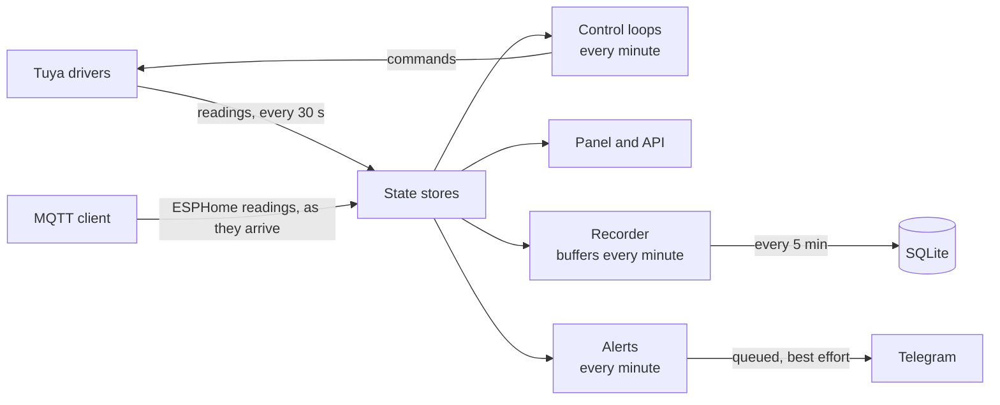
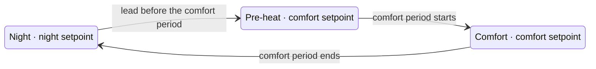

# teplo — design

Source of truth for behaviour. When behaviour changes, this document changes in the same commit.
Code conventions live in [`CLAUDE.md`](../CLAUDE.md).

## 1. Goals

1. **Morning comfort.** Rooms reach the comfort temperature by the start of the comfort period, every day.
2. **No breaker trips.** Current on every phase stays under the input breaker limit, whatever the household switches on.
3. **Offline operation.** Control, panel and history keep working with the internet down.
4. **Convenient control.** A web panel on the LAN, usable from a phone.
5. **24/7 monitoring.** Live state, history and an event journal.
6. **Reuse.** Another house is a configuration, not a fork.

Non-goals for v1: remote access from outside the LAN (use a VPN), cloud integrations, cooling, controlling the EV.

## 2. Invariants

- **Offline at runtime.** Devices are driven over the LAN. The internet serves only Telegram alerts and NTP, both best-effort.
- **Router-hosted.** One process on a Keenetic/Netcraze router with Entware: aarch64, Python 3.13, about 600 MB free RAM, USB flash storage.
- **Secrets outside the repository.** Device addresses and keys, tokens and passwords live in the secrets file on the router; the repository references devices by slug.
- **Configuration is data.** Schedules, tariffs, limits and priorities live in the database, seeded by site data migrations and edited in the panel.
- **Fail-safe actuation.** While teplo is down, every floor holds at least its idle floor setpoint.
- **Monitor-only loads are never switched.** The washing machine and group plugs are observed, nothing more.

## 3. Reference house

The first site (`sites/barsoom`) shaped the requirements.

- **Supply:** 3 phases, 15 kW allocated, C25 breaker on the pole, C20 in the house.
- **Stabilizers:** inverter, single-phase Штиль ИнСтаб IS7000 (5.5 kW output, 90–310 V input) on two phases, a third planned. At low grid voltage a stabilizer draws more input current than it delivers: about 25 A at 230 V, 30 A at 190 V, 35 A at 165 V for full load.
- **EV:** US-spec Model S 2014, single-phase charging at 10–22 A through a mobile connector, behind a stabilizer. Not controllable locally: no BLE vehicle commands, dead cellular modem.
- **Heating:** electric floors are the main heating; a fireplace is lit by hand. The second floor warms from air rising from below and the second-floor bathroom floor.

| Zone | Kind | Notes |
|---|---|---|
| Living room | air | most important, shed last |
| Kitchen | air | |
| Hallway | air | shed first among floors |
| Bathroom 1F | floor | rarely needed, idle by default |
| Bathroom 2F | floor | also heats the second floor |

Other loads: two water heaters on smart plugs (sheddable), a washing machine on a smart plug (monitor-only), the EV (detected).

## 4. Devices

### Capabilities

The domain talks to devices through capability ports. A driver implements one or more capabilities for one protocol.

| Capability | Reads | Commands |
|---|---|---|
| `FloorThermostat` | power, setpoint, floor temperature | power, setpoint |
| `MeteredPlug` | on/off, power, current, voltage | — |
| `SwitchablePlug` | as `MeteredPlug` | on/off |
| `TemperatureSensor` | temperature, optional humidity | — |
| `PhaseMeter` | current per phase | — |
| `ClimateUnit` | mode, target, room temperature | mode, target |
| `EvCharger` | charging state, current | current limit |

v1 drivers: Tuya thermostat, Tuya plug, ESPHome temperature sensor, ESPHome phase meter.
`ClimateUnit` and `EvCharger` ship as stub drivers: a device can be configured with them and the panel shows it as "driver not implemented".

Every reading carries a timestamp. A device is **unavailable** after 10 minutes without a reading, counted on the monotonic clock from the moment teplo stored the reading, so setting the system clock neither hides a lost device nor makes a live one look lost; the phase meter is **stale** after 10 seconds.

### Tuya thermostats (Warmfloor ET-44W)

- Local protocol 3.3 on TCP 6668, AES with a per-device local key.
- No air sensor: the only temperature is the remote floor probe.
- Data points verified on the device:

| DP | Meaning | Values |
|---|---|---|
| 1 | power | bool |
| 2 | mode | `hold` (manual), `smart` (weekly program), `holiday` |
| 16 | setpoint | int, 0.1 °C, 50–400 |
| 24 | floor temperature | int, 0.1 °C |
| 121 | probably the floor limit | int, 0.1 °C, reads 450 |

DP 3 always reads `warming` and does not reflect the relay. DPs 104–117 are vendor-specific and unmapped; 116 is not a temperature. teplo keeps the thermostat in `hold` mode.

- **Write budget:** one state change per zone per 30 minutes. Whether the device persists every write to flash is unknown, so writes stay rare. Dry-run journals at the same cadence on its own timestamp and does not spend the budget, so a zone switched to live control writes at the next cycle. Air mode in dry-run keeps its would-be changes 30 minutes apart on a third timestamp (section 6).

### Tuya plugs

- Wi-Fi plugs with power metering (Tuya category `cz`), local protocol 3.5 on TCP 6668; their secrets set `protocol = '3.5'`.
- The two water heater plugs are read-only until stage 4: the driver implements `MeteredPlug` and has no switching operation, so nothing in teplo can switch them. Switching will come as `SwitchablePlug` behind dry-run.
- The driver takes its client from the shared Tuya client builder, like the thermostat driver, so the long-lived client never switches itself to "device22" mode, which queries DP 1 only (see Power loss in section 9). tinytuya 1.20 makes that switch only for protocols 3.3 and 3.4, so for the 3.5 plugs the guard is insurance.
- A job of their own polls the plugs every 30 seconds, so a lost plug never delays the thermostats. Availability changes are journaled as for a thermostat, a plug that stays unavailable raises the device-lost alert under its own name (section 9), and the recorder samples `plug_on` (0 or 1), `plug_power` (W), `plug_current` (A) and `plug_voltage` (V) every minute.
- Data points, from the Tuya cloud model and a local status read:

| DP | Code | Meaning | Values |
|---|---|---|---|
| 1 | `switch_1` | relay | bool |
| 18 | `cur_current` | current | int, mA |
| 19 | `cur_power` | active power | int, 0.1 W |
| 20 | `cur_voltage` | voltage | int, 0.1 V |

Not read yet: 9 `countdown`, 17 `add_ele` (energy since the previous report, 0.001 kWh), 26 `fault`, 38 `relay_status` (`memory`: the relay returns to its last state after a power cut) and the remaining vendor DPs.

### Local keys

A Tuya device's local key comes from the cloud once, via the Smart Life QR login used by Home Assistant: the owner reads the User Code in Smart Life (Me → Settings → Account and Security), scans a QR and confirms; the tool downloads every device with its local key and logs out. Re-pairing a device changes its key.

### ESPHome devices

ESPHome firmware publishes readings to the Mosquitto broker on the router. Configurations live in `esphome/`.

- **Phase meter:** ESP32 with three SCT-013-050 clamps (1 V at 50 A) on the input phase conductors, before the stabilizers. Each clamp sits on a single conductor. The clamps share a 1.65 V bias (two 10 kΩ resistors, 10 µF to ground) and feed ADC1 pins. Reports RMS current per phase every second.
- **Air sensors:** ESP32-C3 with SHT3x over I2C, the sensor 5–10 cm away from the board. Reports every 30 seconds.
- **Outdoor sensor:** DS18B20 on a 3 m cable with a 4.7 kΩ pull-up, the board indoors.

The firmware and teplo share one MQTT contract:

- **Broker:** Mosquitto on the router, port 1883, on the LAN address only, with a username and password for every client (`docs/deploy.md`). teplo takes its credentials from the `[mqtt]` table of the secrets file (section 11), the nodes from `esphome/secrets.yaml` (`mqtt_broker`, `mqtt_username`, `mqtt_password`), which stays out of the repository.
- **Nodes:** a node is named `teplo-` and the slug of its device, e.g. `teplo-air-kitchen`. It publishes under `teplo/<node>` without Home Assistant discovery, and its birth and will messages, `online` and `offline`, go to `teplo/<node>/status`.
- **Readings:** every sensor publishes to `teplo/<node>/sensor/<object_id>/state` with QoS 0, not retained: a decimal string, or `nan` when the reading failed.

| Node | Device kind | Object ids | Every |
|---|---|---|---|
| `teplo-air-living-room`, `teplo-air-kitchen`, `teplo-air-hallway`, `teplo-air-second-floor` | temperature sensor | `temperature` (°C) and `humidity` (%), 1 decimal | 30 s |
| `teplo-outdoor` | temperature sensor | `temperature` (°C), 1 decimal | 30 s |
| `teplo-phase-meter` | phase meter | `l1_current`, `l2_current`, `l3_current` (A RMS), 2 decimals | 1 s |

A node may also publish `wifi_signal` (dBm, every 60 seconds) and `uptime`, which teplo ignores. `teplo-ir-bedroom` and `teplo-spare` use the same broker but are not teplo devices.

teplo subscribes to `teplo/+/sensor/+/state` and `teplo/+/status`:

- A node maps to the device of its slug whose driver is `esphome_temperature` (kind `temperature_sensor`) or `esphome_phase_meter` (kind `phase_meter`). teplo reads these devices from the database when it starts, so a device added later is heard after a restart.
- Retained messages, nodes without such a device and object ids the device's driver does not read are ignored. The first message of an unknown node is logged as `esphome_node_unknown`, which points at a misspelt node name.
- A temperature sensor's `temperature` becomes a new reading, stamped when it arrives. `humidity` joins the latest reading without making it younger, so the age of a reading is always the age of its temperature; a new temperature keeps the previous humidity until the next one arrives.
- The phase meter's `l1_current`, `l2_current` and `l3_current` are the currents of phases A, B and C. Its store keeps the latest current of each phase with the moment it arrived on the monotonic clock, and the mean and maximum of each phase since they were last taken for history. The meter is stale while a phase has no current from the last 10 seconds, and the store names each such phase. The driver of a stale meter refuses to read, and the readings it gives are dated by the oldest of the three.
- Values stay decimals. `nan` records the failure `sensor_reading_failed`, and a payload that is not a number `device_protocol_error`, instead of a reading; a failed humidity also leaves the latest reading without humidity. `offline` on the status topic records `device_unavailable`. A broker that teplo cannot reach, that refuses its credentials or that drops the connection records `broker_unavailable` for every ESPHome device; the next connection clears that failure and no other, so a node that stays silent once the broker is back, such as one unplugged before a broker restart or one still booting when teplo connects late, is journaled as a device without a reading rather than blamed on a broker that works. As for a Tuya device, a failure keeps the last reading until it ages out, and the next reading clears it. A driver asked for a reading it no longer has raises the failure recorded for its device, with that failure's code, or `device_unavailable` when none was recorded. A failing reading is logged once, and again only after a good one.
- Without an `[mqtt]` table teplo does not connect and logs `mqtt_not_configured` once at start; the ESPHome devices stay unavailable and everything else runs as before.
- Nothing polls these devices, so a job of their own checks their stores every 30 seconds. Its first check waits a minute after the start, by when every node that is up has reported, so a restart does not journal working sensors as lost. Availability changes are journaled as for a thermostat, with the code of the recorded failure, or `device_unavailable` with the reason `no reading` when none was recorded, so the panel's journal explains every loss: a device that has not reported since the start is journaled unavailable at the first check, with the failure recorded for it, such as `broker_unavailable`, or else as `device_unavailable`. The phase meter becomes unavailable, like any device, 10 minutes after its newest current; its staleness is not journaled.
- Every minute the recorder samples `air_temperature` (°C) of every available temperature sensor, with `air_humidity` (%) when the reading has one, and the mean and maximum current of each phase since the previous sample, `phase_current_mean` and `phase_current_max` (A) under the subjects `l1`, `l2` and `l3`. Each sample starts the mean and maximum over, and an unavailable phase meter records none.

## 5. Architecture

### Process

One process on the router runs an asyncio runtime:

- device drivers and the MQTT client feed a **state store** per device kind (latest readings and availability): jobs poll the Tuya devices, the MQTT client writes the ESPHome readings as they arrive, and a job checks the ESPHome stores for availability changes (section 4);
- the MQTT client runs in paho's network thread from just after the start journal entry until after the last sample flush. It subscribes again on every connection and reconnects on its own, 1 second after a failure and then doubling the wait up to 30 seconds. A message that fails in handling is logged and dropped, so it never ends the thread;
- control loops read the state stores, decide, and send commands through drivers;
- a recorder samples every available device each minute and writes the history to SQLite in batches every 5 minutes. The metrics are `floor_temperature`, `floor_setpoint` and `thermostat_power` for a thermostat, `plug_on`, `plug_power`, `plug_current` and `plug_voltage` for a plug, `air_temperature` and `air_humidity` for a temperature sensor, and `phase_current_mean` and `phase_current_max` for each phase of the phase meter;
- an alert job checks the state stores every minute and queues alerts, which a second job sends to Telegram (section 9);
- uvicorn serves the Django ASGI app (panel and API) from the same loop;
- use cases are synchronous: each periodic job runs its use case in a worker thread (`asyncio.to_thread`) with fresh database connections, and Django runs the panel's views in its own thread, so blocking device and ORM calls stay off the loop;
- jobs run concurrently: in-memory state (state stores, sample buffer, alert book, alert outbox, outage backlog, the heating cycle's control book) is guarded by locks, the Tuya drivers serialize calls to each device, and the MQTT thread writes the sensor stores while jobs and the panel read them.



### Modules

Bounded contexts are Django apps laid out in the altyn-backend style described in `CLAUDE.md` (domain policies, use cases, models, repositories, services, drivers, views):

- **climate**: zones, schedules, regulation, optimal start.
- **power**: power cuts and their causes; phases, limits, loads, shedding, phase map learning and EV detection come with stage 2.
- **devices**: registry, capabilities, drivers, state store.
- **tariffs**: tariff intervals.
- **telemetry**: history samples, event journal, retention (planned).
- **notifications**: Telegram alerts.
- **system**: trusted clock, dry-run, health.
- **panel**: web pages and API.

Control policies in `climate/domain` and `power/domain` import nothing from Django, Tuya or MQTT; AST architecture tests keep it that way.

## 6. Heating control

### Zones

- **Air zone:** has an air sensor; teplo switches the floor to hold the room air at the target.
- **Floor zone:** no air sensor; teplo sets the thermostat's floor setpoint from the schedule and the thermostat regulates itself.
- A zone has one or more heat sources ordered by priority. v1 uses floor thermostats only; a heat pump can become the first source later with the floor as backup.
- A zone's air sensor is a `temperature_sensor` device linked to the zone. The climate settings name the outdoor sensor and the second-floor sensor. Both come from the site data and are edited in the admin; the heating cycle reads the outdoor sensor for optimal start and the second-floor sensor for the second-floor guard, and the panel shows their readings (section 10).

### Control paths

Air control ships in dry-run: gates edited in the admin keep the thermostats on their floor-mode writes until the owner switches air control on, zone by zone. Every minute the heating cycle picks one path per zone:

| Path | Zone | The thermostat follows |
|---|---|---|
| floor mode | a floor zone, or an air zone whose air sensor is unavailable | floor mode |
| air mode | an air zone with `air_control_live` on and its air sensor available | air mode |
| air mode in dry-run | an air zone with `air_control_live` off and its air sensor available | floor mode, while air mode journals what it would do |

`air_control_live` is off by default. `TEPLO_DRY_RUN` and a zone's `live_control` gate every thermostat write on every path as before: a write they hold back is journaled as `zone_command_issued` with `dry_run` set, on its own 30-minute stamp. The second-floor guard has a gate of its own, `second_floor_guard_live` in the climate settings, off by default.

The owner switches the gates in the admin. A zone's `air_control_live` is ticked in the zone list or on the zone's page, one air zone at a time, once the dry-run journal (see Dry-run journal) and the zone's card (section 10) show what air mode would do; the next cycle runs the zone in air mode, and its writes take the zone's write budget like any other. Unticking it hands the thermostat back to floor mode at the zone's next allowed write. `second_floor_guard_live` is ticked in the climate settings the same way.

### Schedules and targets

Weekly schedule per zone; each period selects a mode with a target. The air targets are set per zone.

| Mode | Air target | Default period |
|---|---|---|
| comfort | 22.0 °C | 06:30–23:30 every day |
| night | 19.5 °C | the rest |

Pre-heat, the lead before a comfort period, aims at the comfort target. Overrides from the panel: `+/-` changes the target until the next period; **boost** holds the zone at its boost floor setpoint for 2 hours.

### Floor mode

Every zone carries a comfort, a night and a boost floor setpoint for floor mode, and an idle floor setpoint and a floor limit for air mode (see Actuation). A floor zone always runs in floor mode; an air zone runs in floor mode while its air sensor is unavailable or its air control is off.

- comfort period and pre-heat: comfort floor setpoint;
- night: night floor setpoint;
- boost: boost floor setpoint;
- clock untrusted: comfort floor setpoint.

| Zone | Comfort | Night | Boost |
|---|---|---|---|
| Living room, Kitchen, Hallway | 28 °C | 22 °C | 30 °C |
| Bathroom 2F | 30 °C | 22 °C | 30 °C |
| Bathroom 1F | 18 °C | 18 °C | 30 °C |

Pre-heat in floor mode starts a fixed lead before the comfort period, 3 hours by default and configurable per zone.



### Regulation of air zones

In air mode a zone is in one of two air states, heat or idle, decided every minute from its air sensor.

- The air target is the comfort air target in the comfort period and in pre-heat, and the night air target at night.
- Heat starts when air < target − start offset (0.3 °C, climate settings).
- Heat stops when air ≥ target − early-stop offset. The offset is learned per zone (see Learning) and starts at the initial early-stop offset of the climate settings, 0.3 °C.
- In between, the zone keeps its air state. A zone entering air mode, when its gate is switched on, its air sensor returns or teplo starts, starts idle unless the start condition holds.
- Minimum 30 minutes between state changes of a zone: a change that needs a thermostat write waits for the zone's write budget (section 4), and until the write goes out, or is journaled while writes are held back, the zone keeps its previous state. A change that needs no write, as during a boost or while the zone is disabled, takes effect at once.
- teplo keeps the air state of each zone in memory.

### Actuation

| Zone state | Thermostat power | Thermostat setpoint |
|---|---|---|
| heat | on | floor limit (default 30 °C) |
| idle | on | idle floor setpoint (default 18 °C) |
| boost | on | boost floor setpoint, whatever the air state |
| shed | on | 5 °C |
| disabled | off | unchanged |

Idle is a raised floor minimum rather than off, so a dead controller leaves the house at no less than 18 °C on the floor. The idle floor setpoint, the floor limit and both air targets are set per zone, validated like the other setpoints; the reference house gives its air zones 18 °C, 30 °C, 22.0 °C and 19.5 °C.

### Optimal start

teplo starts heating early enough to reach the comfort target at the start of the comfort period.

- Lead time = dead time + max(0, comfort air target − current air) / heat-up rate. The rate is the one learned for the 5 °C bucket of the current outdoor reading, or else the one of the nearest learned bucket, the colder one on a tie.
- Until a zone has 3 learned mornings (climate settings), or without an air or an outdoor reading, the lead is the zone's fixed pre-heat lead, 3 hours by default. Every lead is capped at 4 hours (climate settings) and is never below the dead time.
- Optimal start drives the pre-heat only of an air zone in air mode. Floor zones, and air zones in floor mode or in air mode in dry-run, keep their fixed lead.
- The lead is computed every minute until the pre-heat starts; from then the start is held until the comfort period begins, so a room that warms faster than planned stays in pre-heat. teplo keeps the start in memory: a cycle after a restart computes it again from the room as it is, and a sensor that drops out and returns finds it held.
- In air mode in dry-run, floor mode pre-heats on the fixed lead and warms the air the lead is computed from, which would push a later would-be start further back every minute. So the would-be start is held from the start of floor mode's pre-heat as well, on the lead computed then, before the floor has warmed the air; the would-be pre-heat still begins at its own start.
- An untrusted clock pauses optimal start along with the schedules.

### Learning

Each zone keeps what it has learned in its own row (`ZoneLearning`), written at most once per stop and once per morning, so the flash sees few writes. Progress within a stop or a morning stays in memory: a restart loses only the stop or the morning in progress. The admin lists the rows read-only: the early-stop offset, the dead time, the heat-up rate of each outdoor bucket and the count of learned mornings.

- **Early-stop offset.** When heat stops in air mode and the write of the idle floor setpoint goes out live, teplo watches the air: the peak is the highest reading of the next 2 hours, or of the time until heat starts again if that comes sooner. The new offset is old + (peak − target), smoothed by an exponential moving average with alpha 0.3, rounded to 0.01 °C and kept within 0 and 1.5 °C. A stop teaches only under the target the zone last chose to heat for: a stop caused by a falling target, as at the end of the comfort period, teaches nothing, and neither does a stop in dry-run, because the floor keeps heating. A boost, a lost air sensor, the zone leaving live air mode or an untrusted clock drops the watch.
- **Mornings.** A morning is the pre-heat that drives an air zone, observed from its first minute: the zone goes from night to pre-heat, both seen on a trusted clock, with its air sensor and the outdoor sensor available, its thermostat written live, heating enabled and no boost. Today's floor-mode pre-heat with its fixed lead counts as a morning: the floor is the heat source either way, at its comfort setpoint in floor mode and at its floor limit while air mode heats. So a zone learns while it runs in floor mode or in air mode in dry-run, and has its mornings when air control is switched on. The cycle samples the air every minute. The dead time lasts from the start of the pre-heat until the air has risen 0.1 °C; the rate is the rise after the dead time divided by the hours until the air reaches the comfort target or, short of it, until the comfort period starts. A morning is dropped when a sensor is lost, a boost starts, the zone stops heating on schedule or the pre-heat ends before the comfort period; one whose rise after the dead time is 0.2 °C or less teaches nothing. A learned morning moves the zone's dead time, and the rate of the bucket of the outdoor reading taken when the pre-heat started, by an exponential moving average with alpha 0.3, and counts the learned mornings. A pre-heat already running when teplo starts, or when its clock becomes trusted, is not a morning.

### Second-floor guard

The second floor has no heating of its own and warms from below and from Bathroom 2F, the guarded zone named in the climate settings.

- The guard turns on when the second-floor sensor reads below 19.0 °C and releases at 19.0 + 0.3 °C or more; in between it keeps its state. The threshold, the hysteresis and the guarded zone come from the climate settings. A lost second-floor sensor, or no guarded zone, leaves the guard off and the zone on its schedule.
- With `second_floor_guard_live` on, the guarded zone heats at least at its comfort floor setpoint, on whichever path drives it. The guard only raises: a zone already at its comfort or boost setpoint keeps it, and a disabled zone stays off. Its writes take the zone's write budget like any other.
- teplo keeps the guard's state in memory; it starts off.

### Dry-run journal

The dry-run paths journal what they would do only when it changes, never every minute, as each journal entry is written to flash:

| Entry | Written when | Payload |
|---|---|---|
| `air_control_dry_run` | the would-be air state or thermostat target of a zone in air mode in dry-run changes | air, target, schedule mode, would-be state, would-be power and setpoint, early-stop offset, and in pre-heat the lead in minutes |
| `optimal_start_dry_run` | the start of the pre-heat a zone in air mode in dry-run would use is held, once per morning: when that pre-heat begins, or when floor mode's pre-heat begins if that comes first | lead in minutes, would-be start, start of the fixed lead |
| `second_floor_guard_dry_run` | the guard, with its gate off, would turn on or off | second-floor air, whether the guard would be on, the comfort floor setpoint it would hold |

A zone in air mode in dry-run runs the air regulation and the optimal start of air mode on its own would-be state, so the journal shows what live air control would really do. Its would-be changes keep 30 minutes apart on a stamp of their own, `last_air_dry_run_at`, apart from the write stamp and `last_dry_run_at`; a change held back keeps the previous would-be state, as a held-back write keeps the live one, and a boost clears the stamp as it clears the write stamp. teplo keeps the last would-be state journaled and the would-be start in memory, so after a restart the next cycles journal them again. Each entry names the zone as its subject, and the panel's journal puts it in words (section 10).

### Fallbacks

- Air sensor unavailable: the zone runs in floor mode until the sensor returns, then enters air mode again.
- Clock untrusted: schedules pause and every zone holds its comfort target, the comfort floor setpoint in floor mode and the comfort air target in air mode.
- Manual changes made on a thermostat or in a vendor app are reverted at the zone's next allowed write.

## 7. Load management

### Inputs

- Current per phase every second from the phase meter.
- For every controllable load: its phase and nominal current, learned.

### Thresholds per phase

| Threshold | Default | Meaning |
|---|---|---|
| start ceiling | 20 A | a load starts only if the predicted current stays at or below it |
| shed | 24 A for 3 s | shed loads on that phase, one per second, until ≤ 20 A |
| restore | ≤ 18 A for 2 min | return one shed load per minute |

Rationale: a C25 breaker holds 1.13 × In (28 A) for an hour and trips within an hour at 1.45 × In (36 A); real trips came from overloads around 37 A. Seconds of reaction time are enough.

### Shedding priority

A configurable ordered list; loads are shed from the top and returned from the bottom. Default:

1. Water heater 1F
2. Water heater 2F
3. Bathroom 1F
4. Hallway
5. Kitchen
6. Bathroom 2F
7. Living room

Only loads on the overloaded phase are shed. Monitor-only loads and the EV are never in the list.

### Starting loads

When several loads want to start, they start one at a time, 30 seconds apart, in reverse shedding order, each after checking the measured phase current.

### Phase map learning

Every switch of a controllable load records which phase moved and by how much within 5 seconds. A **calibration** action switches each load in turn while the house is quiet (about 10 minutes). A thermostat that is already at its floor limit produces no step; the sample is skipped and retried later.

### EV detection

A step of 10–22 A on one phase that no controllable load explains and that lasts over 5 minutes is reported as EV charging on that phase. It only reduces headroom. Recommended car setting at home: 16 A or less.

### Phase meter lost

No new starts while the meter is stale. After 1 minute stale, keep at most one floor per phase running and send an alert. The alert is sent already (section 9) and the panel hatches the phase bars (section 10); the rest comes with load management.

### Journal

Overloads, sheds and restores are written to the event journal immediately, so a trip can be traced after power returns.

### Outages

- Every power cut is recorded, and the owner marks its cause in the panel: an overload that tripped our breaker, the village grid, or unknown (sections 9 and 10).
- Overload accounting and anything learned from trips count only outages marked overload. Grid, unknown and unmarked outages never count, so an outage of the village grid never reads as a trip.
- Planned for stage 2: when an overload was journaled right before the cut, the overload answer comes preselected.

## 8. Tariffs

A tariff is a list of daily intervals, each `cheap`, `normal` or `expensive`; the default site has 23:00–07:00 cheap.
Uses: optimal start prefers to finish pre-heating within a cheap interval when comfort allows, and a water heater can be limited to cheap intervals. The tariff never overrides comfort.

## 9. Reliability

- **Clock.** The clock is trusted when NTP has synchronised since boot. Otherwise schedules pause (section 6) and the panel offers "take time from this device", which stores an offset inside teplo without touching the system clock. A last command stamped later than the clock (the clock moved back, e.g. after a reboot) does not hold back the next write. Likewise a boost counts only while it ends within its 2-hour duration from now, trusted clock or not, so a boost stamped before the clock moved back cannot hold a zone at the boost setpoint. Each job that asks whether the clock is trusted reads the NTP status before it reads the time, so a time read just before NTP sets the clock is never taken as trusted.
- **Supervision.** An Entware init script starts teplo at boot; a cron job restarts it if the process is gone and lists each restart in `restarts.log`. Planned: an alert after more than 3 restarts an hour. The teplo resumed alert does not catch a restart loop, as each gap is shorter than its 3 minutes.
- **Device loss.** A device without a reading for 10 minutes appears in the panel as unavailable; one that stays unavailable, or a phase meter that stays stale, sends an alert (see Alerts below). A failed read or write keeps its error code (`device_unavailable`, `device_protocol_error`, `driver_not_implemented`, `device_not_found`, `secret_missing`, `device_config_invalid`, and for the ESPHome devices `sensor_reading_failed` and `broker_unavailable`) beside the driver's own error text: the state store holds both, the log records both, and the journal entries `device_availability_changed` and `zone_command_failed` store the code as `error_code` next to `reason` and `error`. A secrets table with an empty address or a protocol other than 3.1–3.5, or one tinytuya refuses, fails as `device_config_invalid` for that device alone: the poll records it and goes on to the next device.
- **Power loss.** The router has no UPS, so a power cut reboots it. At start teplo reads the router's uptime, the first number in `/proc/uptime`. The start follows a power cut when the router came up less than 10 minutes before teplo started and after teplo's last activity; once the clock is trusted, the router came up at the start less the uptime. A restart of teplo alone (a deploy, a crash, the watchdog) is never taken for a power cut: the router has been up for longer, or teplo has been active since it came up, as when a deploy restarts teplo at 20:40 after it came back at 20:34 from a cut at 20:24 and reported the cut at 20:35. A missing or garbled `/proc/uptime` counts as a restart and logs one warning. A router rebooted for another reason, by hand or for a firmware update, reads as a power cut as well. The start keeps this in memory until the clock is trusted. Should teplo restart before then, the times it stamped since the boot run hours behind and fall before the boot, so the new start still follows the power cut, measured from the last activity before it, as long as the router has been up for less than 10 minutes; after that the power cut is lost: the new start reports its outage as a restart and records nothing. A restart in the minute between NTP setting the clock and the check that reports the power cut loses it as well, as the times stamped in that minute fall after the boot. A power cut is recorded whatever its length, from the last activity to the start, once the clock is trusted, together with the teplo resumed notice (see Alerts below): the `power` context stores the outage with its cause unmarked and journals it as `power_outage` with the outage id and the interval, and the panel asks for the cause (section 10). Should the database fail to store it, e.g. while it stays locked, the power cut waits in memory and a job retries every minute, oldest first, logging `outage_record_failed` with the interval at each failure; the notice goes out all the same, and a restart of teplo before the power cut is stored loses it. On start teplo also reads every device and reconciles the desired state. Thermostats may come back switched off and the zone's next allowed write switches them on. Every Tuya driver takes its client from one shared function that disables tinytuya's device22 fallback, so the client keeps the full status query and a device that answers badly while booting is read normally afterwards.
- **Flash wear.** History is written in batches every 5 minutes; journal events are written immediately. Pruning history to one year of minute samples is planned; until then it only grows, in the reference house by 38 rows a minute (three per thermostat, four per plug, two per air sensor, one for the outdoor sensor and six for the phase meter), about 20 million rows a year. The start takes the latest time among the newest 5000 samples by row id, a little over two hours of history in the reference house, rather than scanning the whole table, so it does not slow down as history grows. It also takes the last activity the previous start recorded, so the last time taken on a set clock carries across starts that come before NTP synchronises, until the clock, still running behind, stamps a later time (see Alerts below).
- **Coexistence.** teplo runs at nice 10 on its own ports (panel 8088, MQTT 1883); the watchdog restarts it when its resident memory exceeds 300 MB.

### Alerts

The `notifications` context sends alerts to one Telegram chat. A pure policy decides when an alert is raised and cleared; each raise and clear is journaled as `alert_raised` or `alert_cleared`, which the panel's journal shows in the page's language, and queued for Telegram.

| Alert | Raised when | Cleared when |
|---|---|---|
| Device lost | a thermostat, plug or temperature sensor has stayed unavailable for 2 minutes, about 12 minutes after its last reading; the phase meter has stayed stale for 1 minute (section 7), one to two minutes after its last current; a device without a reading since teplo started, or a phase meter without a current of every phase, 10 minutes after the start | the device reads again; the phase meter is no longer stale |
| Zone off | the zone's floor target wants the thermostat on (any heating-enabled zone, day or night, live or dry-run) and the thermostat has reported power off for 35 minutes | the thermostat reports power on, or the zone no longer wants it on |
| teplo resumed | teplo starts after a power cut, at any gap from its last activity, or after a restart of teplo alone more than 3 minutes after its last activity | — |

- A job checks the alerts every minute. An alert is sent once and its recovery once. The state lives in memory, so a restart forgets which alerts were raised: a device that is still lost alerts again 10 minutes later and a zone that is still off 35 minutes later, while one that recovers before that sends no recovery. For example, «Кухня: нет связи с термостатом с 20:24» goes out, a deploy restarts teplo at 20:40, the thermostat answers at 20:45, and no «снова на связи» follows; the panel and the journal show the thermostat back. Restoring raised alerts from the journal would instead send recoveries of alerts that never reached the chat, as the journal does not record delivery.
- Durations are measured on the monotonic clock, so a clock step after a reboot neither raises nor hides an alert; a reading taken before the step keeps its true age, so a device that goes silent right after NTP sets the clock alerts about 12 minutes after its last reading, as any other.
- The moment a message names is kept on the monotonic clock as well: when teplo first notices the condition it records the last reading's age, or the notice itself for a device that has not answered since the start and for a zone that is off. The moment becomes wall-clock time only when the alert is raised, so a clock set in between does not shift it; an alert raised while the clock is untrusted names no time, e.g. «Кухня: нет связи с термостатом», and is not held back. The text itself is written when the message is sent, and a moment on an earlier day than the sending names its date: an alert raised on 1 November that waits out a Telegram outage until 3 November reads «Бойлер 1 этаж: нет связи с розеткой с 1 ноября 21:15», where one sent the same evening reads «… с 21:15».
- The monitored devices come from a list of sources: the thermostats, named by their zone, and the metered plugs, the temperature sensors and the phase meter, named by their device names. The text names the kind of device that went silent, e.g. «Кухня: нет связи с термостатом с 20:24», «Бойлер 1 этаж: нет связи с розеткой с 20:24» and «Воздух: кухня: нет связи с датчиком с 20:24», and its recovery «Бойлер 1 этаж: розетка снова на связи» or «Воздух: кухня: датчик снова на связи». The phase meter's own name says what it is, so its texts name no kind: «Фазометр: нет связи с 20:24» and «Фазометр: снова на связи».
- The phase meter counts as lost while it is stale (section 4), so a phase that stops reporting alerts as well as a silent node, and its message names the last current of the phase silent longest. The delay after teplo notices a loss is set per device kind in the alert policy: 1 minute for the phase meter, which load management cannot do without, and 2 minutes for the other kinds.
- Zone off takes the floor target from the climate policy (`resolve_mode`, `decide_floor_target`). 35 minutes exceed the 30-minute write budget, so a correction teplo is about to make never alerts. While the thermostat is unavailable its power is unknown and the zone-off timer stops; it starts over once the power is known again, as teplo can correct the thermostat only after it answers. The message still names the moment teplo first saw the thermostat off.
- teplo resumed: the outage runs from the last journal entry or flushed sample to the start, in local time, e.g. «teplo снова работает. Перерыв 20:24–20:33 (9 мин)». Like the alerts, the notice is dated against its sending: an outage from 23:10 to 23:40 whose notice goes out after midnight reads «teplo снова работает. Перерыв 31 октября 23:10–23:40 (30 мин)». After a power cut the notice gets a second line, «Отметь причину в панели: http://192.0.2.1:8088/», with the panel address from the `TEPLO_PANEL_URL` setting, or «Отметь причину в панели.» when the setting is empty; the notice after a restart of teplo alone stays one line. A power cut is reported at any gap, so a cut that teplo comes back from within 3 minutes of its last activity is reported and recorded too. A deploy restart flushes the samples on stop and takes under a minute; after a power loss the outage may start up to 5 minutes early, one sample flush period, and if no device was readable and nothing was journaled for a while, it reaches back to the last record. The notice waits for a trusted clock and dates the start by teplo's uptime; should the start still fall before the last activity, as when a clock that ran ahead stamped the last activity, no outage can be measured from it, and the notice is held back instead of being dropped. The start stays the same at every check, so such a notice goes out only if a later clock step moves the start past the last activity. A restart is not journaled again, as `teplo_started` already holds the last activity; a power cut is journaled as `power_outage` (see Power loss above). After a boot the router's clock runs hours behind until NTP sets it, and the samples flushed meanwhile carry those early times, so the outage starts at the latest time among the newest samples, not at the time of the newest one: a second power cut before NTP synchronised is measured from the last sample taken on the set clock, and two cuts 13 minutes apart read as one outage spanning both, not as «Перерыв 15:32–20:40 (5 ч 8 мин)». The newest samples reach back only about two hours, so the start also takes the last activity the previous start recorded: the last time taken on a set clock carries across starts that come before NTP synchronises, until the clock, still running behind, stamps a later time. A clock 5 hours behind does so after about 5 hours without internet, and a power cut after that is measured from the last time it stamped, which reads 5 hours before the cut.
- Texts are translated with gettext into `TEPLO_ALERT_LANGUAGE`, Russian by default.
- Delivery is best effort and never holds up control: a second job sends queued messages every minute, oldest first, through the Bot API `sendMessage` over HTTPS with the standard library, with a 10-second timeout and the optional HTTP proxy from the secrets file. A failed send stays queued and is retried. A raised alert waits as long as it lasts, so an outage of Telegram, the internet or the proxy delays it but never silences it; once the alert clears, it and its recovery wait one more hour and are dropped together, so a recovery never arrives without its alert. A recovery whose alert already went out and the teplo resumed notice wait an hour. A message Telegram refuses (4xx other than 429) is dropped and logged, and a refused alert takes its recovery with it, queued or still to come, so the chat never gets «Кухня: термостат снова на связи» without the alert before it. Without a `[telegram]` table alerts are only journaled, and the log says so once.
- `manage.py send_test_alert` sends a test message at once and prints `ok`, or fails with the error code and the reason, so a wrong token or chat, missing CA certificates or a blocked network shows up when the table is set rather than at the next outage. `docs/deploy.md` lists the codes.

## 10. Panel

Server-rendered Django templates with HTMX; zone cards, the house facts above them and the loads block refresh every 10 seconds (thermostats and plugs are polled every 30 seconds, the air sensors report every 30 seconds) and the phase bars every 3 seconds from a partial of their own; all assets are served locally.

- **Dashboard:** zone cards (air, floor, target, state: heating, waiting, shed), `+/-` and boost, a loads block, a question about each power cut whose cause is not marked, phase bars to 25 A with the EV marker, outdoor temperature, clock and device warnings.
- **Schedules:** weekly periods per zone and mode targets.
- **Settings:** tariffs, phase thresholds, shedding priority (drag to reorder), floor limits, water heater cheap-only switch, calibration.
- **History:** temperatures, phase currents, zone states; the event journal, where the cause of a power cut can be changed.

A JSON API under `api/v1` exposes the same state: `zones/`, `plugs/`, `sensors/`, `phases/` and the read-only `outages/`. `zones/` gives each zone with its readings, its floor target and its gates, `live_control` and `air_control_live`, and the path that drives it, `path`: `floor`, `air` or `air_dry_run`, with `air_target`, the air target on the air paths and null in floor mode. `sensors/` lists every temperature sensor by name with its slug, kind, temperature, humidity, availability and the age of its reading in whole seconds, `age_seconds`; a sensor keeps its last reading once it is unavailable, as the store does. `phases/` lists `l1`, `l2` and `l3` with the latest current of each in amperes, whether it is stale and its `age_seconds`, and is empty without a phase meter. `outages/` lists every recorded power cut newest first with its `id`, `began_at`, `ended_at`, `cause` and `cause_marked_at`. Access requires the panel password: a single Django user `owner` is created from the secrets file, and the session is remembered per device. Until the schedules and settings pages land, configuration is edited in the Django admin.

The visual language is a thermal camera. An ironbow ramp maps 14 to 32 °C and is the only saturated colour, so colour always means floor temperature. Each room is a floor tile: its reading is set in large type, and its floor band glows in the ramp colour at the point of the scale where the floor reads, with the target marked on the same scale. Dark and light themes follow the device setting. Fonts (Unbounded for readings, Golos Text for text, both OFL) and the Lucide icons (ISC) are vendored with their licenses. The interface is English and Russian, picked from the browser's language; zones are listed by name.

A room with an air sensor shows the air temperature beside the floor reading, in large type with the humidity small, and in ink, as colour means floor temperature. A lost air sensor is hatched and says what to check, like a lost plug, while the floor reading stays. The house facts above the tiles start with the outdoor temperature from the climate settings' outdoor sensor, and a row below them lists the other air sensors that belong to no zone, such as the second floor's, with their temperature and humidity.

A room with an air sensor also names the path that drives it (section 6) in a chip beside its schedule state: «По полу» for floor mode, «По воздуху» for air mode, and «По воздуху: наблюдение» for air mode in dry-run, where floor mode drives the thermostat and air mode is only journaled. The chips are drawn in ink, the one for air mode filled. On the air paths the air caption gives the air target, «Воздух, цель 22,0°», as the floor caption gives the floor target; in air mode the floor target is the floor limit while the room heats and the idle floor setpoint while it waits. A zone in pre-heat follows the start of comfort with the lead of its pre-heat, «Комфорт с 06:30. Разогрев начат за 2 ч 40 мин»: the held optimal lead in air mode, the fixed lead on the other paths. At night a zone in air mode dates its next warm-up by the optimal lead of the minute, which moves as the room cools. The panel decides each zone as the heating cycle does, from the readings, what the zone has learned and the cycle's control book, so a card shows the mode, the target and the held pre-heat start the cycle works with, the raise of a live second-floor guard included.

Below the floor tiles, the loads block lists the metered plugs by name with their relay state, power and voltage. It is drawn in ink only, so colour keeps meaning floor temperature; a lost plug is hatched and says what to check, like a lost thermostat.

Below the loads, the phase bars show the current of L1, L2 and L3 against a scale to 25 A with the value beside each bar, and tick marks at the 20 A start ceiling and the 24 A shed threshold (section 7). The scale and the ticks are section 7's defaults, held by the panel's use case, as no setting holds the phase thresholds yet; once load management stores them, the bars read them from there. They are drawn in ink only. A stale meter is hatched and says what to check, and a phase without a current from the last 10 seconds shows neither bar nor value; without a phase meter the block is left out.

Above the floor tiles, a card asks about each power cut whose cause is not marked, newest first: «Свет пропадал 20:24–20:33 (9 мин). Что это было?» with three answers, «Перегруз: выбило наш автомат», «Пропало в посёлке» and «Не знаю». The interval is dated like the alerts: the date appears when it is not today in local time, e.g. «Свет пропадал 31 октября 20:24–20:33 (9 мин)». An answer is stored with the time it was given and the card leaves the dashboard; the cards refresh with the zone cards, so a power cut recorded while the page is open appears within 10 seconds. The journal shows each `power_outage` entry with its interval, its current cause and the same three answers, so a cause can be changed later. Like the loads block, the cards use no ramp colour.

The journal words the dry-run entries of section 6, in ink: «Кухня: в режиме по воздуху включил бы обогрев (20,9° при цели 22,0°)» or «… остановил бы обогрев …», with the setpoint air mode would give the thermostat below it, «На термостате было бы 30°»; «Кухня: в режиме по воздуху начал бы разогрев в 04:10, а не в 03:30», or «… тоже начал бы разогрев в 03:30» when the two starts agree; and «Санузел 2 этаж: защита второго этажа включила бы комфорт (2 этаж 18,8°)» or «… вернула бы расписание (2 этаж 19,3°)». The other values, such as the schedule mode, the early-stop offset and the lead, stay in the payload.

Diagnostic text never reaches the page. A failure or an untrusted clock is explained by a translated message chosen by its code; a message that would only repeat its headline is left out, and an unknown code or a journal entry written before codes existed gets a generic one. The raw text stays in the element's tooltip, and for a device failure also in the journal payload and the log. The journal and these messages name the kind of device, as the alerts do: a thermostat, a plug or a sensor, while the phase meter's own name says what it is, e.g. «Фазометр: нет связи».

## 11. Configuration and reuse

- **Site app.** `sites/<name>/` is a Django app whose data migrations create zones, devices, schedules, tariffs, thresholds and the shedding priority, link the air zones to their air sensors and fill the climate settings. The active site is selected by setting. `sites/example` is the template.
- **Secrets file.** TOML on the router, default `/opt/etc/teplo/secrets.toml`:

```toml
[devices.thermostat-kitchen]
address = '192.0.2.10'
device_id = '...'
local_key = '...'
protocol = '3.3'

[devices.plug-boiler-1f]
address = '192.0.2.11'
device_id = '...'
local_key = '...'
protocol = '3.5'

[telegram]
token = '...'
chat_id = '...'
proxy = 'http://...'

[panel]
password = '...'

[mqtt]
host = '192.0.2.1'
port = 1883
username = 'teplo'
password = '...'
```

`port` defaults to 1883. Without the `[mqtt]` table, or with an empty `host`, `username` or `password`, or a port outside 1–65535, teplo runs without MQTT. The password never reaches the log.

## 12. Deployment

- **Entware packages:** python3, python3-pip, python3-sqlite3, python3-asyncio, python3-cryptography, mosquitto-nossl, and mosquitto-client-nossl for checking the broker.
- **Paths:** code `/opt/share/teplo`, settings and secrets `/opt/etc/teplo`, database `/opt/var/lib/teplo`, logs `/opt/var/log/teplo`.
- **Install:** a virtualenv with system site packages, so the Entware build of `cryptography` is reused.
- **Deploy:** from the workstation over SSH (port 222): ship the code, install dependencies, run migrations, restart the service.

## 13. Testing and rollout

- **Domain:** pure unit tests.
- **Use cases:** stub ports passed through constructors.
- **Infrastructure:** protocol encoding against captured frames; repositories against the test database with factories.
- **Views:** mocks.
- **Scenarios:** a house simulator (thermal model per zone, phase currents, EV and appliance events) drives the control loops through days of simulated time, e.g. "EV at 22 A, water heater and microwave on the same phase: no phase above 24 A for more than 3 s".
- **Architecture:** AST tests fail when a domain module imports Django, a driver or a network client, when any module but the shared Tuya client builder imports tinytuya, and when any module but the MQTT client imports paho.
- **CI:** GitHub Actions runs ruff, mypy, `makemigrations --check` and pytest on every push; any failure fails the build.
- **Rollout:** every stage first runs in dry-run, journalling the commands it would send, then is enabled zone by zone.

## 14. Roadmap

1. Thermostats in floor mode: schedules, night setback, timed pre-heat, boost, dry-run, dashboard and journal.
2. Phase meter and load management (the meter is already read and alerts when stale).
3. Air sensors, air regulation, learned optimal start and the second-floor guard (the sensors are already read and alert when lost). Ships in dry-run: the zones learn their mornings and the journal shows what air control, optimal start and the guard would do, until the owner switches them on in the admin, air control zone by zone and the guard in the climate settings (section 6).
4. Smart plugs: water heaters as sheddable loads (their plugs are already read and alert when lost), washing machine monitoring.

Later: heat pump driver, EV charger driver, away and frost modes.

## 15. Open questions

- ET-44W: meaning of DPs 104–121; whether setpoint writes wear its flash.
- Zone and water heater currents and phases: learned by calibration.
