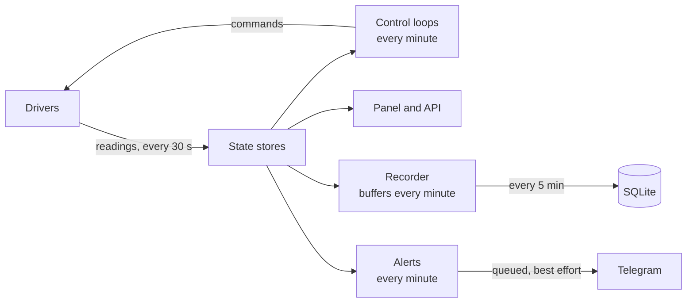
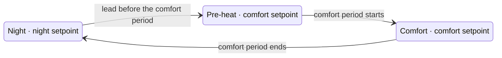

# teplo — design

Source of truth for behaviour. When behaviour changes, this document changes in the same commit.
Code conventions live in [`CLAUDE.md`](../CLAUDE.md).

## 1. Goals

1. **Morning comfort.** Rooms reach the comfort temperature by the start of the comfort period, every day.
2. **No breaker trips.** Current on every phase stays under the input breaker limit, whatever the household switches on.
3. **Offline operation.** Control, panel and history keep working with the internet down.
4. **Convenient control.** A web panel on the LAN, usable from a phone.
5. **24/7 monitoring.** Live state, history and an event journal.
6. **Reuse.** Another house is a configuration, not a fork.

Non-goals for v1: remote access from outside the LAN (use a VPN), cloud integrations, cooling, controlling the EV.

## 2. Invariants

- **Offline at runtime.** Devices are driven over the LAN. The internet serves only Telegram alerts and NTP, both best-effort.
- **Router-hosted.** One process on a Keenetic/Netcraze router with Entware: aarch64, Python 3.13, about 600 MB free RAM, USB flash storage.
- **Secrets outside the repository.** Device addresses and keys, tokens and passwords live in the secrets file on the router; the repository references devices by slug.
- **Configuration is data.** Schedules, tariffs, limits and priorities live in the database, seeded by site data migrations and edited in the panel.
- **Fail-safe actuation.** While teplo is down, every floor holds at least its idle floor setpoint.
- **Monitor-only loads are never switched.** The washing machine and group plugs are observed, nothing more.

## 3. Reference house

The first site (`sites/barsoom`) shaped the requirements.

- **Supply:** 3 phases, 15 kW allocated, C25 breaker on the pole, C20 in the house.
- **Stabilizers:** inverter, single-phase Штиль ИнСтаб IS7000 (5.5 kW output, 90–310 V input) on two phases, a third planned. At low grid voltage a stabilizer draws more input current than it delivers: about 25 A at 230 V, 30 A at 190 V, 35 A at 165 V for full load.
- **EV:** US-spec Model S 2014, single-phase charging at 10–22 A through a mobile connector, behind a stabilizer. Not controllable locally: no BLE vehicle commands, dead cellular modem.
- **Heating:** electric floors are the main heating; a fireplace is lit by hand. The second floor warms from air rising from below and the second-floor bathroom floor.

| Zone | Kind | Notes |
|---|---|---|
| Living room | air | most important, shed last |
| Kitchen | air | |
| Hallway | air | shed first among floors |
| Bathroom 1F | floor | rarely needed, idle by default |
| Bathroom 2F | floor | also heats the second floor |

Other loads: two water heaters on smart plugs (sheddable), a washing machine on a smart plug (monitor-only), the EV (detected).

## 4. Devices

### Capabilities

The domain talks to devices through capability ports. A driver implements one or more capabilities for one protocol.

| Capability | Reads | Commands |
|---|---|---|
| `FloorThermostat` | power, setpoint, floor temperature | power, setpoint |
| `MeteredPlug` | on/off, power, current, voltage | — |
| `SwitchablePlug` | as `MeteredPlug` | on/off |
| `TemperatureSensor` | temperature, optional humidity | — |
| `PhaseMeter` | current per phase | — |
| `ClimateUnit` | mode, target, room temperature | mode, target |
| `EvCharger` | charging state, current | current limit |

v1 drivers: Tuya thermostat, Tuya plug, ESPHome temperature sensor, ESPHome phase meter.
`ClimateUnit` and `EvCharger` ship as stub drivers: a device can be configured with them and the panel shows it as "driver not implemented".

Every reading carries a timestamp. A device is **unavailable** after 10 minutes without a reading, counted on the monotonic clock from the moment teplo stored the reading, so setting the system clock neither hides a lost device nor makes a live one look lost; the phase meter is **stale** after 10 seconds.

### Tuya thermostats (Warmfloor ET-44W)

- Local protocol 3.3 on TCP 6668, AES with a per-device local key.
- No air sensor: the only temperature is the remote floor probe.
- Data points verified on the device:

| DP | Meaning | Values |
|---|---|---|
| 1 | power | bool |
| 2 | mode | `hold` (manual), `smart` (weekly program), `holiday` |
| 16 | setpoint | int, 0.1 °C, 50–400 |
| 24 | floor temperature | int, 0.1 °C |
| 121 | probably the floor limit | int, 0.1 °C, reads 450 |

DP 3 always reads `warming` and does not reflect the relay. DPs 104–117 are vendor-specific and unmapped; 116 is not a temperature. teplo keeps the thermostat in `hold` mode.

- **Write budget:** one state change per zone per 30 minutes. Whether the device persists every write to flash is unknown, so writes stay rare. Dry-run journals at the same cadence on its own timestamp and does not spend the budget, so a zone switched to live control writes at the next cycle.

### Tuya plugs

- Wi-Fi plugs with power metering (Tuya category `cz`), local protocol 3.5 on TCP 6668; their secrets set `protocol = '3.5'`.
- The two water heater plugs are read-only until stage 4: the driver implements `MeteredPlug` and has no switching operation, so nothing in teplo can switch them. Switching will come as `SwitchablePlug` behind dry-run.
- The driver takes its client from the shared Tuya client builder, like the thermostat driver, so the long-lived client never switches itself to "device22" mode, which queries DP 1 only (see Power loss in section 9). tinytuya 1.20 makes that switch only for protocols 3.3 and 3.4, so for the 3.5 plugs the guard is insurance.
- A job of their own polls the plugs every 30 seconds, so a lost plug never delays the thermostats. Availability changes are journaled as for a thermostat, a plug that stays unavailable raises the device-lost alert under its own name (section 9), and the recorder samples `plug_on` (0 or 1), `plug_power` (W), `plug_current` (A) and `plug_voltage` (V) every minute.
- Data points, from the Tuya cloud model and a local status read:

| DP | Code | Meaning | Values |
|---|---|---|---|
| 1 | `switch_1` | relay | bool |
| 18 | `cur_current` | current | int, mA |
| 19 | `cur_power` | active power | int, 0.1 W |
| 20 | `cur_voltage` | voltage | int, 0.1 V |

Not read yet: 9 `countdown`, 17 `add_ele` (energy since the previous report, 0.001 kWh), 26 `fault`, 38 `relay_status` (`memory`: the relay returns to its last state after a power cut) and the remaining vendor DPs.

### Local keys

A Tuya device's local key comes from the cloud once, via the Smart Life QR login used by Home Assistant: the owner reads the User Code in Smart Life (Me → Settings → Account and Security), scans a QR and confirms; the tool downloads every device with its local key and logs out. Re-pairing a device changes its key.

### ESPHome devices

ESPHome firmware publishes readings to the Mosquitto broker on the router. Configurations live in `esphome/`.

- **Phase meter:** ESP32 with three SCT-013-050 clamps (1 V at 50 A) on the input phase conductors, before the stabilizers. Each clamp sits on a single conductor. The clamps share a 1.65 V bias (two 10 kΩ resistors, 10 µF to ground) and feed ADC1 pins. Reports RMS current per phase every second.
- **Air sensors:** ESP32-C3 with SHT3x over I2C, the sensor 5–10 cm away from the board. Reports every 30 seconds.
- **Outdoor sensor:** DS18B20 on a 3 m cable with a 4.7 kΩ pull-up, the board indoors.

## 5. Architecture

### Process

One process on the router runs an asyncio runtime:

- device drivers and the MQTT client feed a **state store** per device kind (latest readings and availability);
- control loops read the state stores, decide, and send commands through drivers;
- a recorder batches history to SQLite;
- an alert job checks the state stores every minute and queues alerts, which a second job sends to Telegram (section 9);
- uvicorn serves the Django ASGI app (panel and API) from the same loop;
- use cases are synchronous: each periodic job runs its use case in a worker thread (`asyncio.to_thread`) with fresh database connections, and Django runs the panel's views in its own thread, so blocking device and ORM calls stay off the loop;
- jobs run concurrently: in-memory state (state stores, sample buffer, alert book, alert outbox) is guarded by locks, and the Tuya drivers serialize calls to each device.



### Modules

Bounded contexts are Django apps laid out in the altyn-backend style described in `CLAUDE.md` (domain policies, use cases, models, repositories, services, drivers, views):

- **climate**: zones, schedules, regulation, optimal start.
- **power**: phases, limits, loads, shedding, phase map learning, EV detection.
- **devices**: registry, capabilities, drivers, state store.
- **tariffs**: tariff intervals.
- **telemetry**: history samples, event journal, retention.
- **notifications**: Telegram alerts.
- **system**: trusted clock, dry-run, health.
- **panel**: web pages and API.

Control policies in `climate/domain` and `power/domain` import nothing from Django, Tuya or MQTT; AST architecture tests keep it that way.

## 6. Heating control

### Zones

- **Air zone:** has an air sensor; teplo switches the floor to hold the room air at the target.
- **Floor zone:** no air sensor; teplo sets the thermostat's floor setpoint from the schedule and the thermostat regulates itself.
- A zone has one or more heat sources ordered by priority. v1 uses floor thermostats only; a heat pump can become the first source later with the floor as backup.

### Schedules and targets

Weekly schedule per zone; each period selects a mode with a target.

| Mode | Air target | Default period |
|---|---|---|
| comfort | 22.0 °C | 06:30–23:30 every day |
| night | 19.5 °C | the rest |

Overrides from the panel: `+/-` changes the target until the next period; **boost** holds the zone at its boost floor setpoint for 2 hours.
Second-floor guard: if the second-floor air falls below 19 °C, Bathroom 2F heats at its comfort floor setpoint.

### Floor mode

Every zone carries three floor setpoints. A floor zone always runs in floor mode; an air zone runs in floor mode while its air sensor is unavailable, which in stage 1 is always.

- comfort period and pre-heat: comfort floor setpoint;
- night: night floor setpoint;
- boost: boost floor setpoint;
- clock untrusted: comfort floor setpoint.

| Zone | Comfort | Night | Boost |
|---|---|---|---|
| Living room, Kitchen, Hallway | 28 °C | 22 °C | 30 °C |
| Bathroom 2F | 30 °C | 22 °C | 30 °C |
| Bathroom 1F | 18 °C | 18 °C | 30 °C |

Pre-heat in floor mode starts a fixed lead before the comfort period, 3 hours by default and configurable per zone.



### Optimal start

teplo starts heating early enough to reach the comfort target at the start of the comfort period.

- Lead time = dead time + (target − current air) / heat-up rate.
- The heat-up rate per zone is learned from past mornings as a function of the indoor-outdoor difference (exponential moving average per outdoor-temperature bucket).
- Until a zone has 3 learned mornings the lead time is 3 hours. The lead time is capped at 4 hours.

### Regulation of air zones

- Heat starts when air < target − 0.3 °C.
- Heat stops when air ≥ target − early-stop offset. The offset is learned from the overshoot observed in the 2 hours after each stop; it starts at 0.3 °C.
- Minimum 30 minutes between state changes of a zone.

### Actuation

| Zone state | Thermostat power | Thermostat setpoint |
|---|---|---|
| heat | on | floor limit (default 30 °C) |
| idle | on | idle floor setpoint (default 18 °C) |
| shed | on | 5 °C |
| disabled | off | unchanged |

Idle is a raised floor minimum rather than off, so a dead controller leaves the house at no less than 18 °C on the floor.

### Fallbacks

- Air sensor unavailable: the zone runs in floor mode until the sensor returns.
- Clock untrusted: schedules pause and every zone holds its comfort target.
- Manual changes made on a thermostat or in a vendor app are reverted at the zone's next allowed write.

## 7. Load management

### Inputs

- Current per phase every second from the phase meter.
- For every controllable load: its phase and nominal current, learned.

### Thresholds per phase

| Threshold | Default | Meaning |
|---|---|---|
| start ceiling | 20 A | a load starts only if the predicted current stays at or below it |
| shed | 24 A for 3 s | shed loads on that phase, one per second, until ≤ 20 A |
| restore | ≤ 18 A for 2 min | return one shed load per minute |

Rationale: a C25 breaker holds 1.13 × In (28 A) for an hour and trips within an hour at 1.45 × In (36 A); real trips came from overloads around 37 A. Seconds of reaction time are enough.

### Shedding priority

A configurable ordered list; loads are shed from the top and returned from the bottom. Default:

1. Water heater 1F
2. Water heater 2F
3. Bathroom 1F
4. Hallway
5. Kitchen
6. Bathroom 2F
7. Living room

Only loads on the overloaded phase are shed. Monitor-only loads and the EV are never in the list.

### Starting loads

When several loads want to start, they start one at a time, 30 seconds apart, in reverse shedding order, each after checking the measured phase current.

### Phase map learning

Every switch of a controllable load records which phase moved and by how much within 5 seconds. A **calibration** action switches each load in turn while the house is quiet (about 10 minutes). A thermostat that is already at its floor limit produces no step; the sample is skipped and retried later.

### EV detection

A step of 10–22 A on one phase that no controllable load explains and that lasts over 5 minutes is reported as EV charging on that phase. It only reduces headroom. Recommended car setting at home: 16 A or less.

### Phase meter lost

No new starts while the meter is stale. After 1 minute stale, keep at most one floor per phase running and send an alert.

### Journal

Overloads, sheds and restores are written to the event journal immediately, so a trip can be traced after power returns.

## 8. Tariffs

A tariff is a list of daily intervals, each `cheap`, `normal` or `expensive`; the default site has 23:00–07:00 cheap.
Uses: optimal start prefers to finish pre-heating within a cheap interval when comfort allows, and a water heater can be limited to cheap intervals. The tariff never overrides comfort.

## 9. Reliability

- **Clock.** The clock is trusted when NTP has synchronised since boot. Otherwise schedules pause (section 6) and the panel offers "take time from this device", which stores an offset inside teplo without touching the system clock. A last command stamped later than the clock (the clock moved back, e.g. after a reboot) does not hold back the next write. Likewise a boost counts only while it ends within its 2-hour duration from now, trusted clock or not, so a boost stamped before the clock moved back cannot hold a zone at the boost setpoint.
- **Supervision.** An Entware init script starts teplo at boot; a cron job restarts it if the process is gone. More than 3 restarts an hour sends an alert.
- **Device loss.** A device without a reading for 10 minutes appears in the panel as unavailable; one that stays unavailable sends an alert (see Alerts below). A failed read or write keeps its error code (`device_unavailable`, `device_protocol_error`, `driver_not_implemented`, `device_not_found`, `secret_missing`) beside the driver's own error text: the state store holds both, the log records both, and the journal entries `device_availability_changed` and `zone_command_failed` store the code as `error_code` next to `reason` and `error`.
- **Power loss.** On start teplo reads every device, reconciles the desired state, and journals the outage interval from the last heartbeat. Thermostats may come back switched off and the zone's next allowed write switches them on. Every Tuya driver takes its client from one shared function that disables tinytuya's device22 fallback, so the client keeps the full status query and a device that answers badly while booting is read normally afterwards.
- **Flash wear.** History is written in batches every 5 minutes; journal events are written immediately; retention is one year of minute samples.
- **Coexistence.** teplo runs at nice 10 on its own ports (panel 8088, MQTT 1883); the watchdog restarts it when its resident memory exceeds 300 MB.

### Alerts

The `notifications` context sends alerts to one Telegram chat. A pure policy decides when an alert is raised and cleared; each raise and clear is journaled as `alert_raised` or `alert_cleared`, which the panel's journal shows in the page's language, and queued for Telegram.

| Alert | Raised when | Cleared when |
|---|---|---|
| Device lost | a thermostat or plug has stayed unavailable for 2 minutes, about 12 minutes after its last reading; a device without a reading since teplo started, 10 minutes after the start | the device reads again |
| Zone off | the zone's floor target wants the thermostat on (any heating-enabled zone, day or night, live or dry-run) and the thermostat has reported power off for 35 minutes | the thermostat reports power on, or the zone no longer wants it on |
| teplo resumed | teplo starts more than 3 minutes after its last activity | — |

- A job checks the alerts every minute. An alert is sent once and its recovery once. The state lives in memory: after a restart a device that is still lost alerts again 10 minutes later.
- Durations are measured on the monotonic clock, so a clock step after a reboot neither raises nor hides an alert; a reading taken before the step keeps its true age, so a device that goes silent right after NTP sets the clock alerts about 12 minutes after its last reading, as any other.
- The moment a message names is kept on the monotonic clock as well: when teplo first notices the condition it records the last reading's age, or the notice itself for a device that has not answered since the start and for a zone that is off. The moment becomes local time only when the message is made, so a clock set in between does not shift it; a message made while the clock is untrusted names no time, e.g. «Кухня: нет связи с термостатом», and is not held back.
- The monitored devices come from a list of sources: the thermostats, named by their zone, and the metered plugs, named by their device name. The text names the kind of device that went silent, e.g. «Кухня: нет связи с термостатом с 20:24» and «Бойлер 1 этаж: нет связи с розеткой с 20:24», and its recovery «Бойлер 1 этаж: розетка снова на связи».
- Zone off takes the floor target from the climate policy (`resolve_mode`, `decide_floor_target`). 35 minutes exceed the 30-minute write budget, so a correction teplo is about to make never alerts. While the thermostat is unavailable its power is unknown and the zone-off timer stops; it starts over once the power is known again, as teplo can correct the thermostat only after it answers. The message still names the moment teplo first saw the thermostat off.
- teplo resumed: the outage runs from the last journal entry or flushed sample to the start, in local time, e.g. «teplo снова работает. Перерыв 20:24–20:33 (9 мин)». A deploy restart flushes the samples on stop and takes under a minute; after a power loss the outage may start up to 5 minutes early, one sample flush period, and if no device was readable and nothing was journaled for a while, it reaches back to the last record. The notice waits for a trusted clock and dates the start by teplo's uptime; it is not journaled again, as `teplo_started` already holds the last activity.
- Texts are translated with gettext into `TEPLO_ALERT_LANGUAGE`, Russian by default.
- Delivery is best effort and never holds up control: a second job sends queued messages every minute, oldest first, through the Bot API `sendMessage` over HTTPS with the standard library, with a 10-second timeout and the optional HTTP proxy from the secrets file. A failed send stays queued and is retried. A raised alert waits as long as it lasts, so an outage of Telegram, the internet or the proxy delays it but never silences it; once the alert clears, it and its recovery wait one more hour and are dropped together, so a recovery never arrives without its alert. A recovery whose alert already went out and the teplo resumed notice wait an hour. A message Telegram refuses (4xx other than 429) is dropped and logged. Without a `[telegram]` table alerts are only journaled, and the log says so once.
- `manage.py send_test_alert` sends a test message at once and prints `ok`, or fails with the error code and the reason, so a wrong token or chat, missing CA certificates or a blocked network shows up when the table is set rather than at the next outage. `docs/deploy.md` lists the codes.

## 10. Panel

Server-rendered Django templates with HTMX; zone cards and the loads block refresh every 10 seconds (thermostats and plugs are polled every 30 seconds) and the stage 2 phase-current widget every 3 seconds; all assets are served locally.

- **Dashboard:** zone cards (air, floor, target, state: heating, waiting, shed), `+/-` and boost, a loads block, phase bars to 25 A with the EV marker, outdoor temperature, clock and device warnings.
- **Schedules:** weekly periods per zone and mode targets.
- **Settings:** tariffs, phase thresholds, shedding priority (drag to reorder), floor limits, water heater cheap-only switch, calibration.
- **History:** temperatures, phase currents, zone states; the event journal.

A JSON API under `api/v1` exposes the same state: `zones/` and `plugs/`. Access requires the panel password: a single Django user `owner` is created from the secrets file, and the session is remembered per device. Until the schedules and settings pages land, configuration is edited in the Django admin.

The visual language is a thermal camera. An ironbow ramp maps 14 to 32 °C and is the only saturated colour, so colour always means floor temperature. Each room is a floor tile: its reading is set in large type, and its floor band glows in the ramp colour at the point of the scale where the floor reads, with the target marked on the same scale. Dark and light themes follow the device setting. Fonts (Unbounded for readings, Golos Text for text, both OFL) and the Lucide icons (ISC) are vendored with their licenses. The interface is English and Russian, picked from the browser's language; zones are listed by name.

Below the floor tiles, the loads block lists the metered plugs by name with their relay state, power and voltage. It is drawn in ink only, so colour keeps meaning floor temperature; a lost plug is hatched and says what to check, like a lost thermostat.

Diagnostic text never reaches the page. A failure or an untrusted clock is explained by a translated message chosen by its code; a message that would only repeat its headline is left out, and an unknown code or a journal entry written before codes existed gets a generic one. The raw text stays in the element's tooltip, and for a device failure also in the journal payload and the log.

## 11. Configuration and reuse

- **Site app.** `sites/<name>/` is a Django app whose data migrations create zones, devices, schedules, tariffs, thresholds and the shedding priority. The active site is selected by setting. `sites/example` is the template.
- **Secrets file.** TOML on the router, default `/opt/etc/teplo/secrets.toml`:

```toml
[devices.thermostat-kitchen]
address = '192.168.1.52'
device_id = '...'
local_key = '...'
protocol = '3.3'

[devices.plug-boiler-1f]
address = '192.168.1.53'
device_id = '...'
local_key = '...'
protocol = '3.5'

[telegram]
token = '...'
chat_id = '...'
proxy = 'http://...'

[panel]
password = '...'
```

## 12. Deployment

- **Entware packages:** python3, python3-pip, python3-sqlite3, python3-asyncio, python3-cryptography, mosquitto-nossl.
- **Paths:** code `/opt/share/teplo`, settings and secrets `/opt/etc/teplo`, database `/opt/var/lib/teplo`, logs `/opt/var/log/teplo`.
- **Install:** a virtualenv with system site packages, so the Entware build of `cryptography` is reused.
- **Deploy:** from the workstation over SSH (port 222): ship the code, install dependencies, run migrations, restart the service.

## 13. Testing and rollout

- **Domain:** pure unit tests.
- **Use cases:** stub ports passed through constructors.
- **Infrastructure:** protocol encoding against captured frames; repositories against the test database with factories.
- **Views:** mocks.
- **Scenarios:** a house simulator (thermal model per zone, phase currents, EV and appliance events) drives the control loops through days of simulated time, e.g. "EV at 22 A, water heater and microwave on the same phase: no phase above 24 A for more than 3 s".
- **Architecture:** AST tests fail when a domain module imports Django, a driver or a network client, and when any module but the shared Tuya client builder imports tinytuya.
- **CI:** GitHub Actions runs ruff, mypy, `makemigrations --check` and pytest on every push; any failure fails the build.
- **Rollout:** every stage first runs in dry-run, journalling the commands it would send, then is enabled zone by zone.

## 14. Roadmap

1. Thermostats in floor mode: schedules, night setback, timed pre-heat, boost, dry-run, dashboard and journal.
2. Phase meter and load management.
3. Air sensors, air regulation, learned optimal start.
4. Smart plugs: water heaters as sheddable loads (their plugs are already read and alert when lost), washing machine monitoring.

Later: heat pump driver, EV charger driver, away and frost modes.

## 15. Open questions

- ET-44W: meaning of DPs 104–121; whether setpoint writes wear its flash.
- Zone and water heater currents and phases: learned by calibration.
